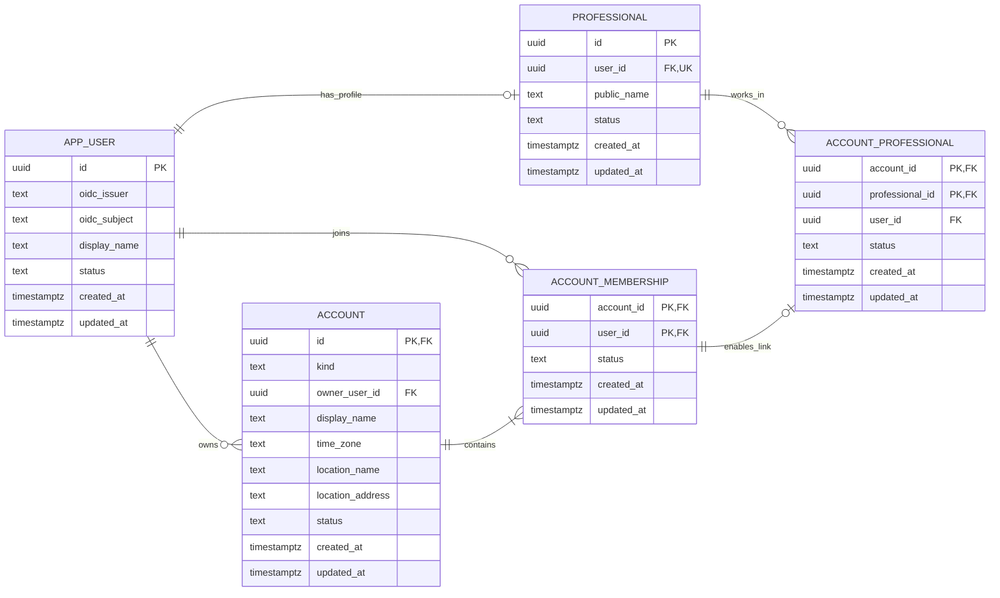
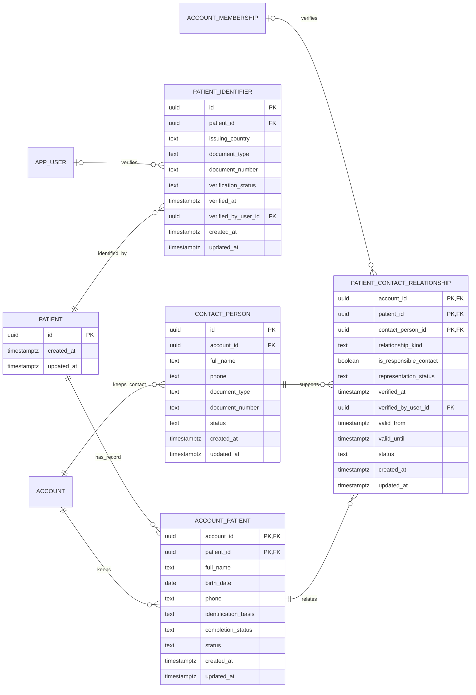
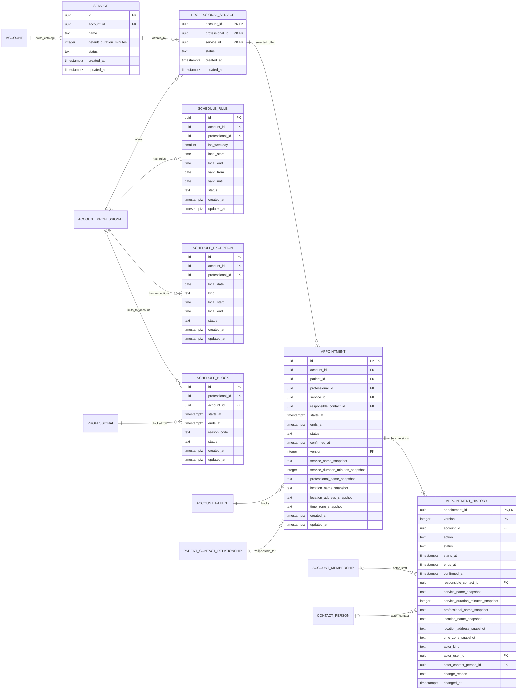
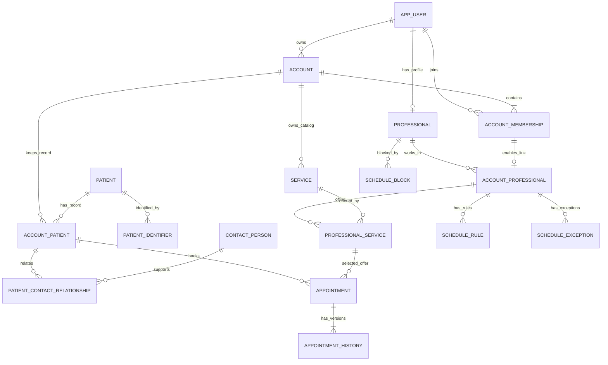

# Esquema de base de datos de Nightingale

**Versión:** 0.3, primera entrega completa aceptada.  
**Fecha:** 2026-10-23.  
**Estado:** T01–T06 comprobadas documentalmente; C01–C03 aceptados por el usuario. Cierre documental del 2026-10-23.  
**Motor del diseño:** PostgreSQL. Referencia técnica: documentación oficial de PostgreSQL 18; no fija la versión de un despliegue.  
**Propietario de los datos operativos:** Nightingale API.  
**Fuente del diseño:** este documento, por instrucción expresa del usuario.

Lectura por grupos: [cuentas y profesionales](#3-cuentas-usuarios-y-profesionales), [pacientes y contactos](#4-pacientes-y-contactos), [servicios y agenda](#5-servicios-y-agenda), [citas e historial](#6-citas-e-historial), [diagrama general](#7-vista-general-del-esquema) y [revisión del conjunto](#8-revisión-del-conjunto).

## 1. Alcance y lectura

Este documento describe el esquema físico propuesto: tablas, columnas, tipos de PostgreSQL, nulabilidad, valores por defecto, claves, restricciones, índices, cardinalidades y conservación. No contiene SQL ni instrucciones para crear modelos o bases de datos.

La entrega cubre cuentas, usuarios, profesionales, pacientes, contactos responsables, servicios, agenda, citas e historial funcional de citas. Los nombres y detalles físicos son propuestas revisables; no acreditan tablas existentes ni funciones implementadas.

No cubre SQLite, sincronización, auditoría técnica, comunicaciones, lista de espera, APIs, migraciones o código de aplicación. Tampoco define todavía datos clínicos, inventario, facturación o archivos médicos. No se crean campos genéricos para anticipar esas funciones.

### 1.1 Estado de las decisiones

| Marca | Significado |
|---|---|
| Acuerdo | El usuario lo definió o aprobó en esta conversación. |
| Propuesta física | Una elección de tablas, columnas o restricciones para revisar. |
| Pendiente | Aún no hay una decisión suficiente; no permite deducir una regla automática. |

La aprobación del plan autoriza redactar esta propuesta. Cada revisión de etapa acepta o cambia sus decisiones físicas por separado.

### 1.2 Acuerdos del 2026-10-23

- El primer uso se centra en consultorios independientes. Las relaciones admitirán clínicas y personas en varias cuentas, sin desarrollar ahora gestión clínica avanzada.
- Un profesional siempre tiene usuario. Puede poseer su consulta independiente y trabajar en varias clínicas. Un asistente tiene una sola identidad aunque pertenezca a varias cuentas.
- Cada cuenta tiene un lugar de atención. El tiempo del profesional no puede reservarse simultáneamente en cuentas distintas.
- Una identidad interna identifica al paciente; sus fichas y contactos por cuenta no dan acceso entre consultas.
- Se admiten cédula y pasaporte venezolanos. Un paciente puede tener varios documentos propios.
- Una ficha puede guardarse como borrador y completarse después; completitud y actividad son estados distintos.
- Un menor sin documento propio puede tener cita con nombre, fecha de nacimiento y contacto responsable. Su documento queda pendiente; el del adulto no identifica al menor.
- El contacto responsable no necesita ser paciente ni usuario. Parentesco, representación declarada, representación verificada y permiso son conceptos distintos.
- Coincidencias de nombre, teléfono o representante no unen pacientes automáticamente. Añadir un documento conserva la identidad e historial del menor.
- Las citas pasadas siguen siendo citas; su historial describe modificaciones. La duración real no se recalcula por cambiar el servicio.

Estos acuerdos sustituyen, para este diseño, la lectura anterior que limitaba todas las cuentas a un profesional o exigía documento propio a todo paciente antes de citar. Concretan también la identidad común del profesional entre cuentas. Conservan el aislamiento y la separación de responsabilidades del producto.

### 1.3 Límites de autoridad

El [plan maestro](master-plan.md), la [arquitectura](technical-architecture.md) y la [SRS](srs.md) conservan sus responsabilidades generales. Las instrucciones expresas de esta conversación concretan el alcance de este documento; no se modifican esas fuentes como efecto de esta entrega.

La ubicación de esta documentación no concede al escritorio acceso SQL. El [reparto de tres proyectos](decisions/transactional-sync-three-projects.md) conserva a Nightingale API como propietario de PostgreSQL operativo. Aquí solo se especifican datos y relaciones.

## 2. Convenciones físicas propuestas

### 2.1 Nombres e identificadores

- Tablas en singular y `snake_case`; columnas con el mismo formato. Los nombres técnicos son ingleses; las explicaciones son españolas.
- `account` representa la cuenta, sea independiente o clínica. `account_id` expresa ese ámbito en las tablas de este diseño.
- `app_user` representa a la persona que accede al sistema. Evita usar `user` como nombre físico: PostgreSQL reserva esa palabra. Véase [palabras reservadas](https://www.postgresql.org/docs/18/sql-keywords-appendix.html).
- Las entidades con identidad propia usan una PK `id` de tipo `uuid`, no nula y estable. Las tablas de relación pueden usar una PK compuesta por sus extremos para impedir duplicados sin otro identificador.
- Un UUID no contiene datos personales ni demuestra autorización. El documento no fija su versión ni un generador. Véase [tipo UUID](https://www.postgresql.org/docs/18/datatype-uuid.html).
- PK significa clave primaria; FK, clave foránea; UQ, unicidad; NN, columna no nula. Los índices se describen aparte de las claves que ya crean su propio índice.

### 2.2 Tipos y valores

| Tipo | Uso previsto | Regla del diseño |
|---|---|---|
| `uuid` | Identificadores y sus referencias | Mismo tipo en ambos extremos; sin valor por defecto salvo indicación expresa. |
| `text` | Nombres, documentos, códigos y zona horaria | Números de documento y teléfono no son cantidades; no pierden prefijos ni ceros por conversión numérica. |
| `date` | Fecha civil, por ejemplo nacimiento | No contiene hora ni sustituye un instante. |
| `timestamptz` | Instantes de creación, cambio y cita | Representa un instante; la zona IANA de la cuenta se conserva por separado. |
| `time without time zone` | Hora local de un horario habitual | Se interpreta con zona y fecha cuando se diseñe Agenda; no representa por sí sola una reserva. |
| `boolean` | Una condición binaria real | No sustituye un ciclo con varios estados. |
| `smallint` | Valores discretos pequeños | Solo si el campo documenta su intervalo permitido. |
| `integer` | Duración o cantidades administrativas | Unidad y límites explícitos en cada campo; no se inventan límites de citas en T01. |

Se usa `text` sin longitudes arbitrarias mientras no haya una regla de producto que justifique un límite. Los campos requeridos de texto no admiten una cadena vacía o compuesta solo por espacios. Los códigos enumerados propuestos son `text` con conjunto cerrado documentado, no un ENUM global reutilizado por tablas con significados distintos. Fuentes: [tipos de texto](https://www.postgresql.org/docs/18/datatype-character.html) y [tipos numéricos](https://www.postgresql.org/docs/18/datatype-numeric.html).

`timestamptz` no conserva el nombre de la zona original. Por eso `America/Caracas`, como ejemplo de zona IANA, vive en su propia columna. No se guarda una edad que cambie con el tiempo. Fuente: [fecha, hora y zona](https://www.postgresql.org/docs/18/datatype-datetime.html).

Cada diccionario declara obligatoriedad y valor por defecto por separado. **Sin valor por defecto** significa que el campo requiere un valor explícito cuando es obligatorio; **nulo** solo se permite si la columna lo indica. Un guion en la explicación nunca implica una cadena literal guardada.

Las marcas `created_at` y `updated_at`, cuando figuren, son obligatorias y no tienen valor por defecto en este diseño. La segunda no puede ser anterior a la primera. No se afirma que PostgreSQL actualice esas marcas automáticamente ni se prescribe código para hacerlo.

### 2.3 Claves, restricciones e índices

Las PK y UQ tienen su índice de unicidad; no se añade otro índice con las mismas columnas y orden. Una FK no crea por sí sola un índice en su origen. Los índices adicionales se justifican por búsqueda, relación o control de integridad concretos; no son resultados de una medición.

Una FK compuesta comprobará también el ámbito cuando una relación deba permanecer en la misma cuenta. Sus columnas obligatorias serán NN para evitar que un nulo eluda parte de la referencia. No se presentará un CHECK de fila como garantía sobre datos de otra tabla.

Las reglas entre tablas que no cubran PK/FK/UQ se identificarán por separado, junto con el mecanismo propuesto y la necesidad de comprobar concurrencia. Las restricciones diferidas, cuando se indiquen, deben cumplirse al final de la transacción; no permiten un estado inválido persistido. Fuentes: [restricciones](https://www.postgresql.org/docs/18/ddl-constraints.html), [índices parciales](https://www.postgresql.org/docs/18/indexes-partial.html) y [restricciones disparadas diferidas](https://www.postgresql.org/docs/18/sql-createtrigger.html).

La propuesta conserva identificadores: no actualiza PK ni usa borrado en cascada para eliminar identidad o historia funcional. Cada FK declara el tratamiento de eliminación. Desactivar no borra filas ni rompe referencias; no equivale a resolver una solicitud de supresión de datos, cuya política queda fuera de esta entrega.

### 2.4 Ámbito de los datos

| Ámbito | Significado | Límite |
|---|---|---|
| Global interno | Una identidad de usuario, profesional o paciente, reutilizable en varias relaciones | No es un directorio público ni da acceso entre cuentas. |
| Por cuenta | Pertenencia, ficha administrativa, contacto, servicio o dato operativo de esa cuenta | Conocer un identificador global no permite consultar estos datos. |
| Por profesional | Actividad de la misma persona en distintas cuentas | La futura restricción de ocupación debe comprobar toda su actividad, sin revelar detalles de otras cuentas. |

Ejemplo de lectura: Ana es una persona con un usuario y un perfil profesional. Su consulta y una clínica son cuentas distintas; cada una requiere sus propias relaciones. La pertenencia de otra persona a la consulta de Ana no la incorpora automáticamente a la clínica.

### 2.5 Extensión y conservación

Una capacidad nueva añadirá relaciones específicas cuando exista una necesidad definida. No se añaden a las tablas actuales campos JSON de contenido libre, columnas clínicas anticipadas ni un catálogo genérico de atributos.

Los nombres, tipos y restricciones de esta versión son una propuesta objetivo, no una transformación de datos existentes. No se documentan migraciones ni métodos de generación de modelos. Las políticas legales de acceso y retención no se deducen de una edad, un parentesco o un estado de actividad.

## 3. Cuentas, usuarios y profesionales

**Estado del grupo:** revisado y aceptado en C01. Las reglas de identidad, pertenencia múltiple y usuario obligatorio del profesional son acuerdos; las propuestas físicas de este grupo se aceptaron para esta primera versión, que admite revisiones posteriores.

| Tabla | Propietario funcional | Ámbito | Propósito |
|---|---|---|---|
| `app_user` | Identidad y acceso | Global interno | Identificar a una persona que accede al sistema. |
| `account` | Cuenta | Por cuenta | Identificar consulta independiente o clínica y su único lugar de atención. |
| `account_membership` | Cuenta y acceso | Por cuenta | Representar la pertenencia de una persona a una cuenta. |
| `professional` | Profesionales | Global interno | Identificar al profesional cuyo tiempo se reserva, ligado a un usuario. |
| `account_professional` | Profesionales | Por cuenta | Vincular al profesional con cada cuenta donde atiende. |

Una identidad global no es una ficha de paciente, una sesión ni un permiso global. La propiedad de una cuenta y la condición profesional son relaciones separadas de la pertenencia. La gestión detallada de roles y permisos queda fuera de esta versión del esquema: estas cinco tablas no constituyen por sí solas un sistema completo de autorización.

### 3.1 `app_user`

Una fila por persona que accede al sistema. No se crea una fila por clínica. Médico, asistente, administrador y otros integrantes del equipo pueden tener esta identidad; su condición no se fija mediante un tipo global de usuario.

| Columna | Tipo | Obligatoria | Por defecto | Clave | Significado |
|---|---|---|---|---|---|
| `id` | `uuid` | Sí | Sin valor por defecto | PK | Identidad interna de la persona. |
| `oidc_issuer` | `text` | Sí | Sin valor por defecto | UQ con `oidc_subject` | Emisor de su identidad externa. |
| `oidc_subject` | `text` | Sí | Sin valor por defecto | UQ con `oidc_issuer` | Sujeto dentro de ese emisor. |
| `display_name` | `text` | Sí | Sin valor por defecto | Ninguna | Nombre para identificar a la persona dentro del equipo. |
| `status` | `text` | Sí | `active` | CHECK | `active` o `inactive`; estado de esta identidad. |
| `created_at` | `timestamptz` | Sí | Sin valor por defecto | Ninguna | Instante de creación de la identidad. |
| `updated_at` | `timestamptz` | Sí | Sin valor por defecto | CHECK temporal | Instante del último cambio. |

**Claves y restricciones:** PK en `id`; UQ en `(oidc_issuer, oidc_subject)`. Los dos valores OIDC se comparan exactamente y con distinción de mayúsculas, sin cambiar su contenido para deduplicar. Se propone intercalación determinista `C` para esas columnas. Un correo o nombre coincidente no une identidades. No hay contraseña ni correo obligatorio en esta propuesta. Un vínculo OIDC por usuario es una propuesta de esta versión, no una prohibición de admitir varios mediante una relación futura.

**Índices:** los de PK y UQ cubren consulta por identidad interna y por emisor/sujeto; no se propone índice de nombre ni búsqueda global de personas sin un caso aprobado.

**Cambios y conservación:** `id` permanece estable. Cambiar nombre no crea otro usuario. Desactivar no borra perfil profesional, propiedad o pertenencias; tampoco declara que las cuentas o citas desaparecen. No se eliminan identidades referenciadas. Estas columnas no describen tokens ni su validación.

### 3.2 `account`

Una fila por espacio administrativo. La consulta independiente y la clínica usan la misma tabla. En esta propuesta ambas tienen un propietario responsable y un único lugar de atención, sin una tabla anticipada de sedes.

| Columna | Tipo | Obligatoria | Por defecto | Clave | Significado |
|---|---|---|---|---|---|
| `id` | `uuid` | Sí | Sin valor por defecto | PK; parte de FK de propietario | Identidad de la cuenta. |
| `kind` | `text` | Sí | Sin valor por defecto | CHECK | `independent` o `clinic`. |
| `owner_user_id` | `uuid` | Sí | Sin valor por defecto | FK; UQ parcial | Persona propietaria responsable, no un rol global. |
| `display_name` | `text` | Sí | Sin valor por defecto | Ninguna | Nombre administrativo de la cuenta. |
| `time_zone` | `text` | Sí | Sin valor por defecto | Regla de zona | Zona IANA válida, por ejemplo `America/Caracas`. |
| `location_name` | `text` | Sí | Sin valor por defecto | Ninguna | Nombre del lugar de atención de esta cuenta. |
| `location_address` | `text` | Sí | Sin valor por defecto | Ninguna | Dirección administrativa de ese lugar. |
| `status` | `text` | Sí | `active` | CHECK | `active` o `inactive`; actividad de la cuenta. |
| `created_at` | `timestamptz` | Sí | Sin valor por defecto | Ninguna | Instante de creación. |
| `updated_at` | `timestamptz` | Sí | Sin valor por defecto | CHECK temporal | Instante del último cambio. |

**Claves y restricciones:** PK en `id`; FK de `owner_user_id` a `app_user.id`; FK compuesta de `(id, owner_user_id)` a `account_membership.(account_id, user_id)`, diferida al cierre de la transacción. La segunda exige que el propietario pertenezca a su cuenta; no prueba permisos por sí sola. Las referencias y su tratamiento de eliminación aparecen en §3.6.

Se propone un índice único parcial sobre `owner_user_id` para las filas `independent`, incluidas las inactivas: una persona conserva una consulta independiente, aunque además pertenezca a clínicas o sea propietaria de estas. `display_name`, dirección y zona no son únicos. Dos cuentas pueden atender en la misma dirección sin compartir pacientes o permisos.

**Índices:** PK; UQ parcial de consulta independiente; índice B-tree no único en `owner_user_id` para listar todas las cuentas propias, incluidas clínicas. No duplica el parcial, cuyo alcance excluye clínicas.

**Reglas adicionales:** una cuenta `independent` tiene exactamente un profesional, cuyo usuario es el propietario. Una clínica admite varios profesionales. Estas reglas no caben en un CHECK de esta fila; §3.7 describe el control propuesto. Un propietario de clínica no tiene que ser profesional. Admitir copropietarios o cambiar el profesional responsable de una consulta independiente requerirá revisar esta propuesta; no se deducen esas capacidades de una pertenencia.

`time_zone` requiere pertenencia al catálogo de zonas IANA admitidas; `text` y no vacío no bastan para probarlo. Se propone validación de integridad al escribir la cuenta contra las zonas reconocidas por PostgreSQL, sin tratar ese catálogo como tabla de pacientes o zona copiada a cada usuario. No se fija una zona por defecto para evitar asignar Caracas a una cuenta distinta sin decisión.

**Cambios y conservación:** la cuenta conserva su identificador al cambiar nombre, dirección o estado. En esta primera propuesta `kind` y el propietario de una consulta independiente son estables; convertirla a clínica o transferirla a otra persona queda pendiente de un caso específico. La dirección comunicada de cada cita se conserva según §6, sin sustituirla por una edición posterior de esta cuenta. No se borra una cuenta con relaciones existentes.

### 3.3 `account_membership`

Una fila por pareja cuenta/persona. La pertenencia expresa vínculo administrativo; no concede acceso a otras cuentas de la misma persona ni define por sí sola sus acciones permitidas.

| Columna | Tipo | Obligatoria | Por defecto | Clave | Significado |
|---|---|---|---|---|---|
| `account_id` | `uuid` | Sí | Sin valor por defecto | PK compuesta; FK | Cuenta a la que pertenece la persona. |
| `user_id` | `uuid` | Sí | Sin valor por defecto | PK compuesta; FK | Persona que pertenece a la cuenta. |
| `status` | `text` | Sí | `active` | CHECK | `active` o `inactive`; estado del vínculo. |
| `created_at` | `timestamptz` | Sí | Sin valor por defecto | Ninguna | Instante en que se registra el vínculo. |
| `updated_at` | `timestamptz` | Sí | Sin valor por defecto | CHECK temporal | Instante del último cambio. |

**Claves y restricciones:** PK `(account_id, user_id)`; FK de cada extremo a su entidad. Se conserva una sola fila por pareja, aunque se desactive y reactive. No se añade un `id` que permita duplicar la misma pertenencia.

**Índices:** el de PK sirve para equipo por cuenta y la FK hacia cuenta. Índice B-tree no único `(user_id, account_id)` para cuentas de la persona y referencias al usuario. No se añade UQ sobre `user_id`: impediría que el mismo asistente acompañe al profesional en varias cuentas.

**Cambios y conservación:** desactivar conserva el vínculo y sus referencias. La FK de propietario conserva la identidad del propietario aunque su pertenencia esté inactiva; no debe interpretarse como autorización para operar. Una revocación no exige cambiar al propietario ni borrar datos históricos. No se conserva aquí un historial de permisos ni se presume que pertenencia activa equivalga a administración.

### 3.4 `professional`

Una fila por profesional. Su identidad permanece al atender en otra clínica o abrir su consulta independiente. El perfil no es una identidad de paciente ni exige que toda persona con usuario sea profesional.

| Columna | Tipo | Obligatoria | Por defecto | Clave | Significado |
|---|---|---|---|---|---|
| `id` | `uuid` | Sí | Sin valor por defecto | PK; parte de UQ de referencia | Identidad estable del profesional. |
| `user_id` | `uuid` | Sí | Sin valor por defecto | FK; UQ; parte de UQ de referencia | Usuario propio y obligatorio del profesional. |
| `public_name` | `text` | Sí | Sin valor por defecto | Ninguna | Nombre profesional que se usa al presentar sus citas. |
| `status` | `text` | Sí | `active` | CHECK | `active` o `inactive`; actividad del perfil. |
| `created_at` | `timestamptz` | Sí | Sin valor por defecto | Ninguna | Instante de creación del perfil. |
| `updated_at` | `timestamptz` | Sí | Sin valor por defecto | CHECK temporal | Instante del último cambio. |

**Claves y restricciones:** PK `id`; FK `user_id` a `app_user.id`; UQ `user_id`, que permite como máximo un perfil por persona; UQ `(id, user_id)` para que §3.5 pueda comprobar los dos valores en una FK compuesta. Esta última unicidad ya se deduce de la PK, pero su declaración explícita sirve como destino de esa FK.

**Índices:** los de las tres claves anteriores. No se añade otro índice a `user_id` ni a `id`. No se proponen índices de especialidades, datos clínicos o licencias que aún no tienen columnas definidas.

`public_name` tiene un propósito distinto de `app_user.display_name`: presentación profesional frente a identificación del integrante del equipo. Ambos pueden coincidir; no se propone sincronizarlos ni usarlos como identificadores únicos.

**Cambios y conservación:** la relación con el usuario es estable en esta versión. Desactivar no elimina citas ni vinculaciones con cuentas. Asociar el perfil de una persona a otra no es una edición de nombre. El nombre presentado en cada cita se conserva según §6.

### 3.5 `account_professional`

Una fila por profesional y cuenta donde atiende. Se distingue de la pertenencia para no convertir en profesional a todo asistente o administrador de la cuenta.

| Columna | Tipo | Obligatoria | Por defecto | Clave | Significado |
|---|---|---|---|---|---|
| `account_id` | `uuid` | Sí | Sin valor por defecto | PK compuesta; parte de UQ/FK | Cuenta donde atiende. |
| `professional_id` | `uuid` | Sí | Sin valor por defecto | PK compuesta; parte de FK | Identidad común del profesional. |
| `user_id` | `uuid` | Sí | Sin valor por defecto | Parte de UQ/FK | Usuario del perfil, necesario para comprobar pertenencia. |
| `status` | `text` | Sí | `active` | CHECK | `active` o `inactive`; actividad de esta vinculación profesional. |
| `created_at` | `timestamptz` | Sí | Sin valor por defecto | Ninguna | Instante de creación del vínculo. |
| `updated_at` | `timestamptz` | Sí | Sin valor por defecto | CHECK temporal | Instante del último cambio. |

**Claves y restricciones:** PK `(account_id, professional_id)`; UQ `(account_id, user_id)`; FK `(professional_id, user_id)` a `professional.(id, user_id)`; FK `(account_id, user_id)` a `account_membership.(account_id, user_id)`.

La repetición deliberada de `user_id` permite que esas dos FK impidan asignar el perfil de una persona utilizando la pertenencia de otra. No es otra identidad editable; debe coincidir con el usuario del perfil. La UQ identifica como máximo una vinculación profesional por pertenencia y documenta esa cardinalidad de forma explícita.

**Índices:** los de PK y UQ; índice B-tree no único `(professional_id, account_id)` para obtener las cuentas del profesional y cubrir el origen de la FK hacia su perfil. El índice de UQ cubre la FK hacia la pertenencia. No hay unicidad global sobre `professional_id`, porque impediría trabajar en varias cuentas.

**Cambios y conservación:** una baja en una clínica desactiva esta vinculación, no el perfil común ni las vinculaciones en otras cuentas. No se reasigna una fila a otro profesional. La actividad efectiva requiere revisar cuenta, usuario, pertenencia, perfil y vinculación; las FK prueban correspondencia y existencia, no que todos sus estados sean activos. La definición de permisos y sus comprobaciones queda fuera de estas tablas.

### 3.6 Referencias y cardinalidades

Todas las columnas referenciadas son del mismo tipo que su destino. Las siete FK siguientes son propuestas. Ninguna autoriza a leer otra cuenta.

| Referencia | Origen → destino | Comprobación | Eliminación / cambio de clave |
|---|---|---|---|
| F01 | `account.owner_user_id` → `app_user.id` | El propietario existe. | RESTRICT; identidades estables. |
| F02 | `account.(id, owner_user_id)` → `account_membership.(account_id, user_id)` | El propietario pertenece a esa misma cuenta. | NO ACTION diferida al cierre; evita perder la pertenencia del propietario. |
| F03 | `account_membership.account_id` → `account.id` | La cuenta de la pertenencia existe. | RESTRICT. |
| F04 | `account_membership.user_id` → `app_user.id` | La persona de la pertenencia existe. | RESTRICT. |
| F05 | `professional.user_id` → `app_user.id` | El profesional tiene usuario propio. | RESTRICT. |
| F06 | `account_professional.(professional_id, user_id)` → `professional.(id, user_id)` | Perfil y usuario corresponden a la misma persona. | RESTRICT. |
| F07 | `account_professional.(account_id, user_id)` → `account_membership.(account_id, user_id)` | Esa persona pertenece a la cuenta donde atiende. | RESTRICT. |

F02 forma un ciclo de referencias con F03: al cierre de una transacción deben existir cuenta y pertenencia de su propietario. Se propone diferir F02, no hacer opcional al propietario ni dejar una cuenta huérfana. RESTRICT y NO ACTION diferida no se presentan como equivalentes; véase [claves foráneas y acciones](https://www.postgresql.org/docs/18/ddl-constraints.html#DDL-CONSTRAINTS-FK).

| Relación | Cardinalidad persistida | Condición |
|---|---|---|
| Usuario → cuentas propias | Cero o muchas | Como máximo una `independent`, por el índice parcial propuesto. |
| Cuenta → propietario | Exactamente uno | FK F01 y pertenencia F02. |
| Usuario → pertenencias | Cero o muchas | Una por cuenta; incluye profesionales y personal de apoyo. |
| Cuenta → pertenencias | Una o muchas | Al menos la del propietario al cierre. |
| Usuario → perfil profesional | Cero o uno | Perfil: usuario obligatorio; usuario: puede no ser profesional. |
| Perfil profesional → vinculaciones con cuentas | Cero o muchas | La misma identidad puede atender en varias. |
| Pertenencia → vinculación profesional | Cero o una | Un asistente puede pertenecer sin tener esa vinculación. |
| Cuenta → profesionales | Uno si es independiente; cero o muchos si es clínica | Regla adicional §3.7. Una clínica sin profesionales aún no ofrece agenda profesional. |

### 3.7 Integridad entre tablas y límites

Las siguientes son propuestas físicas para revisión; no se afirma que estén implementadas:

| Regla | Garantía exigida | Mecanismo propuesto |
|---|---|---|
| I01 | Una consulta `independent` tiene exactamente una fila en `account_professional`, y el usuario de esa fila es su propietario. | Restricción de integridad diferida entre las tablas afectadas; un trigger de restricción con cambios de la misma cuenta coordinados sobre esa cuenta. Las dos partes —cardinalidad y propietario— deben comprobarse juntas antes del cierre. |
| I02 | Una cuenta `clinic` puede vincular varios profesionales sin exigir que su propietario lo sea. | F01–F07; I01 solo aplica a cuentas independientes. |
| I03 | El tipo de cuenta, su propietario independiente y la relación perfil/usuario no cambian de significado por una edición administrativa. | Restricción de cambio sobre esos atributos mientras no exista un caso de conversión o transferencia revisado. No se bloquea cambiar nombre, dirección o actividad. |
| I04 | `time_zone` identifica una zona IANA admitida, no una cadena cualquiera. | Validación de integridad al escribir la fila contra el catálogo de zonas PostgreSQL. |

Un CHECK que consulte otra tabla no cubre I01. Tampoco basta con contar profesionales antes de una escritura sin coordinar cambios concurrentes. La propuesta exige control diferido y coordinación por cuenta; su prueba con dos conexiones pertenece a una implementación posterior, fuera de este documento. Fuente del mecanismo diferido: [constraint triggers](https://www.postgresql.org/docs/18/sql-createtrigger.html).

No se crean en estas cinco tablas reservas o calendarios duplicados. La identidad `professional.id` será la referencia común para impedir solapamientos incluso entre cuentas; el mecanismo temporal y las tablas de cita se describen en §6. Ningún índice de este grupo demuestra todavía esa protección.

### 3.8 Diagrama de cuentas, usuarios y profesionales

Los atributos muestran todas las columnas del grupo. PK y FK corresponden al diccionario; las UQ simples se marcan en los atributos y las compuestas se detallan en el texto. Las líneas representan cardinalidad; no convierten todas las relaciones semánticas en una FK simple.

En el diagrama se usan mayúsculas para las entidades Mermaid; sus nombres físicos son los mismos en minúsculas. F02 es una referencia adicional del propietario a su pertenencia, incluida en §3.6; se omite como segunda línea entre las mismas cajas para evitar superposición. La cardinalidad condicional de profesionales por tipo de cuenta aparece en §3.6/I01; la ruta a través de pertenencia no la sustituye.

### 3.9 Ejemplos ficticios de lectura

| Caso | Filas y relaciones esperadas | Lo que no se deduce |
|---|---|---|
| Ana abre su consulta | Un `app_user`, un `professional`, una cuenta `independent`, su pertenencia y su vinculación profesional. | Una cuenta sin pertenencia del propietario no es un estado persistido válido. |
| Ana atiende en dos clínicas | Se reutilizan usuario y perfil; se añaden pertenencias y vinculaciones para las dos cuentas `clinic`. | No se crean otros dos usuarios ni otros dos perfiles. |
| Luis asiste a Ana en las tres cuentas | Un usuario de Luis y tres pertenencias autorizadas por separado. No necesita perfil profesional. | Ser asistente en una cuenta no lo incorpora automáticamente a las otras. |
| Una administradora no médica posee una clínica | Usuario propietario, cuenta y pertenencia; los perfiles de quienes atienden se vinculan por separado. | Propietaria no equivale a profesional de la salud. |
| Otra persona intenta vincular el perfil de Ana con su propia pertenencia | F06 exige el usuario de Ana y F07 exige la pertenencia de ese mismo usuario. | Conocer `professional_id` no permite usar el vínculo de otra persona. |
| Se intenta añadir otro profesional a la cuenta independiente | I01 debe rechazar el resultado persistido; para una clínica se admiten varios. | La FK por sí sola no comprueba el máximo de profesionales de una consulta independiente. |
| Ana deja una clínica | Se desactiva esa vinculación y, si corresponde, su pertenencia; se conservan perfil, consulta y demás relaciones. | Una baja en una cuenta no es una baja global ni borra citas previas. |

### 3.10 Revisión C01

Revisar los nombres físicos y, en especial, estas propuestas: un propietario responsable por cuenta; máximo de una consulta independiente por propietario incluso inactiva; lugar y dirección obligatorios; una identidad OIDC por usuario; `public_name` separado del nombre del usuario; pertenencia distinta de la vinculación profesional; controles de integridad diferidos para la consulta independiente. Son decisiones físicas propuestas, no nuevas aprobaciones atribuidas al usuario.

El usuario aceptó C01 el 2026-10-23 al responder «Puedes continuar, por favor». La lista anterior conserva los puntos presentados para esa revisión; no se extiende esa aceptación a las tablas de etapas posteriores.

El esquema de este grupo no contiene un historial de cambios de propietario, ni un sistema de roles y permisos, ni una prueba ejecutada de aislamiento o concurrencia. Pacientes y contactos se definen en la siguiente etapa.

## 4. Pacientes y contactos

**Estado del grupo:** revisado y aceptado en C02 el 2026-10-23. Identidad interna, fichas por cuenta, borrador, excepción del menor y ausencia de acceso automático son acuerdos; los campos y controles se aceptaron como primera propuesta física revisable.

### 4.1 `patient`

**Propietario:** Pacientes. **Ámbito:** global interno. Es la identidad estable de la persona atendida, no un usuario ni una ficha compartida. Mantiene deliberadamente pocos datos.

| Columna | Tipo | Obligatoria | Por defecto | Clave | Significado |
|---|---|---|---|---|---|
| `id` | `uuid` | Sí | Sin valor por defecto | PK | Identidad interna, también para menores sin documento. |
| `created_at` | `timestamptz` | Sí | Sin valor por defecto | Ninguna | Creación de la identidad. |
| `updated_at` | `timestamptz` | Sí | Sin valor por defecto | CHECK temporal | Último cambio de esta fila. |

**Claves y restricciones:** PK `id`; regla temporal de §2.2. No hay unicidad por nombre, nacimiento, teléfono o representante. La fila no contiene esos datos ni un estado global de actividad: cada consulta administra la actividad de su propia ficha.

**Índices:** solo PK. No se propone un buscador público de pacientes globales.

**Cambios y conservación:** obtener un documento, cambiar de contacto o acudir a otra consulta no cambia `id`. No se elimina una identidad referenciada. Una unión de identidades erróneamente duplicadas requiere revisión expresa y conservación de referencias; no se diseña aquí una reasignación masiva ni se borra una de las historias para resolver la coincidencia.

### 4.2 `patient_identifier`

**Propietario:** Identificación de pacientes. **Ámbito:** global interno restringido. Conserva identificadores propios y su estado de comprobación. Su existencia no permite consultar la ficha o conocer otras cuentas del paciente.

| Columna | Tipo | Obligatoria | Por defecto | Clave | Significado |
|---|---|---|---|---|---|
| `id` | `uuid` | Sí | Sin valor por defecto | PK | Identidad del registro de documento. |
| `patient_id` | `uuid` | Sí | Sin valor por defecto | FK | Paciente al que se atribuye el documento. |
| `issuing_country` | `text` | Sí | `VE` | CHECK; parte de UQ parcial | País emisor; esta versión admite `VE`. No expresa nacionalidad. |
| `document_type` | `text` | Sí | Sin valor por defecto | CHECK; parte de UQ parcial | `national_id` —cédula— o `passport`. |
| `document_number` | `text` | Sí | Sin valor por defecto | UQ parcial | Número canónico, con prefijos significativos y ceros conservados. |
| `verification_status` | `text` | Sí | `declared` | CHECK | `declared`, `verified` o `invalidated`. |
| `verified_at` | `timestamptz` | No | Nulo | CHECK de pareja | Instante de la comprobación, si la hubo. |
| `verified_by_user_id` | `uuid` | No | Nulo | FK; CHECK de pareja | Persona que dejó constancia de la comprobación. |
| `created_at` | `timestamptz` | Sí | Sin valor por defecto | Ninguna | Creación del registro. |
| `updated_at` | `timestamptz` | Sí | Sin valor por defecto | CHECK temporal | Último cambio. |

**Claves y restricciones:** PK `id`; FK `patient_id` a `patient.id`; FK opcional `verified_by_user_id` a `app_user.id`. UQ parcial `(issuing_country, document_type, document_number)` solo para `verified`. Una fila declarada no se convierte en una asociación fiable solo porque otro registro tenga el mismo número. La colisión entre dos identidades al verificar exige revisión, no una unión automática.

Las marcas de comprobación son ambas nulas o ambas no nulas. `verified` exige ambas y `declared` exige ambas nulas; `invalidated` puede conservar la comprobación anterior. Cuando hay `verified_at`, no precede a `created_at` ni supera `updated_at`. El tipo y número se comparan con intercalación determinista `C`. La normalización del formato de cédula/pasaporte debe aprobarse antes de aceptar valores reales; un texto no vacío no demuestra validez ni titularidad. No se eliminan ceros o prefijos por convertir a número.

**Índices:** PK; UQ parcial verificada; B-tree `(patient_id, verification_status)` para documentos de esa identidad; B-tree en `verified_by_user_id` para su referencia. Las coincidencias declaradas no justifican un índice global de búsqueda disponible al personal de cualquier cuenta.

**Cambios y conservación:** el paciente de una fila no se cambia como una corrección común. Un documento mal atribuido se invalida y se revisa; no se reasigna para unir personas sin evidencia. Un documento nuevo añade un registro al mismo paciente. Un documento invalidado conserva su registro y no participa en la unicidad verificada; el procedimiento de revisión debe impedir usar esa baja como autorización para vincular otra persona sin comprobación.

**Límite:** verificación es una constancia administrativa, no una comprobación automática con un registro estatal. Este esquema no define el procedimiento o permiso para verificar ni hace público el dato global. Pueden persistir coincidencias declaradas sin resolver; por eso no se promete ausencia absoluta de duplicados antes de identificar a la persona.

### 4.3 `account_patient`

**Propietario:** Pacientes de la cuenta. **Ámbito:** por cuenta. Es la ficha administrativa que esa consulta mantiene y puede completar. Una cuenta no recibe los nombres o contactos de otra por reutilizar `patient_id`.

| Columna | Tipo | Obligatoria | Por defecto | Clave | Significado |
|---|---|---|---|---|---|
| `account_id` | `uuid` | Sí | Sin valor por defecto | PK compuesta; FK | Cuenta de la ficha. |
| `patient_id` | `uuid` | Sí | Sin valor por defecto | PK compuesta; FK | Identidad interna común. |
| `full_name` | `text` | No | Nulo | CHECK condicional | Nombre que la cuenta registró. |
| `birth_date` | `date` | No | Nulo | Regla de fecha | Fecha registrada por esta cuenta; necesaria para la excepción de menor. |
| `phone` | `text` | No | Nulo | CHECK de texto | Teléfono propio, cuando existe; no es único. |
| `identification_basis` | `text` | No | Nulo | CHECK condicional | `own_document` o `minor_without_document`; permite nulo en borrador. |
| `completion_status` | `text` | Sí | `draft` | CHECK | `draft` o `complete`. |
| `status` | `text` | Sí | `active` | CHECK | `active` o `inactive`, separado de completitud. |
| `created_at` | `timestamptz` | Sí | Sin valor por defecto | Ninguna | Creación de la ficha en esta cuenta. |
| `updated_at` | `timestamptz` | Sí | Sin valor por defecto | CHECK temporal | Último cambio de la ficha. |

**Claves y restricciones:** PK `(account_id, patient_id)`; FK a `account.id` y a `patient.id`. No hay otro `id` ni otra ficha de esa identidad en la misma cuenta. Los textos presentes no son vacíos. Para `complete`, `full_name` e `identification_basis` son obligatorios; `minor_without_document` exige además `birth_date`. Borrador admite esos campos nulos y conserva el identificador para volver a completarlos.

Las condiciones dependientes de documento, contacto y fecha no se dan por cubiertas por un CHECK de esta fila: se detallan en §4.7. No se fija una edad legal automática ni se persiste una edad. La fecha no futura se valida al registrarla; no se usa una condición dependiente del paso del tiempo como prueba permanente de minoría de edad.

**Índices:** PK para ficha/listado por cuenta; B-tree `(patient_id, account_id)` para referencias internas de identidad; B-tree `(account_id, completion_status, status)` para listas de borradores o fichas operativas. No se añade unicidad a nombre, teléfono o nacimiento. Una búsqueda por nombre puede requerir otro índice cuando se defina su forma; no se presume búsqueda parcial eficiente por estos índices.

**Cambios y conservación:** cambios de nombre, nacimiento o teléfono no alteran otra cuenta. Cambiar completitud no activa/desactiva la ficha. Una corrección que deje sin requisitos una ficha completa debe conservarse como borrador o rechazarse según el resultado revisado; no debe continuar marcada completa. Desactivar no borra citas. Completar después el documento del menor conserva la misma PK.

### 4.4 `contact_person`

**Propietario:** Contactos de pacientes de la cuenta. **Ámbito:** por cuenta. Una persona de contacto puede relacionarse con varios pacientes de esa cuenta, sin convertirse en paciente o usuario por ello.

| Columna | Tipo | Obligatoria | Por defecto | Clave | Significado |
|---|---|---|---|---|---|
| `id` | `uuid` | Sí | Sin valor por defecto | PK; parte de UQ de referencia | Identidad del contacto en esta cuenta. |
| `account_id` | `uuid` | Sí | Sin valor por defecto | FK; parte de UQ de referencia | Cuenta que conserva sus datos. |
| `full_name` | `text` | Sí | Sin valor por defecto | Ninguna | Nombre del contacto. |
| `phone` | `text` | No | Nulo | CHECK de texto | Teléfono; será necesario si sustenta el contacto responsable para citar. |
| `document_type` | `text` | No | Nulo | CHECK de pareja | Cédula `national_id` o `passport` propios del adulto, si se registran. |
| `document_number` | `text` | No | Nulo | CHECK de pareja | Número propio, no el identificador del menor. |
| `status` | `text` | Sí | `active` | CHECK | `active` o `inactive`. |
| `created_at` | `timestamptz` | Sí | Sin valor por defecto | Ninguna | Creación del contacto. |
| `updated_at` | `timestamptz` | Sí | Sin valor por defecto | CHECK temporal | Último cambio. |

**Claves y restricciones:** PK `id`; UQ `(account_id, id)` como destino de FK que impide cruzar cuentas; FK `account_id` a `account.id`. Tipo y número de documento son ambos nulos o ambos presentes, con los dos tipos venezolanos de esta versión. No se impone unicidad global a los documentos, nombres o teléfonos del contacto: no se usa esta tabla como registro global de identidad.

**Índices:** PK; UQ compuesta; B-tree `(account_id, status)` para contactos de la cuenta. La reutilización consciente de un contacto evita copiarlo por cada hijo; una coincidencia de teléfono no une adultos automáticamente.

**Cambios y conservación:** el contacto pertenece a una sola cuenta y no se traslada cambiando `account_id`. Su edición afecta a sus vínculos dentro de esa cuenta. No se sincronizan sus datos con otra consulta ni con una ficha propia que esa persona pueda tener como paciente. Desactivar conserva relaciones y sus comprobaciones; no los elimina en cascada.

### 4.5 `patient_contact_relationship`

**Propietario:** Vínculos de pacientes de la cuenta. **Ámbito:** por cuenta. Separa relación declarada, función de contacto y comprobación de representación. No concede permisos al Hub ni acceso a información clínica.

| Columna | Tipo | Obligatoria | Por defecto | Clave | Significado |
|---|---|---|---|---|---|
| `account_id` | `uuid` | Sí | Sin valor por defecto | PK compuesta; parte de FK | Cuenta del vínculo. |
| `patient_id` | `uuid` | Sí | Sin valor por defecto | PK compuesta; parte de FK | Paciente de esa cuenta. |
| `contact_person_id` | `uuid` | Sí | Sin valor por defecto | PK compuesta; parte de FK | Contacto de la misma cuenta. |
| `relationship_kind` | `text` | Sí | Sin valor por defecto | CHECK | `mother`, `father`, `guardian` u `other`; vínculo declarado, no tutela probada. |
| `is_responsible_contact` | `boolean` | Sí | Falso | Ninguna | Función administrativa de contacto responsable para citas. |
| `representation_status` | `text` | Sí | `unverified` | CHECK | `unverified` o `verified`; no equivale a permiso de acceso. |
| `verified_at` | `timestamptz` | No | Nulo | CHECK de pareja | Constancia de comprobación de representación, si la hubo. |
| `verified_by_user_id` | `uuid` | No | Nulo | FK compuesta; CHECK de pareja | Persona perteneciente a esta cuenta que dejó constancia. |
| `valid_from` | `timestamptz` | Sí | Sin valor por defecto | CHECK temporal | Inicio de vigencia declarado para el vínculo. |
| `valid_until` | `timestamptz` | No | Nulo | CHECK temporal | Fin exclusivo; nulo significa sin fin definido. |
| `status` | `text` | Sí | `active` | CHECK | `active` o `inactive`; conserva la fila al terminar el vínculo. |
| `created_at` | `timestamptz` | Sí | Sin valor por defecto | Ninguna | Creación del registro. |
| `updated_at` | `timestamptz` | Sí | Sin valor por defecto | CHECK temporal | Último cambio. |

**Claves y restricciones:** PK `(account_id, patient_id, contact_person_id)`; FK `(account_id, patient_id)` a `account_patient`; FK `(account_id, contact_person_id)` a `contact_person.(account_id, id)`; FK opcional `(account_id, verified_by_user_id)` a `account_membership`. La última usa la nulabilidad deliberada del verificador: sin comprobación no exige verificador; con valor debe pertenecer a la cuenta correcta.

`verified` exige las dos marcas de comprobación y `unverified` exige ambas nulas. Una relación que termina se desactiva o cierra su vigencia, conservando una comprobación anterior; no se borra esa evidencia cambiando a no verificada. Si `valid_until` existe, supera `valid_from`; su intervalo es cerrado al inicio y abierto al final. Cuando existe, `verified_at` queda entre creación y última actualización. Las validaciones no prueban por sí solas la validez legal de la representación.

**Índices:** PK para contactos por paciente/cuenta; B-tree `(account_id, contact_person_id, patient_id)` para pacientes de un contacto y su FK; B-tree `(account_id, verified_by_user_id)` para la referencia del verificador. No se exige un único responsable: varios contactos pueden cumplir esa función. No se crea un índice cuya pertenencia dependa de la hora actual.

**Cambios y conservación:** los extremos no cambian de persona ni cuenta. Estado y vigencia conservan la relación al terminarla. La propuesta mantiene una fila por vínculo, no un historial jurídico completo de cada cambio. Tutela, prueba documental, concesiones del Hub y cambios de acceso por edad necesitan su propio diseño; no se simulan mediante `relationship_kind`.

### 4.6 Referencias y cardinalidades

Las FK F08–F15 tienen tipos compatibles y eliminación/cambio de identidad RESTRICT. No se borra una identidad, ficha, contacto o pertenencia referenciada para ocultar un error de identificación.

| Referencia | Origen → destino | Comprobación |
|---|---|---|
| F08 | `patient_identifier.patient_id` → `patient.id` | El documento se atribuye a una identidad existente. |
| F09 | `patient_identifier.verified_by_user_id` → `app_user.id` | Existe el autor de la constancia, si se registró. |
| F10 | `account_patient.account_id` → `account.id` | La ficha pertenece a una cuenta existente. |
| F11 | `account_patient.patient_id` → `patient.id` | La ficha conserva una identidad existente. |
| F12 | `contact_person.account_id` → `account.id` | El contacto pertenece a una cuenta existente. |
| F13 | `patient_contact_relationship.(account_id, patient_id)` → `account_patient.(account_id, patient_id)` | Existe esa ficha en esa cuenta. |
| F14 | `patient_contact_relationship.(account_id, contact_person_id)` → `contact_person.(account_id, id)` | Contacto y ficha pertenecen a la misma cuenta. |
| F15 | `patient_contact_relationship.(account_id, verified_by_user_id)` → `account_membership.(account_id, user_id)` | El autor pertenece a esa cuenta; columna de verificador opcional. |

| Relación | Cardinalidad | Condición |
|---|---|---|
| Paciente → documentos | Cero o muchos | El menor puede no tener documento propio; cada documento apunta a un paciente. |
| Paciente → fichas por cuenta | Cero o muchas | Una ficha por pareja cuenta/paciente. Una identidad en revisión puede aún no tener ficha. |
| Cuenta → fichas / contactos | Cero o muchas | No se copian por pertenecer a otra cuenta. |
| Ficha → vínculos de contacto | Cero o muchos | Para completar la excepción de menor se necesita al menos un responsable vigente con teléfono. |
| Contacto → vínculos de pacientes | Cero o muchos | Permite hermanos con el mismo contacto. |
| Usuario / pertenencia → constancias | Cero o muchas | El verificador es opcional hasta que se deja constancia; su existencia no acredita permisos. |

### 4.7 Completitud e identificación

Se propone el siguiente resultado de integridad, con comprobación diferida de documentos y contactos para las fichas que deban seguir completas. La fecha de nacimiento, vigencia y condición de menor se revalidan al citar; no se consideran ciertas para siempre por el estado `complete`.

| Situación | Requisitos / resultado propuesto |
|---|---|
| Ficha `draft` | Permite datos incompletos; mantiene cuenta, identidad y valores ya registrados. No habilita una cita nueva por estar activa. |
| Ficha `complete`, base `own_document` | Nombre y al menos un documento propio verificado; teléfono propio o contacto responsable activo con teléfono. Admitir contacto en vez de teléfono propio evita exigir móvil personal a un menor que sí tenga cédula. |
| Ficha `complete`, base `minor_without_document` | Nombre, nacimiento y vínculo responsable vigente, activo y con contacto activo que tenga teléfono. No exige documento del menor ni exige convertir al adulto en paciente. |
| Se añade documento propio al menor | Se conserva `patient.id`; la ficha puede pasar a `own_document` tras revisión. No cambian por sí solas las fichas de otras cuentas. |
| Se invalida el único documento o se retira el único contacto requerido | Antes de persistir el cambio, las fichas afectadas deben dejar de estar completas o satisfacer otra base válida. No se mantienen completas por una FK que solo prueba existencia. |
| Dos pacientes declaran el mismo documento | Se mantiene la coincidencia por revisar; solo una identidad puede tener la clave verificada. No se fusionan por una declaración ni se revela información ajena. |

El control entre tablas se propone como integridad diferida coordinada por identidad y ficha, incluyendo las escrituras que retiran documentos o contactos. No se da por cumplido con una consulta previa aislada. Que `verified_by_user_id` exista no concede derecho a comprobar representación o identidad: esa autorización no forma parte de este esquema documental.

La búsqueda de coincidencias se limita a identificación administrativa. No devuelve por este hecho nombre, teléfono, nacimiento, consultas visitadas ni vínculos de otra cuenta. Se necesita un recorrido autorizado de comprobación antes de atribuir una ficha a una identidad ya existente. La unicidad técnica no prueba que el documento pertenezca a quien lo declara.

### 4.8 Diagrama de pacientes y contactos

Incluye las cinco tablas nuevas y los extremos ya definidos que necesitan. Las marcas de UQ parcial/compuesta se explican en el diccionario; las columnas `text` con varios estados no son nuevos tipos de PostgreSQL.

Las cajas de `ACCOUNT`, `APP_USER` y `ACCOUNT_MEMBERSHIP` solo indican extremos existentes; sus columnas están en §3 y no se duplican aquí. Las relaciones de verificación permiten cero o un verificador por fila. No representan acceso a la ficha.

### 4.9 Casos ficticios y revisión C02

| Caso | Resultado que debe representar el esquema |
|---|---|
| Misma persona en consulta de Ana y otra clínica | Un `patient`, dos `account_patient`; nombres/contactos por cuenta sin acceso cruzado. |
| Hermanos sin documento con su madre Marta | Dos identidades de paciente, dos fichas, un contacto de Marta en esa cuenta y dos vínculos; el documento de Marta no aparece como identificador de los hijos. |
| Uno de los hermanos obtiene cédula | Se añade su documento y se revisa su ficha; mantiene identidad y citas, sin tocar a su hermano. |
| Ficha sin nombre o identificación aún confirmada | Persiste como `draft`; se completa después sin crear otra identidad por cada edición. |
| Dos personas comparten teléfono y apellido | No se unen por esa coincidencia. |
| Se declara por error un documento que ya está verificado para otra identidad | Conflicto de identificación por revisar; no copia ficha ni confirma una unión. |
| Se desactiva un contacto con representación verificada | Se conserva la constancia; deja de servir como vínculo operativo. No se revoca o concede por ello un acceso del Hub diseñado aparte. |

En C02 se revisaron y aceptaron para esta primera versión las propuestas de separar documento declarado/verificado; guardar datos administrativos por cuenta; completar una ficha con contacto responsable en lugar de teléfono propio; constancias de representación sin almacenar archivos; controles diferidos de completitud. Los procedimientos de verificación, formatos exactos de documento/teléfono y tratamiento legal por edad siguen pendientes; no se inventan en este diccionario.

## 5. Servicios y agenda

**Estado del grupo:** revisado y aceptado en C02 el 2026-10-23. El intervalo real de cita y su historial se definen en §6; este grupo no demuestra por sí solo la prevención de reservas simultáneas.

### 5.1 `service`

**Propietario:** Servicios de la cuenta. **Ámbito:** por cuenta. Describe un servicio administrativo que se puede reservar, sin campos de tratamiento o datos clínicos.

| Columna | Tipo | Obligatoria | Por defecto | Clave | Significado |
|---|---|---|---|---|---|
| `id` | `uuid` | Sí | Sin valor por defecto | PK; parte de UQ de referencia | Identidad estable del servicio. |
| `account_id` | `uuid` | Sí | Sin valor por defecto | FK; parte de UQ de referencia | Cuenta propietaria del catálogo. |
| `name` | `text` | Sí | Sin valor por defecto | Ninguna | Nombre administrativo del servicio. |
| `default_duration_minutes` | `integer` | Sí | Sin valor por defecto | CHECK positivo | Duración por defecto en minutos. |
| `status` | `text` | Sí | `active` | CHECK | `active` o `inactive`. |
| `created_at` | `timestamptz` | Sí | Sin valor por defecto | Ninguna | Creación del servicio. |
| `updated_at` | `timestamptz` | Sí | Sin valor por defecto | CHECK temporal | Último cambio del catálogo. |

**Claves y restricciones:** PK `id`; UQ `(account_id, id)` para referencias de la misma cuenta; FK `account_id` a `account.id`. Duración entera mayor que cero. No se fija un máximo clínico ni una regla de múltiplos de minutos sin acuerdo. El nombre no es un identificador único: una edición o coincidencia de nombre no une servicios.

**Índices:** PK; UQ compuesta; B-tree `(account_id, status)` para catálogo activo o inactivo por cuenta. No se indexan precios, especialidades o campos futuros inexistentes.

**Cambios y conservación:** cambiar nombre o duración modifica el catálogo, no recalcula citas anteriores. Desactivar impide usarlo para nuevas reservas según la validación de cita, sin cancelar las existentes. No se mueve el servicio a otra cuenta cambiando `account_id`. La forma de conservar la información presentada en cada cita se define en §6, sin presumir que `updated_at` permita recuperar versiones antiguas.

### 5.2 `professional_service`

**Propietario:** Servicios y profesionales de la cuenta. **Ámbito:** por cuenta. Relaciona cada servicio con los profesionales que lo ofrecen allí. El mismo profesional puede ofrecer catálogos distintos en cuentas distintas.

| Columna | Tipo | Obligatoria | Por defecto | Clave | Significado |
|---|---|---|---|---|---|
| `account_id` | `uuid` | Sí | Sin valor por defecto | PK compuesta; parte de FK | Cuenta del servicio y del profesional. |
| `professional_id` | `uuid` | Sí | Sin valor por defecto | PK compuesta; parte de FK | Profesional que lo ofrece. |
| `service_id` | `uuid` | Sí | Sin valor por defecto | PK compuesta; parte de FK | Servicio de esa cuenta. |
| `status` | `text` | Sí | `active` | CHECK | `active` o `inactive` para esa oferta. |
| `created_at` | `timestamptz` | Sí | Sin valor por defecto | Ninguna | Creación de la relación. |
| `updated_at` | `timestamptz` | Sí | Sin valor por defecto | CHECK temporal | Último cambio. |

**Claves y restricciones:** PK `(account_id, professional_id, service_id)`; FK `(account_id, professional_id)` a `account_professional`; FK `(account_id, service_id)` a `service.(account_id, id)`. No permite combinar al profesional de una cuenta con el catálogo de otra. Sus columnas obligatorias no dejan una referencia compuesta parcialmente nula.

**Índices:** PK para servicios de un profesional; B-tree `(account_id, service_id, professional_id)` para profesionales de un servicio y su FK. No hay unicidad sobre servicio o profesional por separado: ambos pueden tener varias relaciones.

**Cambios y conservación:** la baja afecta solo a esa oferta y conserva sus referencias. La actividad efectiva requiere cuenta, vinculación profesional y servicio activos; una FK no valida esos estados. No se añade aquí otra duración que compita con el servicio. El intervalo elegido para una cita puede diferir del valor por defecto y se conservará en Citas.

### 5.3 `schedule_rule`

**Propietario:** Agenda. **Ámbito:** profesional dentro de una cuenta. Representa un intervalo habitual de un día de la semana, en la zona de la cuenta. Una jornada partida usa varias filas.

| Columna | Tipo | Obligatoria | Por defecto | Clave | Significado |
|---|---|---|---|---|---|
| `id` | `uuid` | Sí | Sin valor por defecto | PK | Identidad de la regla. |
| `account_id` | `uuid` | Sí | Sin valor por defecto | Parte de FK/UQ | Cuenta de la regla. |
| `professional_id` | `uuid` | Sí | Sin valor por defecto | Parte de FK/UQ | Profesional cuyo horario describe. |
| `iso_weekday` | `smallint` | Sí | Sin valor por defecto | CHECK; parte de UQ | Día ISO: 1 lunes, hasta 7 domingo. |
| `local_start` | `time without time zone` | Sí | Sin valor por defecto | CHECK; parte de UQ | Inicio local del intervalo habitual. |
| `local_end` | `time without time zone` | Sí | Sin valor por defecto | CHECK; parte de UQ | Fin local exclusivo, mayor que inicio. |
| `valid_from` | `date` | Sí | Sin valor por defecto | CHECK; parte de UQ | Primer día incluido de vigencia. |
| `valid_until` | `date` | No | Nulo | CHECK; parte de UQ | Último día incluido; nulo si no se define fin. |
| `status` | `text` | Sí | `active` | CHECK | `active` o `inactive`. |
| `created_at` | `timestamptz` | Sí | Sin valor por defecto | Ninguna | Creación de la regla. |
| `updated_at` | `timestamptz` | Sí | Sin valor por defecto | CHECK temporal | Último cambio. |

**Claves y restricciones:** PK `id`; FK `(account_id, professional_id)` a `account_professional`. Día entre 1 y 7; inicio menor que fin; si hay `valid_until`, no precede a `valid_from`. Las fechas de vigencia son finitas; no se usa un valor infinito como segundo modo de expresar fin abierto.

Se propone UQ `(account_id, professional_id, iso_weekday, local_start, local_end, valid_from, valid_until)` tratando dos nulos de `valid_until` como iguales. Esto evita duplicar exactamente una regla abierta. No prohíbe que distintos intervalos de disponibilidad se solapen; su unión se calcula sin producir dos reservas. Unicidad con nulos no distintos es una propiedad explícita de esta propuesta, no el comportamiento ordinario de UQ. Fuente: [unicidad y nulos en PostgreSQL](https://www.postgresql.org/docs/18/ddl-constraints.html#DDL-CONSTRAINTS-UNIQUE-CONSTRAINTS).

**Índices:** PK; UQ compuesta, que también sirve al origen de FK y búsqueda por cuenta/profesional/día. B-tree `(professional_id, account_id, iso_weekday)` para vista conjunta del profesional en sus cuentas. La conveniencia de índices temporales adicionales necesita consultas y mediciones posteriores.

**Cambios y conservación:** desactivar conserva la regla. Cambiar fechas u horas no mueve citas ni reserva intervalos. Una regla que cruza medianoche se expresa en dos días; puede usar 24:00 como fin del primer día, no como inicio de otro intervalo de duración cero. No se guarda una lista ilimitada de eventos futuros por cada repetición.

### 5.4 `schedule_exception`

**Propietario:** Agenda. **Ámbito:** profesional dentro de una cuenta, en una fecha local. Sustituye el horario habitual de ese día; no añade un segundo horario a la regla habitual.

| Columna | Tipo | Obligatoria | Por defecto | Clave | Significado |
|---|---|---|---|---|---|
| `id` | `uuid` | Sí | Sin valor por defecto | PK | Identidad de la excepción. |
| `account_id` | `uuid` | Sí | Sin valor por defecto | Parte de FK/UQ | Cuenta afectada. |
| `professional_id` | `uuid` | Sí | Sin valor por defecto | Parte de FK/UQ | Profesional afectado. |
| `local_date` | `date` | Sí | Sin valor por defecto | UQ compuesta | Fecha finita en la zona de la cuenta. |
| `kind` | `text` | Sí | Sin valor por defecto | CHECK | `closed` o `replacement`. |
| `local_start` | `time without time zone` | No | Nulo | CHECK condicional | Inicio del horario de reemplazo. |
| `local_end` | `time without time zone` | No | Nulo | CHECK condicional | Fin exclusivo del reemplazo. |
| `status` | `text` | Sí | `active` | CHECK | `active` o `inactive`. |
| `created_at` | `timestamptz` | Sí | Sin valor por defecto | Ninguna | Creación de la excepción. |
| `updated_at` | `timestamptz` | Sí | Sin valor por defecto | CHECK temporal | Último cambio. |

**Claves y restricciones:** PK `id`; UQ `(account_id, professional_id, local_date)`; FK `(account_id, professional_id)` a `account_professional`. `closed` exige ambas horas nulas; `replacement` exige ambas no nulas e inicio menor que fin. Una fila inactiva no reemplaza el horario y se reutiliza si se revisa esa misma fecha.

La primera propuesta admite un solo intervalo de reemplazo por día. Una pausa dentro de ese intervalo se representa mediante un bloqueo de esa cuenta, sin crear dos excepciones incompatibles. Ampliar el modelo a varios intervalos de reemplazo independientes requeriría una relación de detalle; no se añade sin necesidad validada.

**Índices:** PK; UQ compuesta para excepción de cuenta/profesional/fecha y su FK. B-tree `(professional_id, local_date, account_id)` para la vista del profesional entre cuentas.

**Cambios y conservación:** inactivar permite volver al horario habitual para ese día, sujeto a la integridad de reservas existentes. Cambiar una excepción no cambia el estado ni el intervalo de las citas. No se usa esta fila como registro de vacaciones globales; esos intervalos corresponden a `schedule_block`.

### 5.5 `schedule_block`

**Propietario:** Agenda del profesional. **Ámbito:** global del profesional o limitado a una cuenta. Representa una indisponibilidad concreta, incluidas vacaciones; sus instantes son absolutos.

| Columna | Tipo | Obligatoria | Por defecto | Clave | Significado |
|---|---|---|---|---|---|
| `id` | `uuid` | Sí | Sin valor por defecto | PK | Identidad del bloqueo. |
| `professional_id` | `uuid` | Sí | Sin valor por defecto | FK; parte de FK compuesta | Profesional cuya disponibilidad limita. |
| `account_id` | `uuid` | No | Nulo | Parte de FK compuesta | Nulo: todas sus cuentas. Valor: solo esa cuenta. |
| `starts_at` | `timestamptz` | Sí | Sin valor por defecto | CHECK temporal | Inicio absoluto incluido y finito. |
| `ends_at` | `timestamptz` | Sí | Sin valor por defecto | CHECK temporal | Fin absoluto exclusivo y finito, posterior al inicio. |
| `reason_code` | `text` | Sí | Sin valor por defecto | CHECK | `vacation`, `administrative` u `unavailable`; sin notas clínicas. |
| `status` | `text` | Sí | `active` | CHECK | `active` o `inactive`. |
| `created_at` | `timestamptz` | Sí | Sin valor por defecto | Ninguna | Creación del bloqueo. |
| `updated_at` | `timestamptz` | Sí | Sin valor por defecto | CHECK temporal | Último cambio. |

**Claves y restricciones:** PK `id`; FK obligatoria `professional_id` a `professional.id`; FK opcional `(account_id, professional_id)` a `account_professional`. La nulabilidad de cuenta es intencional: con cuenta nula no se comprueba esa FK compuesta, pero la FK al profesional sigue siendo obligatoria. Con cuenta presente se exige su vinculación a ese mismo profesional. Inicio anterior al fin; no se permiten intervalos vacíos.

**Índices:** PK; B-tree `(professional_id, starts_at)` para bloqueos de la persona y la FK global; B-tree `(account_id, professional_id, starts_at)` para bloqueos de una cuenta y su FK compuesta. No se impide que dos bloqueos se solapen: restan disponibilidad, no crean dos reservas incompatibles. No se confunde el índice de búsqueda con una exclusión de citas.

**Cambios y conservación:** inactivar conserva el registro. Las vacaciones de toda la actividad se expresan con cuenta nula; un cierre limitado a una cuenta no impide por sí solo atender en otra. Ni crear ni retirar un bloqueo cancela o reprograma citas automáticamente. El motivo de un bloqueo global no se convierte en información visible a todas las cuentas por tener una identidad profesional común.

### 5.6 Referencias y cardinalidades

F16–F22 continúan la numeración de §4.6. Eliminación/cambio de identidades: RESTRICT en todos los casos. No se eliminan servicios o vinculaciones que conserven referencias.

| Referencia | Origen → destino | Comprobación |
|---|---|---|
| F16 | `service.account_id` → `account.id` | El catálogo tiene una cuenta propietaria. |
| F17 | `professional_service.(account_id, professional_id)` → `account_professional.(account_id, professional_id)` | El profesional pertenece a esa cuenta. |
| F18 | `professional_service.(account_id, service_id)` → `service.(account_id, id)` | El servicio pertenece a esa misma cuenta. |
| F19 | `schedule_rule.(account_id, professional_id)` → `account_professional.(account_id, professional_id)` | La regla habitual corresponde a esa vinculación. |
| F20 | `schedule_exception.(account_id, professional_id)` → `account_professional.(account_id, professional_id)` | La excepción corresponde a esa vinculación. |
| F21 | `schedule_block.professional_id` → `professional.id` | Todo bloqueo identifica a un profesional, incluso sin cuenta. |
| F22 | `schedule_block.(account_id, professional_id)` → `account_professional.(account_id, professional_id)` | Si se limita a una cuenta, debe existir esa vinculación. |

| Relación | Cardinalidad | Condición |
|---|---|---|
| Cuenta → servicios | Cero o muchos | Cada servicio tiene exactamente una cuenta. |
| Vinculación profesional → ofertas de servicio | Cero o muchas | Una por servicio; catálogo y vinculación de la misma cuenta. |
| Servicio → profesionales que lo ofrecen | Cero o muchos | No lo ofrece automáticamente todo el equipo. |
| Vinculación profesional → reglas / excepciones | Cero o muchas | Una excepción por fecha; varias reglas semanales. |
| Profesional → bloqueos | Cero o muchos | Profesional obligatorio en cada bloqueo. |
| Vinculación profesional → bloqueos limitados | Cero o muchos | Cada bloqueo tiene cero o una cuenta; sin cuenta afecta toda su actividad. |

### 5.7 Lectura de disponibilidad e integridad pendiente con Citas

La propuesta calcula disponibilidad por profesional, cuenta y fecha, sin otra tabla de huecos que compita con las reservas:

1. Toma los intervalos habituales activos aplicables al día y a su vigencia; une los solapados.
2. Si hay una excepción activa de esa fecha, usa el cierre o el reemplazo en lugar de los intervalos habituales.
3. Convierte el horario local usando la fecha y zona de esa cuenta. Una hora ambigua o inexistente requiere una resolución explícita antes de aceptar un instante; no se presupone un desplazamiento UTC fijo.
4. Resta bloqueos activos del profesional con alcance global o de esa cuenta.
5. Resta las citas incompatibles del mismo profesional en cualquiera de sus cuentas, según los estados y reservas de §6.3.

Los intervalos horarios y de bloqueo incluyen inicio y excluyen fin: terminar a las 10:00 no invade por sí solo un intervalo que empieza a las 10:00. Las fechas de vigencia semanal incluyen ambos días extremos, como indica su diccionario. No son dos convenciones temporales intercambiables.

**Regla aceptada en C02:** un cambio de horario, zona, excepción o bloqueo que vuelva incompatible una cita aceptada debe rechazarse hasta una resolución explícita de esa cita. No mueve ni cancela reservas por su cuenta. La garantía debe cubrir también la carrera entre esa modificación y una nueva reserva; Su protección conjunta con Citas se describe en §6.4. Las FK de este grupo no la prueban.

Tampoco basta con que una vinculación o servicio existan para reservar: deben encontrarse operativos junto a la cuenta y sus relaciones. Desactivar un catálogo o profesional no borra citas ya aceptadas. Las decisiones de cancelación o reprogramación continúan como operaciones propias de Citas.

El calendario de una cuenta reúne sus profesionales, reglas, excepciones, bloqueos pertinentes y citas autorizadas. El calendario del profesional reúne su actividad entre cuentas. Son vistas de los mismos datos; no se duplican eventos ni se concede acceso a nombres de pacientes o motivos ajenos por comprobar que está ocupado.

### 5.8 Diagrama de servicios, agenda y citas

Diagrama del tercer grupo, ampliado con Citas e historial de §6. Las cajas sin atributos remiten a sus diccionarios en §§3–4. Los atributos de los siete modelos de este grupo coinciden con sus tablas físicas.

`time` en el diagrama abrevia exclusivamente `time without time zone` del diccionario. La cuenta opcional del bloqueo expresa su alcance, no un profesional opcional. Su FK global conserva siempre la identidad de la persona. La referencia de la cita a su entrada actual se describe como F26; no se dibuja otra línea paralela a la historia. La referencia histórica al contacto conservado F28 se detalla en §6.6; la línea de contacto del diagrama muestra solo el actor de tipo contacto, F30.

### 5.9 Casos ficticios y revisión C02

| Caso | Resultado que debe representar el esquema |
|---|---|
| Servicio de 30 minutos, cita acordada de 45, catálogo cambia a 20 | Solo cambia el valor por defecto; la cita de §6 conserva los 45 minutos aceptados. |
| Ana ofrece un servicio en su consulta y otro en una clínica | Dos ofertas por cuenta con el mismo perfil; no se cruza el catálogo. |
| Horario de lunes en dos tramos | Dos reglas del mismo profesional/cuenta/día; no dos calendarios con citas copiadas. |
| Un lunes de atención especial | Una excepción `replacement` sustituye todos los tramos habituales de esa fecha; una pausa se resta mediante bloqueo. |
| Cierre de una clínica | Excepción `closed` de esa cuenta; no modifica horarios de la consulta independiente. |
| Vacaciones de Ana | Un bloqueo global con `account_id` nulo afecta todas sus cuentas; el motivo no se publica a todas ellas. |
| Bloqueo limitado a la clínica | No permite reservar allí ese intervalo, pero no cierra por sí solo la consulta independiente. |
| Horarios disponibles en dos cuentas al mismo tiempo | Son posibilidades de atención; aceptar dos citas solapadas para Ana seguirá prohibido. La exclusión y su alcance se definen en §6.3. |
| Cambio de horario o vacaciones sobre una cita aceptada | Propuesta: rechazar el cambio incompatible hasta resolver la cita expresamente; no cancelarla en silencio. |

En C02 se revisaron y aceptaron para esta primera versión la separación entre reglas, excepción diaria y bloqueo; un solo intervalo de reemplazo por día; bloqueo global o por cuenta; duración positiva en minutos sin máximo todavía fijado; y rechazo de cambios de agenda incompatibles con reservas existentes. Los estados ocupantes y la protección conjunta se definen en §6. La duración al reprogramar sigue la propuesta de §6.5; las garantías no se presentan como comprobadas por ejecución.

## 6. Citas e historial

**Estado del grupo:** propuesta física para C03. Mantiene los estados de negocio de la arquitectura vigente y separa el historial funcional de cualquier auditoría técnica o estado de sincronización, que no se diseñan aquí.

### 6.1 `appointment`

**Propietario:** Citas. **Ámbito:** por cuenta, con ocupación global del profesional. Una fila conserva el estado actual de una cita; una reprogramación mantiene su identidad.

| Columna | Tipo | Obligatoria | Por defecto | Clave | Significado |
|---|---|---|---|---|---|
| `id` | `uuid` | Sí | Sin valor por defecto | PK; parte de UQ/FK | Identidad estable de la cita. |
| `account_id` | `uuid` | Sí | Sin valor por defecto | Parte de FK/UQ | Cuenta responsable. |
| `patient_id` | `uuid` | Sí | Sin valor por defecto | Parte de FK | Paciente con ficha en esa cuenta. |
| `professional_id` | `uuid` | Sí | Sin valor por defecto | Parte de FK/exclusión | Profesional cuyo tiempo se reserva en todas sus cuentas. |
| `service_id` | `uuid` | Sí | Sin valor por defecto | Parte de FK | Servicio ofrecido allí por ese profesional. |
| `responsible_contact_id` | `uuid` | No | Nulo | Parte de FK | Contacto elegido para esa cita, si corresponde. |
| `starts_at` | `timestamptz` | Sí | Sin valor por defecto | CHECK; exclusión | Inicio absoluto incluido y finito. |
| `ends_at` | `timestamptz` | Sí | Sin valor por defecto | CHECK; exclusión | Fin absoluto exclusivo y finito, posterior al inicio. |
| `status` | `text` | Sí | `scheduled` | CHECK; exclusión | `scheduled`, `confirmed`, `cancelled`, `completed` o `no_show`. |
| `confirmed_at` | `timestamptz` | No | Nulo | CHECK condicional | Confirmación del horario vigente, si existió. |
| `version` | `integer` | Sí | 1 | FK; CHECK positivo | Versión funcional actual; no es una fecha ni se incrementa automáticamente por el tipo. |
| `service_name_snapshot` | `text` | Sí | Sin valor por defecto | Ninguna | Nombre del servicio acordado, conservado para esta cita. |
| `service_duration_minutes_snapshot` | `integer` | Sí | Sin valor por defecto | CHECK positivo | Duración por defecto del servicio al acordar la cita; no es su duración efectiva. |
| `professional_name_snapshot` | `text` | Sí | Sin valor por defecto | Ninguna | Nombre profesional presentado al acordarla. |
| `location_name_snapshot` | `text` | Sí | Sin valor por defecto | Ninguna | Lugar de atención comunicado para esa versión. |
| `location_address_snapshot` | `text` | Sí | Sin valor por defecto | Ninguna | Dirección comunicada para esa versión. |
| `time_zone_snapshot` | `text` | Sí | Sin valor por defecto | Regla de zona | Zona de presentación de la cita, conservada como dato administrativo. |
| `created_at` | `timestamptz` | Sí | Sin valor por defecto | Ninguna | Creación de la cita; coincide con la primera entrada de historial. |
| `updated_at` | `timestamptz` | Sí | Sin valor por defecto | CHECK temporal | Último cambio; coincide con la entrada de su versión actual. |

**Claves y restricciones:** PK `id`; UQ `(account_id, id)` para referencias históricas con cuenta; FK `(account_id, patient_id)` a `account_patient`; FK `(account_id, professional_id, service_id)` a `professional_service`; FK opcional `(account_id, patient_id, responsible_contact_id)` a `patient_contact_relationship`. Una cita no combina la ficha o el servicio de otra cuenta. Las referencias obligatorias son NN; la del responsable admite nulo de forma deliberada.

FK diferida `(account_id, id, version)` a `appointment_history.(account_id, appointment_id, version)`: la cita y su entrada actual deben existir al cierre. La referencia no prueba por sí sola que estado, intervalo y valores conservados coincidan; §6.4 exige esa igualdad. Inicio menor que fin; versión positiva; duración de catálogo conservada positiva; textos requeridos no vacíos; zona conservada reconocida. Si existe `confirmed_at`, queda entre creación y última actualización. `confirmed` exige confirmación no nula y `scheduled` exige nulo; los estados terminales pueden conservar la confirmación del horario que terminó.

**Índices:** PK; UQ compuesta; exclusión GiST de §6.3; B-tree `(account_id, starts_at, id)` para calendario de cuenta; B-tree `(professional_id, starts_at, id)` para agenda del profesional; B-tree `(account_id, patient_id, starts_at, id)` para citas actuales y pasadas de esa ficha; B-tree `(account_id, professional_id, service_id)` para la oferta referenciada; B-tree `(account_id, patient_id, responsible_contact_id)` para el vínculo responsable. Son índices propuestos según consultas y referencias, no resultados de rendimiento medidos. La PK por `id` permite encontrar la fila para su FK a la versión actual; no se añade un índice idéntico por cada clave citada.

**Cambios y conservación:** cuenta, paciente, profesional y servicio identifican esta reserva y se mantienen estables en la primera versión. Trasladarla a otra cuenta o cambiar paciente/profesional/servicio requiere un caso específico, no una edición libre de sus FK. Reprogramar mantiene `id`, cambia el intervalo autorizado, pasa a `scheduled` e invalida la confirmación en ese mismo cambio. Cancelar conserva la fila y libera su ocupación; atender o registrar ausencia conserva la reserva histórica. No se elimina una cita para quitar un conflicto ni se borran sus entradas de historial.

Los seis campos `snapshot` conservan datos administrativos necesarios para entender la cita. Cambiar el catálogo, nombre profesional o dirección de cuenta no los reemplaza silenciosamente. La duración efectiva se calcula con inicio y fin: no se vuelve a obtener desde el servicio. La conservación de nombres y dirección está acotada a la cita y su historial; no incluye datos clínicos ni una copia completa de la ficha del paciente.

### 6.2 `appointment_history`

**Propietario:** Citas. **Ámbito:** la misma cuenta de su cita. Una fila describe el resultado de un cambio funcional aceptado. La versión anterior se obtiene de la entrada precedente: no se repiten columnas anteriores y nuevas para cada atributo.

| Columna | Tipo | Obligatoria | Por defecto | Clave | Significado |
|---|---|---|---|---|---|
| `appointment_id` | `uuid` | Sí | Sin valor por defecto | PK compuesta; parte de FK/UQ | Cita cuyo cambio se conserva. |
| `version` | `integer` | Sí | Sin valor por defecto | PK compuesta; parte de UQ | Versión resultante, mayor que cero. |
| `account_id` | `uuid` | Sí | Sin valor por defecto | Parte de FK/UQ | Cuenta de la cita, conservada y comprobada. |
| `action` | `text` | Sí | Sin valor por defecto | CHECK | `created`, `confirmed`, `rescheduled`, `cancelled`, `completed` o `no_show`. |
| `status` | `text` | Sí | Sin valor por defecto | CHECK | Estado de la cita después de este cambio, con el mismo conjunto de §6.1. |
| `starts_at` | `timestamptz` | Sí | Sin valor por defecto | CHECK temporal | Inicio de la reserva después del cambio. |
| `ends_at` | `timestamptz` | Sí | Sin valor por defecto | CHECK temporal | Fin exclusivo posterior al inicio. |
| `confirmed_at` | `timestamptz` | No | Nulo | CHECK condicional | Confirmación que conserva la versión resultante. |
| `responsible_contact_id` | `uuid` | No | Nulo | Parte de FK | Contacto asociado a la versión, si existe. |
| `service_name_snapshot` | `text` | Sí | Sin valor por defecto | Ninguna | Nombre de servicio conservado en esa versión. |
| `service_duration_minutes_snapshot` | `integer` | Sí | Sin valor por defecto | CHECK positivo | Valor por defecto del servicio conservado en esa versión. |
| `professional_name_snapshot` | `text` | Sí | Sin valor por defecto | Ninguna | Nombre profesional conservado en esa versión. |
| `location_name_snapshot` | `text` | Sí | Sin valor por defecto | Ninguna | Lugar comunicado en esa versión. |
| `location_address_snapshot` | `text` | Sí | Sin valor por defecto | Ninguna | Dirección comunicada en esa versión. |
| `time_zone_snapshot` | `text` | Sí | Sin valor por defecto | Regla de zona | Zona de presentación conservada en esa versión. |
| `actor_kind` | `text` | Sí | Sin valor por defecto | CHECK | `staff`, `patient` o `contact`; diferencia responsabilidad sin convertir al paciente en usuario. |
| `actor_user_id` | `uuid` | No | Nulo | Parte de FK; CHECK de actor | Integrante de la cuenta que realizó el cambio, si es `staff`. |
| `actor_contact_person_id` | `uuid` | No | Nulo | Parte de FK; CHECK de actor | Contacto que realizó la acción, si es `contact`. No es un permiso. |
| `change_reason` | `text` | No | Nulo | CHECK de texto | Motivo administrativo, cuando se registra; sin notas clínicas ni secretos. |
| `changed_at` | `timestamptz` | Sí | Sin valor por defecto | CHECK temporal | Instante del cambio funcional aceptado. |

**Claves y restricciones:** PK `(appointment_id, version)`; UQ `(account_id, appointment_id, version)` para la referencia desde la cita actual; FK `(account_id, appointment_id)` a `appointment.(account_id, id)`; FK opcional `(account_id, responsible_contact_id)` a `contact_person.(account_id, id)`; FK opcional `(account_id, actor_user_id)` a `account_membership`; FK opcional `(account_id, actor_contact_person_id)` a `contact_person.(account_id, id)`.

Para `staff`, solo `actor_user_id` es no nulo; para `contact`, solo `actor_contact_person_id` es no nulo; para `patient`, ambos son nulos y el actor es el paciente inmutable de la cita. El conjunto de actores no concede acciones automáticas: origen y alcance deben ser válidos. Un contacto existente en la cuenta no prueba vínculo con ese paciente ni representación legal; §6.4 exige la correspondencia y la autorización necesaria al realizar el cambio. No se habilita un portal ni un contrato HTTP por registrar este dato.

Versión positiva; inicio/fin finitos e intervalo no vacío; duración de catálogo positiva; textos requeridos no vacíos; motivo opcional no vacío si existe. Las condiciones de `status`/`confirmed_at` son las de §6.1 y una confirmación no puede ser posterior a `changed_at`. Acciones y estados deben corresponder a §6.5. La referencia del contacto histórico prueba cuenta y existencia; su relación con el paciente debe comprobarse contra la cita, sin añadir un segundo `patient_id` mutable a esta tabla.

**Índices:** los de PK y UQ cubren secuencia por cita y referencia a la cita por cuenta. B-tree `(account_id, actor_user_id)` y `(account_id, actor_contact_person_id)` para sus FK; B-tree `(account_id, responsible_contact_id)` para su referencia. No se añade un índice de texto al motivo ni una segunda restricción de exclusión: los intervalos de versiones antiguas pueden coincidir entre sí y no son reservas adicionales.

**Cambios y conservación:** solo se añaden entradas; no se actualizan ni eliminan para corregir la cita. Las claves y los valores históricos permanecen. Una corrección futura requiere un hecho nuevo con regla explícita, no reescribir la acción anterior. Las referencias no se eliminan en cascada. Esta es historia funcional de citas, no una bitácora técnica de intentos, sesiones, entregas o sincronización.

### 6.3 Integridad temporal entre cuentas

Se propone una **restricción de exclusión GiST** en `appointment`, combinando igualdad de `professional_id` y solapamiento del rango `tstzrange` formado por inicio y fin, con inicio incluido y fin excluido. No se incluye `account_id` como límite de la exclusión: dos cuentas distintas no pueden reservar al mismo profesional en el mismo intervalo.

Participan `scheduled`, `confirmed`, `completed` y `no_show`. `cancelled` queda fuera y libera el intervalo. Conservar los estados atendida/ausencia en la exclusión impide introducir después reservas históricas incompatibles para ese mismo profesional. Los estados terminales no se reabren mediante una asignación de texto.

La combinación de UUID y rango en GiST requiere las clases de operadores correspondientes de `btree_gist`. Es un requisito de ese mecanismo de base de datos, no una dependencia de aplicación añadida aquí. Fuentes: [rangos y exclusión](https://www.postgresql.org/docs/18/rangetypes.html#RANGETYPES-CONSTRAINT) y [btree_gist](https://www.postgresql.org/docs/18/btree-gist.html).

La exclusión protege frente a dos escrituras incompatibles, incluso si ambas consultas previas vieron el intervalo disponible. No demuestra que el horario esté habilitado ni comprueba otra tabla de bloqueos. Esas condiciones necesitan el control adicional de §6.4. Tampoco equivale a reservar un hueco por consultar el calendario.

No se guarda un rango independiente editable junto a inicio y fin. El rango usado por el índice deriva de esos extremos. Se propone comprobación inmediata de la exclusión; la reprogramación modifica una misma fila, no crea una segunda reserva temporal para luego borrar la primera. No se prescribe SQL para construirla.

### 6.4 Integridad funcional y conservación conjunta

| Regla | Garantía exigida | Mecanismo propuesto de integridad |
|---|---|---|
| CI01 | Paciente y oferta profesional pertenecen a la misma cuenta que la cita. | FK compuestas F23–F24. No basta con UUID existentes en tablas distintas. |
| CI02 | Un responsable elegido corresponde al paciente de esa cuenta. | FK compuesta F25; para la excepción de menor se exige valor no nulo y contacto/vínculo operativo al citar. |
| CI03 | Una nueva cita o reprogramación respeta completitud, disponibilidad, bloqueos y estados operativos de sus referencias. | Comprobación coordinada con las filas implicadas y la ocupación del profesional; una FK solo prueba existencia/correspondencia. |
| CI04 | Reserva y cambios de horario/bloqueos no pueden confirmarse en un orden que deje una cita vigente incompatible. | Coordinación de escrituras sobre la identidad estable del profesional, común a todas sus cuentas; la exclusión temporal añade la protección entre citas. |
| CI05 | Estado actual e historial se conservan juntos. | FK de versión actual diferida y control diferido de correspondencia, secuencia y último estado. No permite persistir una cita sin su historia ni una historia futura sin estado actual. |
| CI06 | Un cambio conserva su actor y respeta su transición. | CHECK de forma del actor más integridad con la cita y su predecesora; comprobación de vínculo y alcance al realizar la acción. No concede acceso por declarar el actor. |

Para CI04 se propone que las escrituras que cambian ocupación o disponibilidad de una persona se coordinen sobre su fila `professional`, incluso si proceden de cuentas diferentes. Los cambios que afectan a varios profesionales deben coordinarse en un orden estable por identificador. El control debe cubrir también modificación de horarios, excepciones y bloques, no solo inserción de citas. La lectura de validación debe usar el estado vigente tras esa coordinación; no una copia previa a la espera. Fuentes: [bloqueos de fila](https://www.postgresql.org/docs/18/explicit-locking.html#LOCKING-ROWS) y [restricciones entre filas/tablas](https://www.postgresql.org/docs/18/ddl-constraints.html).

El rechazo de cambios de agenda aceptado en C02 se aplica a las citas vigentes `scheduled`/`confirmed` que el cambio afecte. Los hechos terminales conservan lo sucedido; no se recalifican como inválidos porque cambie después el horario habitual. Un cambio de zona no recalcula los instantes ni los datos comunicados de citas existentes. Reprogramar es una decisión expresa con un intervalo nuevo.

Para CI05, la versión empieza en 1 con `created`; cada cambio añade exactamente la siguiente versión, sin huecos. El máximo histórico coincide con `appointment.version`. La fila actual y su última entrada comparten estado, intervalo, confirmación, responsable y los seis valores `snapshot`. `created_at` coincide con el instante de la versión 1; `updated_at` coincide con `changed_at` de la última. Los instantes históricos no retroceden. Los identificadores de cuenta/paciente/profesional/servicio del padre son estables, por lo que no necesitan repetirse en cada entrada.

La FK diferida y un control de integridad diferido con coordinación de la misma cita son mecanismos propuestos para esa correspondencia. El control debe considerar inserciones históricas, cambios de versión y modificaciones del estado actual; comprobar solo la existencia de la última versión no prueba igualdad ni continuidad. La protección de historia inmutable necesita además impedir su actualización/eliminación por las identidades de escritura ordinarias. No se presenta la PK como protección contra una reescritura autorizada de sus columnas. Fuente: [restricciones disparadas diferidas](https://www.postgresql.org/docs/18/sql-createtrigger.html).

Los bloqueos de profesional y cita no sustituyen la autorización ni prueban consentimiento del paciente. Las carreras de permisos, protocolos remotos y reintentos quedan fuera de este esquema acotado. Esta documentación describe las garantías exigidas a los datos, sin afirmar que su implementación exista o haya superado pruebas concurrentes.

### 6.5 Estados, acciones y datos conservados

| Acción | Estado anterior → resultante | Condiciones de la primera propuesta |
|---|---|---|
| `created` | Sin cita → `scheduled` | Versión 1; actor del personal; confirmación nula; ficha completa y referencias operativas. |
| `confirmed` | `scheduled` → `confirmed` | Mismo intervalo; confirmación registrada; personal, paciente o contacto con alcance autorizado. Una solicitud de cambio no es esta acción. |
| `rescheduled` | `scheduled`/`confirmed` → `scheduled` | Personal autorizado; nuevo intervalo válido; confirmación nula en cita e historia resultante. |
| `cancelled` | `scheduled`/`confirmed` → `cancelled` | Actor autorizado; conserva intervalo e historia y libera ocupación. Puede conservar la confirmación que tenía ese horario. |
| `completed` | `scheduled`/`confirmed` → `completed` | Personal registra atención; conserva intervalo y confirmación existente. No crea una historia clínica. |
| `no_show` | `scheduled`/`confirmed` → `no_show` | Personal confirma ausencia después de la hora y margen aplicables; falta de respuesta no basta. |

`cancelled`, `completed` y `no_show` son terminales en esta primera versión. No se incluye `reschedule_requested` como estado ni se registra una petición del Hub como si ya hubiera cambiado el horario. Confirmar una cita ya confirmada sin otro cambio no crea una nueva transición funcional.

**Duración propuesta para C03:** al crear puede elegirse un intervalo distinto del valor por defecto del servicio. Al reprogramar se conserva la duración efectiva anterior mientras no se apruebe una regla específica para ajustarla durante ese acto. No se deducen límites de duración, precisión de selección o margen de ausencia de los tipos de PostgreSQL. Antes de implementar deben quedar fijados; el esquema no los presenta como valores aprobados.

Los valores conservados no se refrescan por editar sus fuentes. Para la reprogramación de esta versión se conservan servicio, nombre profesional y lugar acordados; no se cambia ubicación o cuenta en silencio. La zona conservada permite interpretar lo comunicado, mientras la aceptación del intervalo usa la zona y disponibilidad vigentes. Cambiar los datos acordados, el responsable elegido o reabrir un estado terminal requerirá una acción administrativa explícita revisada; no se habilita una edición general de columnas por disponer de ellas.

### 6.6 Referencias y cardinalidades

F23–F30 continúan la numeración de §5.6. Todas las referencias mantienen tipos compatibles. No se eliminan citas, fichas o personas referenciadas; ninguna FK borra historia en cascada.

| Referencia | Origen → destino | Comprobación | Eliminación / cambio de clave |
|---|---|---|---|
| F23 | `appointment.(account_id, patient_id)` → `account_patient.(account_id, patient_id)` | Existe la ficha de esa cuenta. | RESTRICT. |
| F24 | `appointment.(account_id, professional_id, service_id)` → `professional_service.(account_id, professional_id, service_id)` | La oferta corresponde a cuenta, profesional y servicio. | RESTRICT. |
| F25 | `appointment.(account_id, patient_id, responsible_contact_id)` → `patient_contact_relationship.(account_id, patient_id, contact_person_id)` | El responsable elegido tiene vínculo con ese paciente y cuenta, si se elige. | RESTRICT. |
| F26 | `appointment.(account_id, id, version)` → `appointment_history.(account_id, appointment_id, version)` | La versión actual tiene historia de la misma cita/cuenta. | NO ACTION diferida al cierre. |
| F27 | `appointment_history.(account_id, appointment_id)` → `appointment.(account_id, id)` | La entrada corresponde a esa cita/cuenta. | RESTRICT. |
| F28 | `appointment_history.(account_id, responsible_contact_id)` → `contact_person.(account_id, id)` | El contacto conservado existe en esa cuenta. | RESTRICT. |
| F29 | `appointment_history.(account_id, actor_user_id)` → `account_membership.(account_id, user_id)` | El actor de personal pertenece a esa cuenta, si es de ese tipo. | RESTRICT. |
| F30 | `appointment_history.(account_id, actor_contact_person_id)` → `contact_person.(account_id, id)` | El actor de contacto existe en esa cuenta, si es de ese tipo. | RESTRICT. |

La PK histórica por cita/versión no incluye datos personales. F26 y F27 forman un ciclo deliberado: los datos de una nueva cita y de su primera versión deben existir juntos al cierre. F26 no comprueba que sea la última entrada ni que sus valores coincidan; CI05 completa esa garantía. Las FK opcionales permiten nulo solo en el identificador opcional; cuenta, paciente y oferta siguen siendo obligatorios.

| Relación | Cardinalidad | Condición |
|---|---|---|
| Ficha de paciente → citas | Cero o muchas | Cada cita pertenece a exactamente una ficha de cuenta. |
| Oferta profesional de servicio → citas | Cero o muchas | Una oferta por cita; no un catálogo global mezclado. |
| Vínculo responsable → citas | Cero o muchas | Cada cita tiene cero o un contacto elegido; obligatorio para la base de menor sin documento. |
| Cita → entradas históricas | Una o muchas | La versión 1 existe; exactamente una entrada por versión. |
| Cita → entrada actual | Exactamente una | Referencia diferida a su versión; coincide con el máximo histórico. |
| Pertenencia / contacto → acciones históricas | Cero o muchas | El tipo de actor determina la referencia; paciente no necesita usuario. |

### 6.7 Casos ficticios y revisión C03

| Caso | Estado e historia que se deben poder representar |
|---|---|
| Crear cita de 45 minutos con servicio de 30 | Intervalo real de 45; valor por defecto conservado de 30; versión 1 `created`/`scheduled`. |
| Cambiar el servicio a 20 minutos | La cita y su primera historia mantienen 45 reales y 30 de referencia; no se recalculan. |
| Confirmar y reprogramar esa cita | Versiones 2 `confirmed` y 3 `rescheduled`/`scheduled`; nuevo intervalo, confirmación nula y antecedentes conservados. |
| Fallar el cambio antes de conservar su historia | No puede quedar solo el intervalo nuevo persistido; se conserva la versión anterior completa. |
| Dos cuentas reservan a Ana en intervalos solapados | La exclusión por `professional_id` impide dos reservas incompatibles sin limitarse a una cuenta. |
| Una reserva termina a las 10:00 y otra empieza a las 10:00 | Pueden ser contiguas; la exclusión no las trata como solapadas. Horario y bloqueos siguen requiriendo validación. |
| Cancelar una cita confirmada | Nueva versión terminal que conserva el intervalo y la confirmación previa; libera ocupación sin eliminar historia. |
| Madre gestiona una cita de su hijo sin usuario propio | Actor `contact` con referencia de cuenta y comprobación del vínculo/alcance; no se crea un usuario ficticio para el menor o la madre. |
| Registrar atención o ausencia | Conserva la cita pasada y añade el hecho; ausencia no se deduce del silencio del paciente. |
| Vacaciones concurrentes con reserva | La protección debe cubrir ambos cambios sobre el mismo profesional; una FK o consulta previa aislada no basta. |
| Dos cambios sobre la misma versión | No pueden producir dos predecesoras válidas de la misma siguiente versión ni reescribir una entrada; se conserva una secuencia coherente. |
| Un paciente pide reprogramar | La petición no cambia `appointment.status`, intervalo o confirmación; su ciclo no está en estas tablas. |

Para C03 se presentan las dos tablas, conservación por versión, actores funcionales, exclusión global por profesional, control conjunto con Agenda y conservación de duración al reprogramar. Los límites de negocio aún no fijados quedan enumerados al cierre de la revisión completa; la documentación no equivale a una base de producción probada.

Ejemplo de la misma cita, con instantes UTC y servicio cuyo valor inicial es 30 minutos:

| Versión | Acción / estado resultante | Intervalo conservado | Confirmación | Instante del cambio |
|---|---|---|---|---|
| 1 | `created` / `scheduled` | 2026-10-26 13:00 a 13:45 | Nula | 2026-10-23 12:00 |
| 2 | `confirmed` / `confirmed` | 2026-10-26 13:00 a 13:45 | 2026-10-23 12:05 | 2026-10-23 12:05 |
| 3 | `rescheduled` / `scheduled` | 2026-10-27 14:00 a 14:45 | Nula | 2026-10-23 12:10 |

Si el catálogo cambia a 20 minutos a las 12:08, las tres versiones conservan 30 como valor de referencia y 45 como duración efectiva. La fila `appointment` apunta a versión 3 y coincide con ella; las entradas 1 y 2 conservan lo anterior. Una petición del paciente sin reprogramación aceptada no añade una versión 3 con horario inventado.

## 7. Vista general del esquema

El conjunto contiene 17 tablas. Este diagrama muestra las relaciones funcionales principales, sin repetir las 161 columnas de los tres diagramas de detalle. Las FK F01–F30 y sus condiciones opcionales o diferidas se describen en §§3.6, 4.6, 5.6 y 6.6. Las relaciones de verificador, actor, versión actual y los vínculos opcionales de responsable/alcance se omiten en esta vista para no superponer líneas; la cuenta del contacto se detalla en §4; no desaparecen del esquema.

La cuenta identifica el ámbito administrativo, mientras `professional` conserva la identidad de quien atiende entre cuentas. `patient` y `patient_identifier` son identidad interna; `account_patient` y los contactos conservan datos propios de cada cuenta. Las citas reúnen ficha y oferta de la misma cuenta y mantienen su historia. Reglas, excepciones y bloqueos describen disponibilidad; no son reservas ni calendarios duplicados.

## 8. Revisión del conjunto

### 8.1 Inventario y límites físicos

| Grupo | Tablas | Columnas | FK declaradas | Diagramas de detalle |
|---|---:|---:|---|---|
| Cuentas y profesionales | 5 | 34 | F01–F07 | §3.8 |
| Pacientes y contactos | 5 | 45 | F08–F15 | §4.8 |
| Servicios y agenda | 5 | 43 | F16–F22 | §5.8 |
| Citas e historial | 2 | 39 | F23–F30 | §5.8, junto a servicios y agenda |
| Total | 17 | 161 | 30 | Tres de detalle y uno general |

Todas las tablas tienen propietario, ámbito, campos/tipos, obligatoriedad, valores por defecto, claves, restricciones, índices y conservación. Las tablas de relación usan sus extremos como PK cuando no necesitan otro identificador. `patient` conserva solo identidad y tiempos; `appointment_history` conserva tiempo del hecho y secuencia, sin inventar un estado de actividad editable para la historia.

Las restricciones de fila comprueban forma y coherencia local. Las FK compuestas mantienen cuenta y correspondencia; no sustituyen autorización o validación de estados activos. La exclusión evita solapamientos de reservas del mismo profesional; no reemplaza el control conjunto con Agenda. Las reglas diferidas completan cardinalidad o correspondencia donde una FK no basta. Son mecanismos de diseño propuestos, sin SQL ejecutado en esta entrega.

Los índices de PK/UQ no se duplican sin propósito. Los adicionales declaran su consulta o referencia. La exclusión usa su índice GiST, no se añade otro GiST idéntico como supuesto índice de lectura. No se promete rendimiento sin consultas y mediciones reales.

### 8.2 Recorridos documentales

| Caso de revisión | Resultado esperado | Sección |
|---|---|---|
| Profesional independiente que también atiende en clínicas | Un usuario y un perfil, con pertenencias y vinculaciones por cuenta. | §3.9 |
| Asistente acompaña al profesional en varias cuentas | Un usuario; cada pertenencia se concede por separado. | §3.9 |
| Paciente identificado en dos consultas | Identidad común con fichas y datos administrativos separados. | §4.9 |
| Hermanos con un contacto responsable | Dos pacientes, un contacto en la cuenta y vínculos distintos. | §4.9 |
| Menor obtiene después su cédula | Añade documento sin perder identidad o citas. | §4.9 |
| Ficha incompleta guardada | Borrador recuperable, independiente de su actividad. | §4.7 |
| Documento coincidente sin comprobación | Revisión; no unión automática ni consulta de ficha ajena. | §4.7 |
| Cédula del adulto asociada a varios hijos como contacto | El documento sigue siendo del adulto; no identifica a ninguno de los hijos. | §4.9 |
| Servicio cambia su duración | No recalcula la duración efectiva ni los valores acordados de citas previas. | §§5.9 y 6.7 |
| Horario habitual, excepción, cierre y vacaciones | Sustitución diaria y bloqueos con alcance claro, sin citas copiadas a otra tabla. | §§5.7–5.9 |
| Reserva simultánea entre cuentas | No pueden coexistir dos intervalos ocupantes solapados para el mismo profesional. | §6.3 |
| Dos intervalos contiguos | Fin exclusivo permite que uno termine donde empieza el otro. | §6.7 |
| Confirmación seguida de reprogramación | Misma cita, siguiente versión, confirmación invalidada e historia previa intacta. | §6.7 |
| Cancelación y citas pasadas | La cancelación libera ocupación; todas conservan su fila e historia. | §§6.1–6.5 |
| Cambio con respuesta o escritura incompleta | Los datos no pueden quedar persistidos sin la entrada correspondiente; no se diseña aquí el transporte. | §6.4 |
| Vacaciones concurrentes con una reserva | Coordinación por profesional debe proteger ambos lados de la integridad. | §6.4 |
| Petición del paciente de cambiar horario | No se convierte en estado de cita ni reserva otro intervalo. | §6.5 |

Esta matriz sirve para revisar el texto y sus relaciones. No es una lista de pruebas SQL ejecutadas, no verifica permisos reales ni demuestra que una restricción concurrente ya funcione en producción.

### 8.3 Pendientes de producto y de verificación

El primer esquema físico es revisable. Antes de aplicar sus reglas a datos reales deben concretarse, según el trabajo afectado:

- Formatos y normalización de documentos/teléfonos, procedimiento autorizado de identificación y tratamiento de coincidencias o atribuciones erróneas. Ninguna coincidencia débil fusiona personas.
- Prueba y alcance de representación, política legal por edad y permisos de cada actor. No se deducen acceso o tutela de parentesco, documento o usuario existente.
- Límites y precisión de duración, margen para ausencia y reglas temporales de cancelación. La propuesta inicial conserva duración al reprogramar; ajustar esa duración requiere una decisión expresa.
- Acciones de corrección administrativa que cambien datos acordados, responsable, profesional, servicio o un estado terminal. No se implementan mediante actualización general de columnas o reescritura de historia.
- Tratamiento autorizado de conversión o transferencia de una consulta independiente, copropiedad y evolución posterior del modelo. Las relaciones actuales no constituyen gestión clínica avanzada.
- Pruebas futuras de FK, nulos, restricciones diferidas, historia inmutable, aislamiento, interbloqueos y carreras entre reservas y disponibilidad sobre PostgreSQL real. El diccionario y Mermaid no acreditan esos resultados.

Estos pendientes no se rellenan con proveedores, tiempos legales, campos clínicos o parámetros arbitrarios. La entrega no define APIs, migraciones, modelos de aplicación, sincronización, almacenamiento local, auditoría técnica ni módulos futuros excluidos.

### 8.4 Revisión C03

La revisión final cubre Citas e historial, los datos administrativos conservados, actores sin usuario de paciente, exclusión global por profesional, integridad de disponibilidad y correspondencia entre cita actual e historia. El usuario aceptó C03 el 2026-10-23 al responder «Confirmado» a la solicitud de cerrar esta versión. C01 y C02 conservan sus aceptaciones.

La aceptación cierra la versión documental 0.3; no declara implementadas las tablas ni verificados los mecanismos de base de datos por ejecución. Los pendientes de §8.3 mantienen su estado y las definiciones aceptadas no cambian como parte del cierre.

**Comprobación documental del 2026-10-23:** 17 tablas, 161 columnas y 30 FK con tipos y destinos PK/UQ contrastados; todos los atributos de los diagramas de detalle coinciden con el diccionario. Los cuatro bloques Mermaid se analizaron y renderizaron con Mermaid 11.12.0; los detalles y la vista general se revisaron visualmente. La vista general simplifica vínculos secundarios que permanecen definidos en las referencias. Los seis enlaces de navegación interna resuelven sus encabezados. La matriz de §8.2 y el ejemplo histórico se revisaron por lectura; no se ejecutaron pruebas de base de datos.

## Fuentes técnicas consultadas

Consultadas el 2026-10-23. PostgreSQL 18 sirve como referencia documental, no como afirmación de una instalación existente. Se enlazan páginas oficiales específicas; sus ejemplos SQL no forman parte de esta entrega.

| Tema | Fuente | Uso en esta versión |
|---|---|---|
| UUID | [PostgreSQL 18: UUID](https://www.postgresql.org/docs/18/datatype-uuid.html) | Identificadores de entidades y referencias. |
| Texto | [PostgreSQL 18: character types](https://www.postgresql.org/docs/18/datatype-character.html) | Nombres y códigos como texto. |
| Intercalación | [PostgreSQL 18: collation support](https://www.postgresql.org/docs/18/collation.html) | Comparación exacta propuesta para emisor/sujeto OIDC. |
| Fecha y hora | [PostgreSQL 18: date/time types](https://www.postgresql.org/docs/18/datatype-datetime.html) | Instantes y zona de cuenta separada. |
| Zonas reconocidas | [PostgreSQL 18: pg_timezone_names](https://www.postgresql.org/docs/18/view-pg-timezone-names.html) | Referencia del catálogo de zonas para validar la cuenta. |
| Tipos numéricos | [PostgreSQL 18: numeric types](https://www.postgresql.org/docs/18/datatype-numeric.html) | Día ISO y duración positiva en minutos. |
| PK, UQ, FK y CHECK | [PostgreSQL 18: constraints](https://www.postgresql.org/docs/18/ddl-constraints.html) | Existencia, correspondencia, unicidad y límites de un CHECK. |
| Unicidad parcial | [PostgreSQL 18: partial indexes](https://www.postgresql.org/docs/18/indexes-partial.html) | Cuenta independiente por propietario e identificación documental verificada. |
| Integridad diferida | [PostgreSQL 18: CREATE TRIGGER](https://www.postgresql.org/docs/18/sql-createtrigger.html) | Mecanismo propuesto para cardinalidad entre tablas; sin definición ejecutable. |
| Rangos y reservas | [PostgreSQL 18: range types](https://www.postgresql.org/docs/18/rangetypes.html) | Intervalos de cita con fin exclusivo y exclusión de solapamientos. |
| GiST con UUID | [PostgreSQL 18: btree_gist](https://www.postgresql.org/docs/18/btree-gist.html) | Clases de operadores para combinar identidad profesional y rango. |
| Coordinación de datos | [PostgreSQL 18: row-level locks](https://www.postgresql.org/docs/18/explicit-locking.html#LOCKING-ROWS) | Garantía exigida entre reservas y cambios de disponibilidad; sin código de implementación. |
| Nombres reservados | [PostgreSQL 18: SQL key words](https://www.postgresql.org/docs/18/sql-keywords-appendix.html) | Nombre físico `app_user`. |
| Diagramas | [Mermaid: entity relationship diagrams](https://mermaid.js.org/syntax/entityRelationshipDiagram.html) | Cardinalidades y atributos del diagrama. |
