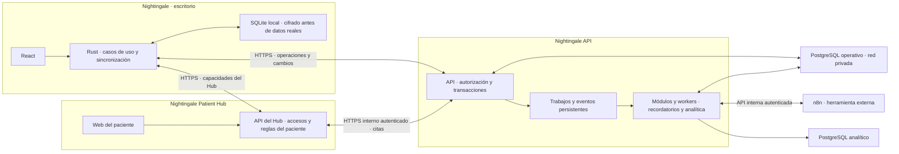

# ADR: Tres proyectos y sincronización transaccional por API

**Estado:** Aceptada por el usuario el 2026-10-21; actualización documental, sin implementación de servicios.
**Fecha:** 2026-10-21
**Sustituye:** el acceso directo del escritorio a PostgreSQL y el reparto cloud del [ADR anterior](native-desktop-cloud-boundaries.md). Conserva operación local, herramientas, plataformas, permisos offline y alcance del producto.

**Revisión documental del 2026-10-23:** D06 del repositorio de API concreta identidad y permisos al aceptar. El usuario aprueba P05/P06 y puede cambiarlos antes o durante la implementación. Se conservan la aceptación histórica de los tres proyectos y las rutas del escritorio; este ajuste no acredita implementación.

## Contexto

Un equipo puede estar intervenido. Sus validaciones Rust y sus credenciales no prueban que una operación remota esté permitida. El usuario decidió conservar los casos de uso nativos y poner la aceptación de cambios compartidos detrás de una API. Después confirmó tres proyectos separados, el paso del Hub por esa API para cambiar citas y la asignación de recordatorios, n8n y analítica a módulos y workers de Nightingale API.

## Decisión

| Proyecto y repositorio propio | Responsabilidad |
|---|---|
| **Nightingale** | Escritorio Tauri, React, Rust y SQLite; operación local, Outbox, sincronización y conflictos. |
| **Nightingale Patient Hub** | Web móvil y API propia; enlaces, acceso y reglas del paciente para citas existentes; solicitudes de reprogramación. |
| **Nightingale API** | Python/FastAPI; autorización remota, aceptación transaccional, sincronización y acceso privado al PostgreSQL operativo; módulos y workers de apoyo. |

Los workers acceden solo a los datos de su módulo con permisos propios; no modifican citas por SQL fuera de la aceptación transaccional común. El diagrama no representa una única transacción entre servicios ni garantiza disponibilidad.

### Operación local y aceptación remota

Rust valida el estado conocido y guarda entidad y Outbox en una transacción SQLite. No espera a la red. Los datos ya recibidos o creados siguen disponibles tras reiniciar; una cita pendiente no garantiza una reserva compartida.

La API recibe operaciones completas, no SQL ni asignaciones libres de campos. Comprueba identidad, dispositivo, cuenta, permisos, transición, versión y restricciones compartidas. Registra efecto, resultado idempotente, historial/auditoría y Change Log en una transacción PostgreSQL. Confirma después del commit. Un reintento autorizado recupera el resultado previo; reutilizar el identificador con otro contenido se rechaza.

Los lotes son pequeños y devuelven resultados por operación; las dependencias causales se declaran. No forman una transacción global obligatoria. Rust conserva la intención ante conflictos y aplica cada página remota junto a su cursor en una transacción local.

### Patient Hub

El Hub valida enlaces, alcance y reglas propias del paciente. Consulta el estado de citas y envía sus acciones a Nightingale API mediante un contrato interno autenticado. API vuelve a comprobar el alcance y las reglas compartidas; una identidad de servicio no concede acceso general a todas las cuentas.

Solo Nightingale API acepta escrituras compartidas de citas. El Hub conserva la propiedad de sus accesos y solicitudes; no recibe credenciales del PostgreSQL operativo. Su almacenamiento privado se concretará en su plan. Una solicitud de reprogramación no reserva un horario. Los reintentos y la consulta de resultados resuelven respuestas perdidas sin afirmar una aceptación que no se conoce.

### Seguridad, rendimiento y trabajo de apoyo

- PostgreSQL operativo permanece en red privada. Solo procesos cloud autorizados reciben credenciales de base de datos, con permisos mínimos; migraciones usan una identidad distinta.
- Toda entrada exige autorización; no se confía en `practice_id`, fechas o validaciones declaradas por el escritorio. El servidor aplica transiciones y reglas comunes también a acciones del Hub.
- Rust conserva los últimos permisos válidos sin red; cambiarlos requiere conexión. D06 confirma OIDC externo y permisos vigentes al aceptar: API rechaza sin efecto si falta permiso y el escritorio conserva la intención para revisión. Proveedor, sesiones, vínculo de dispositivos, orden concurrente de aceptación/revocación y recorrido de revisión siguen pendientes. No se promete revocación instantánea offline.
- Recordatorios, integración con n8n y ETL pertenecen a Nightingale API como módulos y workers. La transacción registra la intención duradera; el trabajo externo ocurre después y admite reintentos.
- No se llama a WhatsApp, n8n, Hub ni analítica dentro de la transacción de una operación nativa. No se promete un tiempo fijo: se medirán por separado guardado local, respuesta remota y demora de sincronización.
- Cifrado y claves locales deben definirse antes de datos reales. Una API no evita que quien controla un equipo lea datos ya descifrados o use su sesión mientras siga autorizada.

## Contratos y documentación

Nightingale API posee el contrato de aceptación/descarga y las migraciones del PostgreSQL operativo. El Hub posee su contrato público y sus datos privados. Ambos acuerdan el contrato interno y la invalidación de confirmaciones al reprogramar; no mantienen dos versiones independientes de las reglas compartidas.

La [referencia de API](../specifications/nightingale-api.md) identifica la fuente que ya se mantiene en el repositorio de Nightingale API. La [especificación inicial del Patient Hub](../specifications/nightingale-patient-hub.md) sigue como consulta hasta el traslado explícito a su repositorio. No se crean ahora repositorios, servicios ni contratos ejecutables.

### Criterios funcionales revisables del 2026-10-23

El usuario aprueba estos criterios y se reserva cambiarlos antes o durante la implementación. No cierran las reglas de detalle ni autorizan implementar las etapas pendientes:

- **P05:** el Hub conserva la solicitud de reprogramación separada del estado de cita. Pedir un cambio conserva estado, horario y confirmación; `reschedule_requested` deja de ser un estado de Citas. Una reprogramación aceptada cambia horario e invalida confirmación en la misma transacción de API. El ciclo de solicitud, duplicados, retirada, rechazo y conciliación siguen pendientes.
- **P06:** la respuesta a una oferta de lista de espera expresa interés; el personal autorizado pide a API asignar el horario. API comprueba oferta, permisos, disponibilidad y versiones al reservar. Sin personal conectado no se adjudica por la sola respuesta; no se amplían las acciones públicas del Hub. Canal, prioridad, vencimiento y casos tardíos siguen pendientes.

Estos criterios sustituyen la propuesta de DAT §11 de usar la solicitud como estado de cita y la lectura de SRS §9 que equipara respuesta a oferta con asignación. Se conservan los identificadores P05/P06 de su registro inicial en API para seguir las revisiones.

## Alternativas y consecuencias

- Se descarta el acceso SQL desde el escritorio: obligaría a proteger la aceptación remota en permisos y código de base de datos accesibles desde equipos no confiables.
- Se descarta hacer de Rust un mero cliente de formularios: el trabajo local y su persistencia mantienen sus casos de uso nativos.
- Se descarta una API que guarde sin validar: no protege frente a un ejecutable modificado.
- Las comprobaciones locales y remotas se superponen deliberadamente; sus pruebas deben impedir divergencias. Los contratos y las migraciones necesitan compatibilidad con escritorios aún soportados.

## Pendientes

Proveedor OIDC y sesiones concretas, vínculo de dispositivos, orden concurrente de aceptación/revocación y recorrido de revisión, claves SQLite, almacenamiento privado del Hub, orden confirmado y retención del Change Log, contratos HTTP exactos, proveedor cloud, cola, métricas de aceptación, RPO/RTO y retención. OIDC externo y permisos vigentes al aceptar ya están confirmados por D06. Las especificaciones fijan límites; no acreditan su seguridad ni rendimiento por ejecución.

## Fuentes técnicas

- [OWASP: seguridad de bases de datos](https://cheatsheetseries.owasp.org/cheatsheets/Database_Security_Cheat_Sheet.html): aislamiento de la base y acceso de aplicaciones instaladas mediante API.
- [OWASP: seguridad REST](https://cheatsheetseries.owasp.org/cheatsheets/REST_Security_Cheat_Sheet.html): HTTPS, autorización y validación de estados.
- [PostgreSQL 18: transacciones](https://www.postgresql.org/docs/18/tutorial-transactions.html) y [restricciones](https://www.postgresql.org/docs/18/ddl-constraints.html): integridad y aceptación atómica, sin prometer rapidez.
