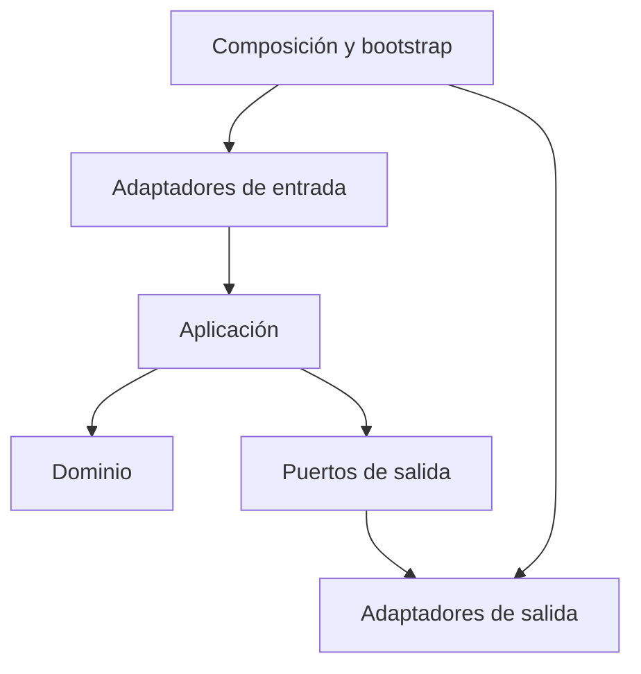
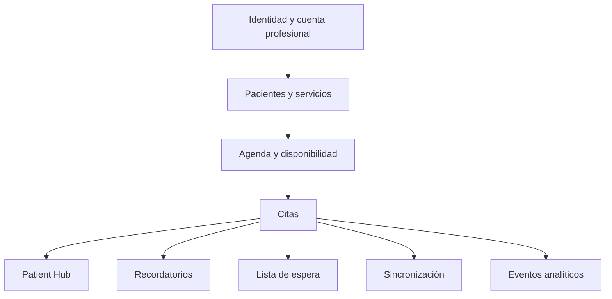

# Plan Maestro de Desarrollo de Nightingale

**Versión:** 0.1  
**Fecha:** 19/10/2026  
**Estado:** Fuente de verdad técnica inicial  
**Ámbito:** Estructura y reglas para el desarrollo del sistema  

## 1. Función de este documento

Este documento es la fuente de verdad para organizar el desarrollo de Nightingale. Define qué partes forman el sistema, qué responsabilidad tiene cada una, cómo se relacionan y qué reglas deberán respetar sus implementaciones.

Su finalidad es servir como referencia al momento de crear especificaciones particulares, decisiones técnicas, pruebas, tareas o planes de ejecución. Esas actividades podrán derivarse de este documento, pero no forman parte de él.

Este documento no contiene:

- Backlog.
- Tareas.
- Historias de usuario.
- Estimaciones.
- Fechas de entrega.
- Asignaciones de trabajo.
- Priorización visual.
- Estados de ejecución.
- Un orden obligatorio de implementación.
- Diseño visual definitivo.

Cuando una decisión posterior contradiga este documento, deberá modificarse el plan maestro o registrarse una excepción explícita. No se deberá mantener una implementación incompatible por conocimiento informal.

## 2. Lenguaje normativo

Los términos se interpretarán de la siguiente manera:

- **Deberá:** requisito obligatorio.
- **No deberá:** prohibición obligatoria.
- **Debería:** recomendación que solo podrá omitirse con una razón documentada.
- **Podrá:** opción permitida, pero no exigida.
- **Pendiente:** decisión que todavía no puede considerarse parte definitiva del diseño.

Los ejemplos de nombres, rutas o contratos explican una intención. Solo serán obligatorios cuando el texto los identifique expresamente como convención.

## 3. Documentos de referencia

Este plan evita repetir información que ya está definida en otros documentos.

| Código | Documento | Responsabilidad |
|---|---|---|
| SRS | `docs/srs.md`, versión 0.2 | Visión, usuarios, alcance y requisitos funcionales |
| DAT | `docs/technical-architecture.md`, versión 0.1 | Arquitectura general, flujos, sincronización, despliegue y decisiones técnicas |
| PMD | Este documento | Estructura normativa para desarrollar componentes y módulos |

Reglas de precedencia:

1. La intención funcional procede de la SRS y de las decisiones posteriores confirmadas.
2. La arquitectura general procede del DAT.
3. La organización interna del código y los límites de componentes proceden del PMD.
4. Una decisión registrada con posterioridad podrá reemplazar una anterior si identifica claramente qué sustituye.
5. Ante una contradicción no resuelta, la implementación deberá detenerse en el punto afectado hasta actualizar la fuente de verdad correspondiente.

Referencias principales al DAT:

- Principios de arquitectura: DAT, sección 4.
- Vista general y componentes desplegables: DAT, secciones 6 y 7.
- Modos de operación: DAT, sección 8.
- Sincronización: DAT, secciones 9 y 10.
- Estados y flujos de citas: DAT, secciones 11 y 12.
- Modelo conceptual de datos: DAT, sección 13.
- Recordatorios y cola: DAT, sección 15.
- Analítica y ETL: DAT, sección 16.
- Seguridad, despliegue y operación: DAT, secciones 17 a 22.

## 4. Alcance consolidado

### 4.1 Segmento inicial

Nightingale estará orientado inicialmente a:

- Médicos independientes.
- Especialistas con consulta privada.
- Asistentes autorizados por esos profesionales.

Las clínicas con múltiples médicos, sedes, departamentos o estructuras administrativas complejas se mantienen fuera del alcance inicial.

### 4.2 Superficies del producto

El sistema estará compuesto por las siguientes superficies:

1. Aplicación de escritorio para el médico y sus asistentes.
2. API y servicios cloud.
3. Patient Hub web para gestionar citas existentes.
4. Procesamiento de recordatorios y comunicaciones.
5. Servicio web de analítica.
6. Flujos internos de n8n.

### 4.3 Regla del Patient Hub

El Patient Hub no permitirá crear citas nuevas. Solo podrá operar sobre citas previamente registradas por el médico o su asistente.

El paciente podrá:

- Consultar su cita.
- Confirmarla.
- Cancelarla dentro de las reglas permitidas.
- Solicitar una reprogramación.
- Consultar el estado resultante.

Una solicitud de reprogramación no modificará directamente la agenda.

### 4.4 Regla de operación offline

La aplicación de escritorio deberá continuar operando con SQLite durante una interrupción de conexión. PostgreSQL será la fuente central de verdad y resolverá el estado compartido entre dispositivos.

Las reservas creadas sin conexión serán provisionales hasta ser aceptadas por el servidor.

### 4.5 Regla de concurrencia

Una cuenta profesional podrá utilizar varios dispositivos concurrentes. La coordinación se mantendrá sencilla mediante:

- Restricciones en PostgreSQL.
- Transacciones breves.
- Idempotencia.
- Versionado optimista.
- Recarga del estado actual ante conflictos.

No se incorporarán CRDT, bloqueos distribuidos ni event sourcing completo en el alcance inicial.

## 5. Decisiones confirmadas y abiertas

### 5.1 Confirmadas

| Área | Decisión |
|---|---|
| Escritorio | Tauri |
| Núcleo local | Rust |
| Interfaz | React y TypeScript |
| Estilos del esqueleto | TailwindCSS sin sistema visual definitivo |
| Persistencia local | SQLite por dispositivo |
| Persistencia central | PostgreSQL |
| Concurrencia | Varios dispositivos por cuenta profesional |
| Arquitectura interna | Arquitectura hexagonal |
| Organización | Empaquetado por componentes |
| Sincronización | API, Outbox local, idempotencia, cursores y versiones |
| Patient Hub | Solo gestiona citas existentes |
| Recordatorios | Ejecución cloud independiente del escritorio |
| Orquestación | n8n como adaptador, no como propietario del dominio |
| Analítica | ETL y PostgreSQL analítico separado del flujo operativo |
| UI inicial | Esqueleto Tauri funcional, sin diseño final |
| IA | Fuera del alcance inicial; proveedor sin definir |

### 5.2 Abiertas

| Área | Estado |
|---|---|
| Lenguaje y framework del backend cloud | Abierto |
| Proveedor cloud | Abierto; AWS y DigitalOcean son candidatos |
| Broker o cola final | Abierto |
| Sistema operativo inicial | Abierto |
| Cifrado de SQLite | Abierto |
| Autenticación cloud | Abierta |
| Duración fija o variable de citas | Abierta |
| Proveedor oficial de WhatsApp | Abierto |
| Frecuencia del ETL | Abierta |
| RPO, RTO y retención | Abiertos |

Las decisiones abiertas deberán expresarse mediante puertos, contratos o límites que permitan reemplazar adaptadores. No deberán ocultarse detrás de dependencias concretas elegidas de manera accidental.

## 6. Modelo arquitectónico interno

Nightingale utilizará arquitectura hexagonal dentro de cada componente funcional.



### 6.1 Dominio

El dominio contendrá:

- Entidades.
- Objetos de valor.
- Invariantes.
- Políticas puras.
- Servicios de dominio cuando una regla no pertenezca a una única entidad.
- Eventos de dominio.
- Errores del dominio.

El dominio no deberá depender de:

- Tauri.
- React.
- SQLite.
- PostgreSQL.
- HTTP.
- n8n.
- WhatsApp.
- El reloj del sistema.
- Generadores concretos de identificadores.
- Variables de entorno.
- Bibliotecas de infraestructura.

### 6.2 Aplicación

La capa de aplicación contendrá:

- Casos de uso.
- Comandos y consultas.
- Coordinación de transacciones.
- Puertos de entrada.
- Puertos de salida.
- DTO internos.
- Autorización contextual.
- Mapeo de errores del dominio hacia resultados de aplicación.

La aplicación podrá depender del dominio de su componente y de contratos públicos permitidos de otros componentes. No dependerá de adaptadores concretos.

### 6.3 Puertos

Los puertos describirán capacidades necesarias, no tecnologías.

Ejemplos:

- `AppointmentRepository`
- `PatientRepository`
- `UnitOfWork`
- `Clock`
- `IdGenerator`
- `MessagePublisher`
- `ReminderScheduler`
- `AuditSink`
- `SyncOperationStore`
- `AccessTokenIssuer`

Un puerto no deberá llamarse `PostgresAppointmentRepository` ni incluir detalles de una biblioteca concreta.

### 6.4 Adaptadores de entrada

Podrán incluir:

- Comandos Tauri.
- Endpoints HTTP.
- Webhooks.
- Consumidores de cola.
- Flujos invocados por n8n.
- Procesos programados.
- Herramientas administrativas limitadas.

Los adaptadores de entrada validarán forma, autenticación y traducción de transporte. Las reglas de negocio permanecerán en dominio y aplicación.

### 6.5 Adaptadores de salida

Podrán incluir:

- Repositorios SQLite.
- Repositorios PostgreSQL.
- Cliente HTTP de sincronización.
- Broker de mensajes.
- Proveedor de WhatsApp.
- Almacenamiento seguro del sistema operativo.
- Reloj real.
- Generador UUID.
- n8n.
- Servicio analítico.

### 6.6 Composición

La composición será el único lugar que conozca las implementaciones concretas de los puertos.

Se encargará de:

- Cargar configuración.
- Construir adaptadores.
- Conectar puertos con implementaciones.
- Definir ciclos de vida.
- Iniciar procesos.
- Registrar cierres ordenados.

No contendrá reglas de negocio.

## 7. Empaquetado por componentes

Cada componente será una unidad funcional con:

- Lenguaje propio del dominio.
- Datos de los que es propietario.
- API pública interna.
- Casos de uso.
- Puertos.
- Adaptadores.
- Pruebas.

La estructura conceptual será:

```text
components/
  <component-name>/
    domain/
      entities/
      value_objects/
      policies/
      events/
      errors/
    application/
      commands/
      queries/
      use_cases/
      dto/
      ports/
    adapters/
      inbound/
      outbound/
    contracts/
    tests/
    mod-or-index
```

No todos los directorios deberán existir si están vacíos. La estructura se aplicará para clarificar límites, no para producir carpetas ceremoniales.

### 7.1 API pública del componente

Cada componente expondrá únicamente:

- Casos de uso autorizados.
- DTO contractuales.
- Eventos públicos.
- Tipos compartidos deliberadamente.

No se importarán repositorios internos, tablas, entidades privadas ni utilidades de otro componente.

### 7.2 Dependencias entre componentes

Las dependencias deberán ser explícitas y dirigidas.

Un componente podrá relacionarse con otro mediante:

- Su API de aplicación pública.
- Un puerto declarado por el consumidor.
- Un evento público.
- Un contrato de transporte versionado.

No se permitirán consultas directas a las tablas propiedad de otro componente desde la lógica de aplicación.

### 7.3 Datos compartidos

Se evitará una carpeta global de modelos que convierta todas las entidades en dependencias comunes.

Solo podrán compartirse primitivas verdaderamente transversales, como:

- `PracticeId`
- `UserId`
- `DeviceId`
- `OperationId`
- Instantes UTC.
- Códigos de error estables.
- Metadatos de auditoría.

## 8. Estructura del repositorio

Se utilizará un monorepo como estructura base. Permitirá mantener contratos, aplicaciones y documentación coordinados sin obligar a que todos los servicios utilicen el mismo lenguaje.

```text
nightingale/
  apps/
    desktop/
      web/
        src/
          app/
          components/
          features/
          routes/
          shared/
      src-tauri/
        src/
          bootstrap/
          components/
          shared_kernel/
          platform/
        migrations/
        capabilities/
        tests/
    patient-hub/
      src/
    analytics-web/
      src/

  services/
    core-api/
      src/
        bootstrap/
        components/
        shared_kernel/
      migrations/
      tests/
    reminder-runtime/
      src/
    analytics-api/
      src/
    etl/
      src/

  contracts/
    api/
    events/
    schemas/
    generated/

  automation/
    n8n/
      workflows/
      credentials.example/
      README.md

  infrastructure/
    local/
    environments/
    observability/
    database/

  test-support/
    fixtures/
    builders/
    fakes/
    scenarios/

  docs/
    architecture/
    decisions/
    contracts/
    operations/

  scripts/
  README.md
```

### 8.1 Carácter conceptual

La estructura fija responsabilidades y límites. Los nombres exactos de archivos generados, manifiestos o carpetas propias del framework podrán adaptarse cuando se elija el backend.

### 8.2 Workspaces

El monorepo podrá combinar:

- Un workspace de Rust para el núcleo Tauri y otros crates compatibles.
- Un workspace JavaScript o TypeScript para interfaces y herramientas.
- Servicios cloud con su propio sistema de construcción si el lenguaje elegido lo requiere.

No se obligará al backend a utilizar Rust únicamente por compartir repositorio.

### 8.3 Contratos generados

El directorio `contracts/generated` contendrá código producido desde fuentes contractuales. No deberá editarse manualmente.

Los contratos fuente deberán ser independientes del lenguaje para permitir generar clientes para TypeScript, Rust u otra tecnología.

## 9. Catálogo de componentes

El catálogo define propiedad funcional. Un componente no equivale necesariamente a un proceso desplegable o microservicio. Varios componentes podrán convivir en una misma aplicación o servicio mientras mantengan sus límites internos.



La dirección del diagrama indica dependencia conceptual, no orden de implementación.

### 9.1 Identidad y acceso

**Responsabilidad:** autenticar personas y representar sus permisos.

**Propiedad:**

- Usuarios.
- Roles.
- Sesiones.
- Credenciales o referencias a un proveedor de identidad.
- Intentos de acceso relevantes.

**Casos de uso públicos:**

- Iniciar y cerrar sesión.
- Renovar una sesión.
- Consultar la identidad activa.
- Asignar o revocar un rol permitido.
- Revocar sesiones.

**Puertos requeridos:**

- Almacén de identidades.
- Verificador de credenciales.
- Emisor de sesión.
- Reloj.
- Auditoría.

**Invariantes:**

- Cada acción deberá vincularse con una identidad o actor técnico.
- Un usuario no podrá operar fuera de una cuenta profesional autorizada.
- Médico y asistente no compartirán una misma identidad.

La autenticación concreta permanece abierta. El dominio no dependerá de un proveedor específico.

### 9.2 Cuenta profesional

**Responsabilidad:** representar el espacio aislado del médico o especialista.

**Propiedad:**

- `practice`.
- Membresías de usuarios.
- Preferencias operativas propias de la cuenta.
- Zona horaria y localización administrativa.

**Casos de uso públicos:**

- Consultar la cuenta activa.
- Actualizar datos administrativos permitidos.
- Gestionar miembros autorizados.
- Configurar reglas generales del servicio.

**Invariantes:**

- Toda entidad operativa deberá pertenecer a una cuenta profesional.
- Ninguna consulta podrá devolver datos de otra cuenta.
- El modelo deberá permitir una evolución futura hacia clínicas sin exponer funciones de clínica en la primera versión.

### 9.3 Dispositivos

**Responsabilidad:** identificar y controlar instalaciones de escritorio.

**Propiedad:**

- Identidad del dispositivo.
- Estado de autorización.
- Usuario que lo registró.
- Última sincronización conocida.
- Versión de aplicación y esquema local reportados.

**Casos de uso públicos:**

- Registrar un dispositivo.
- Renovar su autorización.
- Listar dispositivos de la cuenta.
- Revocar un dispositivo.
- Reportar versión y estado de sincronización.

**Invariantes:**

- Una operación de sincronización deberá identificar dispositivo y usuario.
- Un dispositivo revocado no podrá enviar ni descargar cambios.
- La revocación deberá activar el tratamiento local definido para credenciales y datos.

### 9.4 Pacientes

**Responsabilidad:** conservar la identidad administrativa y los datos de contacto necesarios para gestionar citas.

**Propiedad:**

- Identificador interno.
- Nombres y apellidos.
- Datos de contacto.
- Preferencias y consentimiento de comunicación.
- Estado activo o inactivo.
- Metadatos de versión y auditoría.

**Casos de uso públicos:**

- Registrar paciente.
- Consultar paciente.
- Buscar pacientes dentro de la cuenta.
- Actualizar datos administrativos.
- Desactivar o fusionar duplicados mediante una operación controlada.

**Invariantes:**

- No se almacenará información clínica en este componente.
- Las búsquedas siempre estarán limitadas por `practice_id`.
- Los datos obligatorios deberán ser mínimos y configurados de forma coherente.
- Los cambios de contacto no alterarán retroactivamente el historial de entregas.

**Eventos públicos:**

- `PatientRegistered`
- `PatientContactUpdated`
- `PatientDeactivated`

### 9.5 Catálogo de servicios

**Responsabilidad:** describir los tipos de consulta ofrecidos por el profesional.

**Propiedad:**

- Nombre del servicio.
- Duración o regla de bloques.
- Estado activo.
- Instrucciones administrativas permitidas.
- Reglas de recordatorio asociables.

**Casos de uso públicos:**

- Registrar servicio.
- Modificar configuración.
- Activar o desactivar servicio.
- Consultar servicios disponibles.

**Invariantes:**

- Una cita deberá referenciar una versión válida o una instantánea suficiente del servicio.
- Desactivar un servicio no cancelará automáticamente citas existentes.
- La duración no podrá cambiar silenciosamente citas ya programadas.

La representación de duración fija o múltiples bloques permanece abierta.

### 9.6 Agenda y disponibilidad

**Responsabilidad:** determinar qué intervalos pueden utilizarse para citas.

**Propiedad:**

- Reglas habituales de horario.
- Excepciones.
- Bloqueos.
- Ausencias del profesional.
- Zona horaria aplicable.
- Proyección de espacios disponibles.

**Casos de uso públicos:**

- Definir horario habitual.
- Añadir o retirar un bloqueo.
- Consultar disponibilidad.
- Validar un intervalo solicitado.
- Proponer alternativas disponibles.

**Puertos requeridos:**

- Repositorio de reglas de agenda.
- Consulta de ocupación proporcionada mediante contrato con Citas.
- Reloj.

**Invariantes:**

- La disponibilidad será una conclusión, no un estado duplicado sin control.
- Una excepción explícita tendrá prioridad sobre una regla habitual.
- Toda operación temporal utilizará instantes UTC internamente y la zona de la cuenta para presentación.
- La validación definitiva deberá ejecutarse en PostgreSQL al aceptar una reserva.

**Eventos públicos:**

- `ScheduleRuleChanged`
- `ScheduleBlockCreated`
- `ScheduleBlockRemoved`

### 9.7 Citas

**Responsabilidad:** gobernar el ciclo de vida de una reserva médica administrativa.

**Propiedad:**

- Cita.
- Estado de negocio.
- Horario e intervalo.
- Paciente y servicio asociados.
- Historial de cambios.
- Confirmación.
- Resultado administrativo de asistencia.

**Casos de uso públicos:**

- Crear cita.
- Consultar cita.
- Consultar agenda de citas.
- Confirmar.
- Cancelar.
- Reprogramar.
- Registrar atención.
- Registrar ausencia.
- Aplicar una acción autorizada del Patient Hub.

**Invariantes:**

- Una cita deberá pertenecer a una cuenta, paciente y servicio válidos.
- Una reserva definitiva no podrá solaparse con otra reserva incompatible.
- Una reprogramación conservará el historial.
- Cambiar fecha u hora invalidará la confirmación anterior.
- Una cancelación liberará disponibilidad y no eliminará el historial.
- Ausencia y atención serán estados terminales administrativos.
- Estado de negocio y estado de sincronización serán conceptos separados.

**Eventos públicos:**

- `AppointmentCreated`
- `AppointmentConfirmed`
- `AppointmentRescheduled`
- `AppointmentCancelled`
- `AppointmentCompleted`
- `AppointmentMarkedNoShow`

Los estados y transiciones se definen en DAT, sección 11.

### 9.8 Solicitudes del Patient Hub

**Responsabilidad:** ofrecer acceso limitado a una cita y traducir acciones del paciente a comandos autorizados.

**Propiedad:**

- Referencias de acceso.
- Revocación y vencimiento.
- Solicitudes de reprogramación.
- Intentos relevantes.

**Casos de uso públicos:**

- Emitir acceso para una cita.
- Validar acceso.
- Consultar la vista permitida.
- Confirmar cita.
- Cancelar cita.
- Registrar solicitud de reprogramación.
- Revocar acceso.

**Invariantes:**

- Un acceso solo permitirá ver y operar sobre la cita asociada.
- El Patient Hub no expondrá la agenda general.
- El Patient Hub no creará citas nuevas.
- Una solicitud de reprogramación no reservará un horario.
- Un acceso antiguo no podrá modificar una versión incompatible de la cita.
- La respuesta no incluirá datos internos, auditoría ni información de otros pacientes.

**Eventos públicos:**

- `PatientAccessIssued`
- `PatientConfirmedAppointment`
- `PatientCancelledAppointment`
- `RescheduleRequested`

### 9.9 Recordatorios y comunicaciones

**Responsabilidad:** definir, programar y registrar comunicaciones administrativas relacionadas con citas.

**Propiedad:**

- Política de recordatorios.
- Trabajo persistente de recordatorio.
- Intentos de envío.
- Estado de entrega.
- Respuesta asociada.
- Clave idempotente.

**Casos de uso públicos:**

- Crear recordatorios para una versión de cita.
- Cancelar recordatorios obsoletos.
- Obtener trabajos vencidos.
- Marcar un trabajo en cola.
- Registrar intento y resultado.
- Aplicar respuesta reconocida.
- Programar reintento.

**Invariantes:**

- El registro persistente será la fuente de verdad, no el broker.
- Un trabajo deberá verificar la versión vigente antes de enviar.
- Una clave idempotente impedirá comunicaciones equivalentes duplicadas.
- Una cita cancelada no recibirá recordatorios ordinarios posteriores.
- Los mensajes no incluirán información clínica sensible.
- La IA no será necesaria para ejecutar el flujo inicial.

**Eventos públicos:**

- `ReminderScheduled`
- `ReminderQueued`
- `ReminderSent`
- `ReminderDelivered`
- `ReminderResponded`
- `ReminderFailed`

Los estados operativos se definen en DAT, sección 15.

### 9.10 Lista de espera

**Responsabilidad:** administrar interés por horarios y ofertas derivadas de espacios liberados.

**Propiedad:**

- Entrada de lista de espera.
- Preferencias permitidas.
- Oferta.
- Vencimiento y respuesta.
- Resultado de asignación.

**Casos de uso públicos:**

- Añadir o retirar entrada.
- Consultar candidatos compatibles.
- Crear oferta.
- Aceptar o rechazar oferta.
- Vencer oferta.
- Solicitar asignación de horario a Citas.

**Invariantes:**

- Una aceptación no garantizará el horario hasta que Citas valide disponibilidad.
- Solo habrá una oferta activa por el mismo horario cuando la política así lo requiera.
- La regla de prioridad será explícita y configurable dentro de límites definidos.
- Un paciente inactivo o una entrada retirada no recibirá ofertas.

**Eventos públicos:**

- `WaitlistEntryCreated`
- `WaitlistOfferCreated`
- `WaitlistOfferAccepted`
- `WaitlistOfferExpired`
- `WaitlistSlotAssigned`

### 9.11 Sincronización

**Responsabilidad:** intercambiar operaciones y cambios entre cada SQLite local y la fuente central.

**Propiedad local:**

- `sync_outbox`.
- `sync_inbox`.
- `sync_cursor`.
- Resultado local de operaciones.
- Estado visible de sincronización.

**Propiedad cloud:**

- Registro de operaciones procesadas.
- Resultados idempotentes.
- Registro incremental de cambios.
- Cursores.
- Conflictos.

**Casos de uso públicos:**

- Registrar operación local.
- Enviar lote de operaciones.
- Aplicar resultado.
- Descargar cambios.
- Aplicar cambios remotos.
- Registrar conflicto.
- Reintentar operación.

**Invariantes:**

- Cambiar una entidad local y registrar su Outbox será una única transacción.
- Reenviar una operación no repetirá sus efectos.
- El orden se preservará cuando exista dependencia causal.
- Un conflicto no eliminará silenciosamente la intención local.
- Un error individual no bloqueará operaciones independientes del lote.
- El cursor avanzará únicamente después de aplicar correctamente los cambios asociados.

La semántica completa se define en DAT, secciones 9 y 10.

### 9.12 Auditoría

**Responsabilidad:** conservar una traza inmutable de acciones relevantes.

**Propiedad:**

- Actor.
- Cuenta.
- Dispositivo.
- Acción.
- Entidad afectada.
- Instante.
- Correlación.
- Resultado.
- Metadatos permitidos.

**Invariantes:**

- La auditoría no sustituirá el historial funcional de una entidad.
- No almacenará secretos ni cuerpos innecesarios.
- Los adaptadores no podrán modificar eventos ya registrados.
- Las acciones del paciente y actores técnicos se diferenciarán.

### 9.13 Eventos operativos y analítica

**Responsabilidad:** publicar hechos operativos estables y transformarlos en proyecciones analíticas.

**Propiedad operacional:**

- Outbox de eventos analíticos.
- Cursor de exportación.

**Propiedad analítica:**

- Hechos de citas.
- Hechos de comunicaciones.
- Dimensiones seudonimizadas.
- Agregados e indicadores.

**Invariantes:**

- Una falla analítica no afectará una transacción de citas ya confirmada.
- Los eventos deberán ser reejecutables o deduplicables.
- Los indicadores deberán documentar numerador, denominador y ventana temporal.
- La identidad personal solo se copiará cuando exista una necesidad aprobada.

### 9.14 Configuración

**Responsabilidad:** representar configuración validada sin mezclarla con reglas de negocio.

Tipos de configuración:

- Configuración de aplicación.
- Configuración por entorno.
- Configuración por cuenta profesional.
- Preferencias por dispositivo.
- Secretos.

**Invariantes:**

- Los secretos no formarán parte de archivos versionados.
- Toda configuración tendrá un valor validado o producirá un error de inicio claro.
- Una preferencia local no podrá reemplazar una política central obligatoria.

## 10. Distribución de componentes

El mismo componente conceptual podrá tener adaptadores locales y cloud, pero no todas sus capacidades deberán ejecutarse en ambos lados.

| Componente | Escritorio | Cloud operativo | Patient Hub | Analítica |
|---|---|---|---|---|
| Identidad y acceso | Sesión local y credenciales seguras | Autenticación y autorización definitivas | Validación de acceso limitado | No |
| Cuenta profesional | Copia de lectura y preferencias locales | Fuente de verdad | Datos públicos mínimos | Dimensión limitada |
| Dispositivos | Identidad del dispositivo | Registro y revocación | No | Métricas operativas |
| Pacientes | Copia operativa y edición offline | Fuente de verdad | Datos mínimos de la cita | Identificadores seudonimizados |
| Servicios | Copia operativa | Fuente de verdad | Vista de servicio asociada | Dimensión |
| Agenda | Consulta y cambios offline permitidos | Validación definitiva | No expone agenda | Hechos de capacidad |
| Citas | Operación local y provisional | Fuente de verdad | Acciones limitadas | Hechos de cita |
| Patient Hub | No | Emisión y validación | Interfaz pública | Métricas de uso permitidas |
| Recordatorios | Consulta de estado | Fuente de verdad y ejecución | Respuestas del paciente | Hechos de entrega |
| Lista de espera | Gestión local | Fuente de verdad y asignación | Aceptación limitada | Hechos de recuperación |
| Sincronización | Outbox, Inbox y cursor | Idempotencia y Change Log | No | Métricas técnicas |
| Auditoría | Buffer mínimo si es necesario | Registro central | Genera eventos | Uso restringido |

### 10.1 Regla de autoridad

La columna “fuente de verdad” significa que cualquier estado compartido deberá ser confirmado por PostgreSQL antes de considerarse definitivo para otros dispositivos o servicios.

### 10.2 Regla de disponibilidad local

Solo se copiarán a SQLite los datos que el dispositivo necesita para operar. No se utilizará la base local como réplica indiscriminada de todos los datos históricos.

La ventana y profundidad de datos locales deberán ser configurables o ampliables sin romper contratos.

## 11. Kernel compartido y primitivas

El kernel compartido será deliberadamente pequeño.

### 11.1 Tipos permitidos

- Identificadores tipados.
- `PracticeId`.
- `UserId`.
- `DeviceId`.
- `PatientId`.
- `AppointmentId`.
- `OperationId`.
- `CorrelationId`.
- Instante UTC.
- Zona horaria validada.
- Número de versión.
- Metadatos de actor.
- Resultado paginado genérico.
- Códigos de error transversales.

### 11.2 Tipos no permitidos

El kernel no contendrá:

- Entidades completas de negocio.
- Repositorios específicos.
- DTO de un componente particular.
- Modelos de base de datos.
- Tipos generados por frameworks.
- Clientes de servicios externos.
- Utilidades sin propietario claro.

### 11.3 Tiempo

Las reglas no llamarán directamente al reloj del sistema. Recibirán un puerto `Clock` o un instante explícito.

Todos los instantes se almacenarán en UTC. La zona horaria de la cuenta se utilizará para reglas locales y presentación.

### 11.4 Identificadores

Los clientes podrán generar UUID sin conexión. Los identificadores no codificarán información personal ni secuencias predecibles.

### 11.5 Versiones

Las entidades sincronizables tendrán un contador de versión independiente de fechas como `updated_at`.

Las fechas servirán para observabilidad y presentación. La versión servirá para control optimista.

## 12. Contratos

### 12.1 Fuente contractual

Los contratos de red y eventos deberán definirse en formatos independientes del lenguaje, por ejemplo OpenAPI, JSON Schema o una alternativa equivalente cuando se decida el transporte.

El backend cloud permanece tecnológicamente abierto. Por ello, los clientes no dependerán de clases internas del servidor.

### 12.2 Reglas de compatibilidad

- Añadir campos opcionales será compatible.
- Eliminar o cambiar el significado de un campo requerirá una nueva versión.
- Los consumidores ignorarán campos desconocidos cuando sea seguro.
- Los valores enumerados desconocidos deberán producir un tratamiento controlado.
- Los contratos indicarán zona temporal, formato y nulabilidad.
- Los identificadores mantendrán el mismo tipo semántico entre sistemas.

### 12.3 Comandos y eventos

Un comando expresa intención y podrá ser rechazado. Un evento expresa un hecho ya aceptado.

Ejemplos:

- Comando: `CreateAppointment`.
- Evento: `AppointmentCreated`.
- Comando: `CancelAppointment`.
- Evento: `AppointmentCancelled`.

No se nombrará como evento una solicitud que todavía pueda fallar.

### 12.4 Metadatos comunes de eventos

Cada evento público incluirá:

- `event_id`.
- `event_type`.
- `event_version`.
- `occurred_at`.
- `practice_id`.
- `aggregate_id` cuando corresponda.
- `aggregate_version`.
- `correlation_id`.
- `causation_id` cuando corresponda.
- Actor permitido o referencia seudonimizada.
- Cuerpo versionado.

### 12.5 Catálogo mínimo de eventos

| Área | Eventos |
|---|---|
| Pacientes | `PatientRegistered`, `PatientContactUpdated`, `PatientDeactivated` |
| Agenda | `ScheduleRuleChanged`, `ScheduleBlockCreated`, `ScheduleBlockRemoved` |
| Citas | `AppointmentCreated`, `AppointmentConfirmed`, `AppointmentRescheduled`, `AppointmentCancelled`, `AppointmentCompleted`, `AppointmentMarkedNoShow` |
| Patient Hub | `PatientAccessIssued`, `PatientConfirmedAppointment`, `PatientCancelledAppointment`, `RescheduleRequested` |
| Recordatorios | `ReminderScheduled`, `ReminderSent`, `ReminderDelivered`, `ReminderResponded`, `ReminderFailed` |
| Lista de espera | `WaitlistEntryCreated`, `WaitlistOfferCreated`, `WaitlistOfferAccepted`, `WaitlistOfferExpired`, `WaitlistSlotAssigned` |
| Dispositivos | `DeviceRegistered`, `DeviceRevoked` |

### 12.6 Errores contractuales

Los límites del sistema utilizarán códigos estables.

Categorías mínimas:

- `VALIDATION_ERROR`
- `AUTHENTICATION_REQUIRED`
- `PERMISSION_DENIED`
- `NOT_FOUND`
- `VERSION_CONFLICT`
- `SLOT_UNAVAILABLE`
- `INVALID_STATE_TRANSITION`
- `IDEMPOTENCY_CONFLICT`
- `RATE_LIMITED`
- `DEPENDENCY_UNAVAILABLE`
- `TEMPORARY_FAILURE`
- `INTERNAL_ERROR`

Los mensajes dirigidos al usuario se traducirán en la interfaz. El contrato no expondrá detalles internos, consultas SQL ni trazas.

## 13. Persistencia

### 13.1 Separación de modelos

Se distinguirán:

- Entidad de dominio.
- Modelo de persistencia.
- DTO de transporte.
- Proyección de lectura.

No se utilizará una misma estructura para las cuatro responsabilidades por comodidad.

### 13.2 SQLite

SQLite deberá:

- Mantener integridad mediante claves y restricciones disponibles.
- Aplicar migraciones versionadas.
- Ejecutar cambios de entidad y Outbox en la misma transacción.
- Mantener índices para agenda, pacientes, estados y sincronización.
- Evitar almacenar secretos en texto plano.
- Permitir reconstrucción desde el estado cloud.

El esquema local podrá diferir del esquema PostgreSQL cuando responda a necesidades locales, siempre que el mapeo sea explícito.

### 13.3 PostgreSQL operativo

PostgreSQL deberá:

- Aplicar aislamiento por `practice_id`.
- Impedir reservas incompatibles mediante una restricción o transacción segura.
- Conservar versiones de entidades sincronizables.
- Registrar operaciones idempotentes.
- Mantener el Change Log.
- Conservar trabajos persistentes de recordatorio.
- Ejecutar migraciones compatibles con despliegues controlados.

### 13.4 Propiedad de tablas

Cada tabla tendrá un componente propietario. Otros componentes no escribirán directamente en ella.

Las consultas que combinen componentes podrán resolverse mediante:

- Proyecciones de lectura.
- Vistas controladas.
- Casos de uso compuestos.
- Eventos y modelos derivados.

### 13.5 Migraciones

Toda migración deberá incluir:

- Identificador único.
- Orden estable.
- Compatibilidad esperada.
- Tratamiento de datos existentes.
- Estrategia de fallo.

La aplicación de escritorio deberá verificar la versión del esquema antes de abrir la base local.

No se ejecutarán migraciones destructivas irreversibles sin un mecanismo de respaldo y una decisión documentada.

### 13.6 Datos de prueba

Los datos semilla para desarrollo no contendrán información real de pacientes. Se utilizarán generadores deterministas y casos representativos.

## 14. Contrato de sincronización

Esta sección define la forma que deberá tener la implementación. La semántica general se encuentra en DAT, sección 9.

### 14.1 Unidad de sincronización

La unidad será una operación, no una fila ni un archivo de base de datos.

Una operación incluirá:

- `operation_id`.
- `device_id`.
- `practice_id`.
- `actor_id`.
- `entity_type`.
- `entity_id`.
- `action`.
- `expected_version`.
- `occurred_at_local`.
- `payload`.
- Versión del contrato.

### 14.2 Resultado por operación

El servidor responderá individualmente:

- `accepted`.
- `duplicate`.
- `conflict`.
- `rejected`.
- `retryable_failure`.

El resultado incluirá la versión central y, cuando sea seguro, una representación suficiente del estado actual.

### 14.3 Lotes

Un lote será un medio de transporte, no una transacción global obligatoria.

- Las operaciones independientes podrán completarse aunque otra falle.
- Las dependencias causales deberán declararse u ordenarse.
- El tamaño máximo será configurable.
- Un lote podrá reintentarse sin duplicar efectos.

### 14.4 Change Log

Cada cambio sincronizable aceptado generará una entrada ordenada.

La entrada contendrá:

- Cursor monotónico u opaco ordenable por el servidor.
- Tipo e identificador de entidad.
- Versión.
- Tipo de cambio.
- Representación o referencia necesaria.
- Instante de aceptación.

El cliente no calculará el cursor siguiente. Utilizará exactamente el entregado por el servidor.

### 14.5 Aplicación local de cambios remotos

Los cambios descargados se aplicarán en una transacción local por página o unidad segura.

El cursor solo avanzará después de completar la transacción.

Si un cambio remoto afecta una entidad con una operación local pendiente:

- Se evaluará si son compatibles.
- Se conservará la intención local.
- Se marcará conflicto cuando no exista una regla segura.
- No se aplicará “último escritor gana” a horario o estado crítico de cita.

### 14.6 Política de conflictos

| Tipo | Política |
|---|---|
| Reserva concurrente | PostgreSQL acepta una; la otra queda rechazada como `SLOT_UNAVAILABLE` |
| Edición sobre versión antigua | `VERSION_CONFLICT` y recarga del estado central |
| Cancelación del paciente frente a cambio local antiguo | La cancelación central prevalece |
| Confirmación frente a reprogramación | La reprogramación invalida la confirmación |
| Cambio de contacto concurrente | Podrá aplicarse último cambio aceptado con auditoría |
| Operación duplicada | Se devuelve el resultado idempotente previo |

### 14.7 Recuperación de un dispositivo

Un dispositivo nuevo o reconstruido deberá:

- Autenticarse.
- Registrar o recuperar su identidad autorizada.
- Crear una base local vacía en la versión correcta.
- Descargar un snapshot o páginas iniciales.
- Establecer un cursor.
- Continuar con cambios incrementales.

No reutilizará una copia local perteneciente a otro dispositivo sin un procedimiento explícito.

## 15. Citas y disponibilidad

### 15.1 Reserva definitiva

Solo el componente Citas en el servidor podrá declarar una reserva definitiva compartida.

El caso de uso deberá:

1. Validar cuenta, actor, paciente y servicio.
2. Validar estado del servicio.
3. Validar disponibilidad.
4. Impedir solapamiento.
5. Crear o modificar la cita.
6. Incrementar versión.
7. Registrar historial y auditoría.
8. Publicar los eventos correspondientes dentro de una estrategia Outbox.

Esta enumeración define responsabilidades de una operación, no una tarea de desarrollo.

### 15.2 Cita provisional local

La creación offline deberá:

- Validarse contra la copia local.
- Guardarse con estado de sincronización `pending`.
- Mostrar claramente su carácter provisional.
- No activar recordatorios cloud hasta ser aceptada.
- Convertirse en definitiva o conflicto al sincronizar.

### 15.3 Bloques de agenda

El diseño deberá soportar una representación que impida solapamientos sin depender de la interfaz.

Hasta decidir duración fija o variable:

- La API conceptual utilizará intervalos de inicio y fin.
- El dominio no asumirá que todas las citas duran lo mismo.
- La UI mínima podrá ofrecer bloques configurables para simplificar pruebas.

### 15.4 Transiciones

Las transiciones autorizadas seguirán DAT, sección 11. Cada transición deberá estar implementada como intención de dominio, no como asignación libre de un campo `status`.

## 16. Recordatorios, cola y n8n

### 16.1 Separación de responsabilidades

| Parte | Responsabilidad |
|---|---|
| Citas | Informar creación, cambio o cancelación |
| Recordatorios | Decidir qué trabajos deben existir |
| Planificador | Identificar trabajos que deben entrar en cola |
| Broker | Transportar el identificador del trabajo |
| Worker o n8n | Ejecutar el flujo de integración |
| Adaptador de WhatsApp | Comunicarse con el proveedor |
| Webhook | Traducir resultados externos |
| PostgreSQL | Conservar el estado definitivo |

### 16.2 Fuente persistente

El broker no será la fuente de verdad. `reminder_job` conservará:

- Identificador.
- Cita y versión de cita.
- Tipo de recordatorio.
- Fecha programada.
- Estado.
- Clave idempotente.
- Intentos.
- Próximo reintento.
- Resultado final.

### 16.3 Publicación segura

La transición de trabajo persistente a cola deberá tolerar fallos entre la escritura en PostgreSQL y la publicación.

Se podrá utilizar:

- Outbox de trabajos.
- Consulta periódica de trabajos vencidos con bloqueo seguro.
- Capacidad equivalente del broker elegido.

La decisión concreta deberá conservar la posibilidad de recuperar trabajos no publicados.

### 16.4 Ejecución

El ejecutor recibirá `reminder_job_id`, consultará el estado actual y verificará:

- Que la cita siga activa.
- Que la versión coincida.
- Que el mensaje no haya sido enviado.
- Que exista consentimiento o habilitación aplicable.
- Que la plantilla sea válida.

Después registrará el intento y su resultado mediante la API interna.

### 16.5 Papel de n8n

n8n será un adaptador de orquestación.

Los flujos versionados deberán:

- Recibir identificadores, no conjuntos completos de datos sensibles cuando no sea necesario.
- Consultar la API interna.
- Utilizar credenciales administradas.
- Informar resultados mediante contratos estables.
- Ser idempotentes o apoyarse en idempotencia del servicio.
- Evitar lógica de disponibilidad o transiciones propias de Citas.

### 16.6 Reintentos y errores

Los errores se clasificarán en:

- Temporales: red, límite de proveedor, indisponibilidad.
- Permanentes: número inválido, plantilla rechazada, acceso revocado.
- De negocio: cita cancelada, versión obsoleta, comunicación no permitida.

Solo los temporales producirán reintentos automáticos.

## 17. Patient Hub

### 17.1 Límite funcional

El Patient Hub será una interfaz pública limitada. No será una versión web del escritorio.

Deberá permitir únicamente:

- Validar el acceso a una cita existente.
- Presentar información administrativa permitida.
- Confirmar.
- Cancelar dentro de las reglas vigentes.
- Solicitar reprogramación.
- Mostrar el resultado de la acción.

### 17.2 Contrato de acceso

El acceso deberá estar asociado con:

- Una cita.
- Una versión o política de actualización.
- Un vencimiento.
- Un alcance de acciones.
- Un estado de revocación.

El token no incluirá datos personales legibles. El servidor almacenará solo la representación necesaria para validarlo de forma segura.

### 17.3 Vista pública

La respuesta destinada al paciente podrá incluir:

- Profesional.
- Servicio.
- Fecha y hora.
- Ubicación administrativa.
- Estado visible.
- Acciones disponibles.
- Instrucciones administrativas aprobadas.

No incluirá:

- Auditoría.
- Notas internas.
- Datos de otros pacientes.
- Historia clínica.
- Diagnóstico.
- Datos de sincronización.
- Identificadores internos innecesarios.

### 17.4 Acciones

- **Confirmar:** aplicará sobre la versión vigente o devolverá el estado actualizado.
- **Cancelar:** será una transición del componente Citas y liberará disponibilidad.
- **Solicitar reprogramación:** creará una solicitud separada; no consultará ni reservará la agenda.

### 17.5 Protección contra abuso

El adaptador web deberá contemplar:

- Límites de solicitudes.
- Registro de intentos relevantes.
- Respuestas que no permitan enumerar citas.
- Protección frente a reutilización indebida.
- Revocación de enlaces.
- Validación de origen cuando corresponda.

## 18. Analítica y ETL

La arquitectura general se define en DAT, sección 16. Esta sección fija los contratos para su desarrollo.

### 18.1 Fuente de datos

La analítica consumirá eventos aceptados o un Change Log autorizado. No ejecutará consultas arbitrarias de alto costo sobre el PostgreSQL operativo desde el panel.

### 18.2 Modelo analítico inicial

Hechos previstos:

- Cita creada.
- Cita confirmada.
- Cita cancelada.
- Cita reprogramada.
- Cita atendida.
- Ausencia.
- Recordatorio programado.
- Recordatorio enviado.
- Entrega registrada.
- Respuesta registrada.
- Oferta de lista de espera.
- Horario recuperado.

Dimensiones previstas:

- Cuenta profesional.
- Servicio.
- Fecha.
- Franja horaria.
- Canal.
- Estado.

La dimensión paciente utilizará un identificador seudonimizado salvo que una necesidad aprobada exija otra cosa.

### 18.3 Definición de indicadores

Cada indicador deberá tener una ficha contractual con:

- Nombre.
- Propósito.
- Numerador.
- Denominador.
- Exclusiones.
- Zona horaria.
- Ventana temporal.
- Frecuencia de actualización.
- Nivel de agregación.
- Tratamiento de correcciones tardías.

Ejemplo conceptual:

```text
Nombre: Porcentaje de ausencias sin aviso
Numerador: citas marcadas como no_show
Denominador: citas completadas + no_show
Exclusiones: canceladas y reprogramadas antes del horario
```

### 18.4 Idempotencia del ETL

El ETL deberá:

- Mantener un cursor.
- Deduplicar por `event_id`.
- Permitir reprocesamiento controlado.
- Aplicar correcciones sin duplicar hechos.
- Registrar su última ejecución exitosa.

### 18.5 Servicio analítico

La API analítica solo ofrecerá consultas predefinidas y autorizadas. No expondrá SQL ni acceso genérico al almacén.

El panel analítico podrá ser web, pero compartirá identidad y aislamiento por cuenta con el sistema central.

## 19. Seguridad transversal

Las responsabilidades generales se definen en DAT, sección 17.

### 19.1 Límites de confianza

Se considerarán límites de confianza:

- React hacia Rust mediante IPC de Tauri.
- Escritorio hacia API cloud.
- Patient Hub hacia API pública.
- API hacia PostgreSQL.
- API hacia broker.
- n8n hacia API interna.
- Webhooks externos hacia el receptor.
- ETL hacia fuentes operativas y analíticas.

Todo dato que cruce un límite deberá validarse nuevamente.

### 19.2 Escritorio

- React no recibirá secretos permanentes.
- Los comandos Tauri serán específicos y limitados por capacidades.
- Rust validará identidad, forma e invariantes.
- Las credenciales locales utilizarán almacenamiento seguro del sistema operativo.
- La base local deberá cifrarse antes de producción con datos reales.
- Los registros locales evitarán información personal innecesaria.

### 19.3 Cloud

- PostgreSQL no será público.
- Los servicios utilizarán identidades separadas.
- Los secretos se administrarán fuera del repositorio.
- Los permisos seguirán mínimo privilegio.
- Todo tráfico externo utilizará TLS.
- Las operaciones internas sensibles estarán autenticadas.

### 19.4 Aislamiento por cuenta

Toda consulta operativa deberá requerir contexto de cuenta. No se confiará en un `practice_id` enviado por el cliente sin verificar membresía.

Las pruebas de aislamiento serán obligatorias para repositorios, endpoints y consultas analíticas.

### 19.5 Datos personales

Se aplicará minimización:

- Solo datos necesarios para citas y comunicación.
- Sin historia clínica en el alcance inicial.
- Sin diagnósticos en mensajes.
- Sin datos personales completos en colas cuando baste un identificador.
- Sin cuerpos sensibles en logs generales.

### 19.6 Auditoría frente a observabilidad

La auditoría registra quién hizo qué. La observabilidad explica cómo se comportó el sistema. No se utilizará una como sustituto de la otra.

## 20. Modelo de errores

### 20.1 Categorías internas

- Error de validación.
- Violación de invariante.
- Transición inválida.
- Falta de autorización.
- Conflicto de versión.
- Recurso no disponible.
- Dependencia temporalmente indisponible.
- Error permanente de integración.
- Error interno inesperado.

### 20.2 Conversión por capas

- El dominio devolverá errores semánticos.
- La aplicación añadirá contexto del caso de uso.
- El adaptador traducirá el error al transporte.
- La interfaz mostrará un mensaje apropiado.
- La observabilidad conservará información técnica mediante un identificador de correlación.

No se mostrarán trazas ni detalles de infraestructura al usuario.

### 20.3 Reintentos

Los casos de uso no reintentarán automáticamente errores de negocio. Solo los adaptadores o coordinadores designados reintentarán fallos clasificados como temporales.

## 21. Observabilidad y operación

### 21.1 Correlación

Cada solicitud, operación de sincronización, ejecución de recordatorio y proceso ETL tendrá un identificador de correlación.

Los eventos derivados conservarán `correlation_id` y, cuando corresponda, `causation_id`.

### 21.2 Logs

Los logs serán estructurados y contendrán:

- Instante.
- Nivel.
- Servicio o proceso.
- Versión.
- Correlación.
- Categoría del evento.
- Resultado.
- Duración cuando corresponda.

No contendrán tokens, contraseñas ni información médica.

### 21.3 Métricas mínimas

- Latencia y errores de API.
- Estado de conexiones a PostgreSQL.
- Operaciones de sincronización aceptadas y rechazadas.
- Conflictos por categoría.
- Tamaño y antigüedad de Outbox.
- Trabajos de recordatorio por estado.
- Reintentos y errores permanentes.
- Entregas y respuestas.
- Cursor y retraso del ETL.
- Errores del Patient Hub.

### 21.4 Salud

Los procesos cloud expondrán comprobaciones separadas de:

- Proceso activo.
- Preparación para recibir tráfico.
- Dependencias esenciales disponibles.

Una dependencia opcional, como analítica, no deberá declarar no disponible a la API de citas.

## 22. Esqueleto funcional de la interfaz

El esqueleto existirá para integrar y comprobar funcionalidad. No representa el diseño visual definitivo.

### 22.1 Principios

- Utilizar componentes simples y accesibles.
- Mantener jerarquía visual mínima.
- Evitar decisiones de marca, color, ilustración o animación.
- No crear un sistema de diseño definitivo.
- No acoplar los casos de uso a los componentes React.
- Permitir inspeccionar estados de sincronización y errores.

### 22.2 Rutas o superficies mínimas

| Superficie | Finalidad técnica |
|---|---|
| Acceso | Probar sesión, dispositivo y cuenta activa |
| Agenda | Consultar citas y disponibilidad local |
| Editor de cita | Crear, cancelar y reprogramar |
| Pacientes | Registrar, buscar y actualizar datos administrativos |
| Solicitudes | Revisar reprogramaciones del Patient Hub |
| Lista de espera | Registrar entradas y procesar ofertas |
| Centro de sincronización | Mostrar conexión, Outbox, última sincronización y conflictos |
| Configuración | Probar preferencias y datos de cuenta permitidos |
| Diagnóstico de desarrollo | Inspeccionar versión, dispositivo y estado de adaptadores sin exponer secretos |

### 22.3 Organización del frontend

```text
apps/desktop/web/src/
  app/
    providers/
    router/
    shell/
  components/
    primitives/
    feedback/
    forms/
  features/
    appointments/
    patients/
    schedule/
    waitlist/
    sync/
    settings/
  routes/
  shared/
    api/
    types/
    validation/
    testing/
```

### 22.4 Dependencias del frontend

- `routes` podrá utilizar `features` y componentes compartidos.
- `features` podrá utilizar contratos generados y primitivas visuales.
- `components/primitives` no dependerá de un componente funcional.
- Ningún componente React ejecutará SQL.
- La comunicación local se realizará mediante una capa de cliente Tauri tipada.
- La comunicación web se realizará mediante clientes generados o contractuales.

### 22.5 Estado de servidor y estado visual

Se distinguirán:

- Datos persistentes locales.
- Datos sincronizados.
- Estado de formularios.
- Estado visual efímero.
- Estado de conexión.

No se mantendrá una segunda copia mutable de entidades completas en un gestor global sin necesidad.

### 22.6 TailwindCSS

TailwindCSS se utilizará para estructura y legibilidad básica. El esqueleto podrá emplear un conjunto neutral de clases, pero no fijará la identidad visual final.

## 23. Estrategia de pruebas

Las pruebas verificarán límites y comportamiento, no detalles accidentales de implementación.

### 23.1 Pruebas de dominio

Deberán cubrir:

- Invariantes.
- Transiciones.
- Políticas temporales.
- Conflictos.
- Idempotencia lógica.
- Casos límite.

No utilizarán bases de datos ni red.

### 23.2 Pruebas de aplicación

Utilizarán puertos falsos o en memoria para verificar:

- Coordinación de casos de uso.
- Transacciones esperadas.
- Publicación de eventos.
- Autorización.
- Traducción de errores.

### 23.3 Pruebas de adaptadores

Verificarán:

- Repositorios SQLite.
- Repositorios PostgreSQL.
- Migraciones.
- Contratos HTTP o transporte elegido.
- Broker.
- Webhooks.
- Almacenamiento seguro.

Las pruebas PostgreSQL utilizarán una instancia real aislada, no una simulación SQLite del comportamiento PostgreSQL.

### 23.4 Pruebas de contratos

Productores y consumidores verificarán la misma fuente contractual.

Deberán detectar:

- Campos eliminados.
- Cambios incompatibles.
- Enumeraciones no tratadas.
- Errores con forma incorrecta.
- Eventos con versión inválida.

### 23.5 Pruebas de sincronización

Escenarios mínimos:

- Crear offline y sincronizar.
- Reenviar la misma operación.
- Interrumpir la respuesta después de aceptar en el servidor.
- Dos dispositivos editan versiones distintas.
- Dos dispositivos reservan el mismo horario.
- Descargar varias páginas de cambios.
- Fallar antes de avanzar el cursor.
- Recuperar un dispositivo nuevo.
- Revocar un dispositivo con operaciones pendientes.

### 23.6 Pruebas de recordatorios

Escenarios mínimos:

- Programación inicial.
- Reprogramación de una cita.
- Cancelación antes del envío.
- Trabajo entregado dos veces por la cola.
- Error temporal y reintento.
- Error permanente.
- Webhook duplicado.
- Respuesta sobre una versión antigua.

### 23.7 Pruebas del esqueleto Tauri

La interfaz mínima deberá permitir verificar de extremo a extremo:

- Crear paciente.
- Crear cita.
- Operar sin conexión.
- Mostrar cambio pendiente.
- Recuperar conexión.
- Resolver o presentar conflicto.
- Recibir una actualización creada desde otra sesión.

### 23.8 Reloj y aleatoriedad

Las pruebas utilizarán relojes e identificadores controlables. No dependerán de la hora real ni de UUID impredecibles cuando afecten el resultado.

### 23.9 Datos de prueba

Se mantendrán builders y fixtures reutilizables por componente. Los fixtures no se convertirán en un modelo global compartido que rompa encapsulación.

## 24. Configuración y secretos

### 24.1 Orden de configuración

La carga podrá combinar:

- Valores seguros por defecto.
- Archivo de desarrollo no sensible.
- Variables de entorno.
- Gestor de secretos.
- Configuración central por cuenta.
- Preferencias locales permitidas.

La precedencia deberá documentarse y probarse.

### 24.2 Validación

Los servicios validarán toda configuración al iniciar. Un valor ausente o inválido producirá un error claro antes de recibir trabajo.

### 24.3 Secretos

Nunca se versionarán:

- Contraseñas.
- Tokens.
- Claves de cifrado.
- Credenciales de proveedores.
- Enlaces firmados reales.
- Copias de bases con información personal.

Los ejemplos utilizarán nombres y valores ficticios.

## 25. Construcción, versiones y publicación

### 25.1 Versionado

Se versionarán de forma identificable:

- Aplicación de escritorio.
- API.
- Esquema SQLite.
- Esquema PostgreSQL.
- Contratos.
- Eventos.
- Flujos n8n.
- ETL.

### 25.2 Compatibilidad

La API deberá declarar qué versiones mínimas del escritorio soporta. Una actualización de servidor no podrá dejar inutilizable sin aviso una instalación todavía soportada.

### 25.3 Escritorio

La distribución deberá contemplar:

- Firma.
- Verificación de actualización.
- Migración local.
- Recuperación ante fallo de actualización.
- Canal de pruebas separado.

### 25.4 Artefactos cloud

Cada servicio deberá producir un artefacto reproducible e identificable. La configuración de entorno permanecerá fuera del artefacto.

### 25.5 Flujos n8n

Los flujos se almacenarán como definiciones versionadas sin credenciales. Los cambios manuales en producción deberán reconciliarse con la fuente versionada.

## 26. Calidad de un componente

Un componente podrá considerarse conforme con el plan cuando:

- Su responsabilidad esté delimitada.
- Declare qué datos posee.
- Exponga una API pública mínima.
- Mantenga dominio y aplicación independientes de adaptadores.
- Defina sus puertos.
- Implemente adaptadores sin filtrar detalles al dominio.
- Utilice errores estables.
- Publique eventos versionados cuando corresponda.
- Incluya pruebas de dominio, aplicación y adaptadores relevantes.
- Respete aislamiento por cuenta.
- Añada observabilidad sin exponer datos sensibles.
- Documente decisiones abiertas o excepciones.

Esta lista es un criterio de conformidad, no una lista de tareas ni una secuencia de desarrollo.

## 27. Reglas de documentación

### 27.1 Decisiones arquitectónicas

Una decisión que afecte a varios componentes deberá registrarse como ADR.

Un ADR incluirá:

- Contexto.
- Decisión.
- Alternativas consideradas.
- Consecuencias.
- Estado.
- Fecha.
- Decisión reemplazada, si existe.

### 27.2 Documentación por componente

Cada componente tendrá un README breve con:

- Responsabilidad.
- Propiedad de datos.
- API pública.
- Puertos.
- Eventos.
- Invariantes.
- Adaptadores disponibles.
- Enlaces a contratos y ADR.

No repetirá explicaciones generales de arquitectura hexagonal.

### 27.3 Diagramas

Los diagramas explicarán relaciones que no sean evidentes mediante texto. No se utilizarán para reproducir listas de archivos o tablas que puedan mantenerse con mayor facilidad.

### 27.4 Código como fuente secundaria

El código refleja una implementación. Este documento define la intención. Si divergen, deberá corregirse la implementación o actualizarse formalmente la intención.

## 28. Excepciones

Una excepción a este plan deberá:

- Identificar la regla afectada.
- Explicar la necesidad.
- Limitar su alcance.
- Registrar consecuencias.
- Indicar si es temporal o permanente.
- Definir qué documento debe actualizarse.

No se aceptarán excepciones implícitas basadas únicamente en urgencia o conveniencia local.

## 29. Decisiones que deberán cerrarse en documentos separados

Este plan conserva abiertos los puntos que requieren evaluación específica:

1. Lenguaje y framework del backend cloud.
2. Protocolo y formato final de la API.
3. Proveedor cloud.
4. Sistema operativo inicial.
5. Estrategia de cifrado de SQLite.
6. Proveedor de identidad o autenticación propia.
7. Cola o broker definitivo.
8. Proveedor de WhatsApp.
9. Duración fija o variable de servicios.
10. Política exacta de recordatorios.
11. Política de lista de espera.
12. Frecuencia y modelo físico del ETL.
13. RPO, RTO y retención.
14. Estrategia futura de inteligencia artificial.

Cada cierre deberá producir una modificación de este documento o un ADR referenciado desde él.

## 30. Resumen normativo

Nightingale se desarrollará como un conjunto de aplicaciones y servicios organizados en un monorepo conceptual. Cada capacidad de negocio se empaquetará como un componente con arquitectura hexagonal propia.

La aplicación de escritorio utilizará Tauri, React, TypeScript, TailwindCSS, Rust y SQLite. La interfaz inicial será un esqueleto funcional para integración y pruebas, sin diseño visual definitivo.

PostgreSQL será la fuente central de verdad. Varios dispositivos podrán operar sobre una misma cuenta profesional. La sincronización utilizará operaciones idempotentes, Outbox local, Change Log, cursores y versiones optimistas. Las citas offline serán provisionales hasta su aceptación central.

El Patient Hub solo gestionará citas existentes. Los recordatorios se ejecutarán en la nube, n8n actuará como adaptador de orquestación y la cola no sustituirá el estado persistente. La analítica estará desacoplada mediante eventos, ETL y un PostgreSQL analítico.

El backend cloud, proveedor de infraestructura, broker, autenticación y otras decisiones abiertas permanecerán detrás de contratos y puertos hasta su definición formal.

Este documento no asigna ni ordena trabajo. Define el sistema que los planes de desarrollo deberán respetar.
