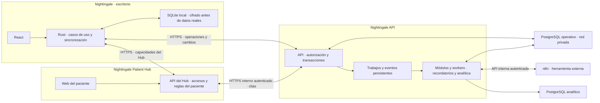
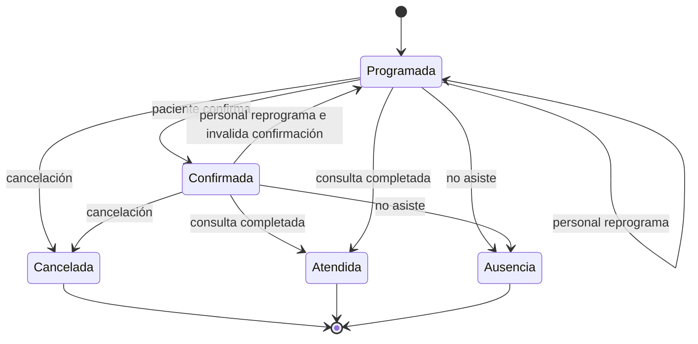
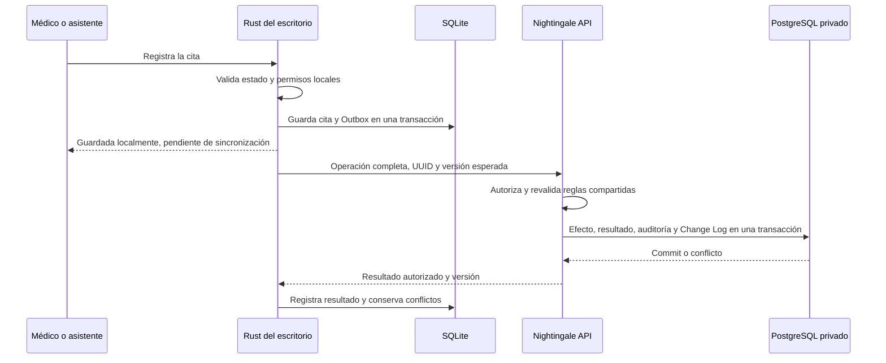
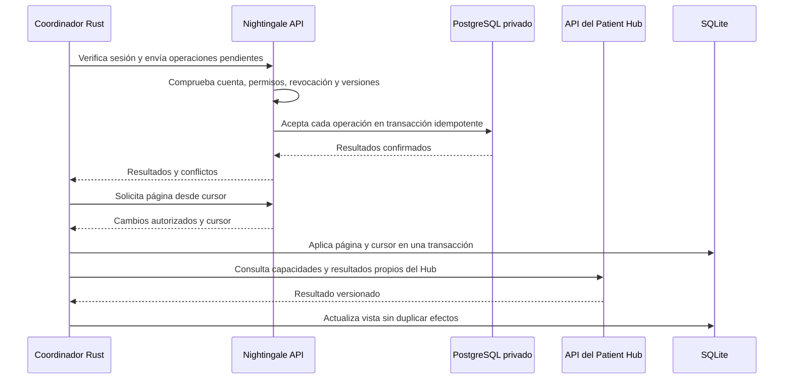
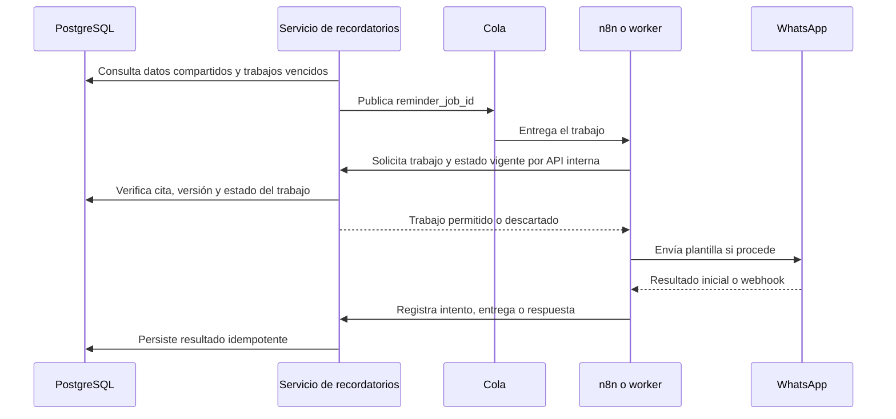
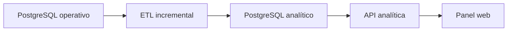

# Documento de Arquitectura Técnica de Nightingale

**Versión:** 0.3\
**Fecha:** 21/10/2026\
**Estado:** Arquitectura revisada por decisión del usuario\
**Documento relacionado:** Especificación de Requisitos de Software de Nightingale, versión 0.5

**Revisión documental del 2026-10-23:** alineación de acceso, transacciones y recordatorios; criterios P05/P06 aprobados por el usuario y revisables antes o durante la implementación. Se conservan las rutas del escritorio para su traslado al repositorio original.

La [decisión de tres proyectos y sincronización transaccional por API](decisions/transactional-sync-three-projects.md), aceptada el 2026-10-21, sustituye el acceso directo del escritorio a PostgreSQL. Mantiene los casos de uso locales en Rust/SQLite. Esta revisión describe la arquitectura objetivo, no funciones implementadas.

## 1. Propósito del documento

Este documento describe la arquitectura técnica propuesta para Nightingale. Su finalidad es convertir las decisiones funcionales del producto en una estructura técnica comprensible antes de comenzar la implementación.

El documento define:

- Los componentes principales del sistema.
- Las responsabilidades de cada componente.
- El funcionamiento con y sin conexión.
- La sincronización entre SQLite y PostgreSQL.
- El comportamiento ante varios dispositivos concurrentes.
- Los flujos de citas, recordatorios y Patient Hub.
- La separación entre datos operativos y analíticos.
- Los criterios iniciales de seguridad, despliegue y recuperación.
- Las decisiones que todavía permanecen abiertas.

No pretende detallar cada clase, tabla, endpoint o tarea de programación. Es una guía para mantener una arquitectura coherente durante el desarrollo.

## 2. Resumen del producto

Nightingale será una aplicación de escritorio dirigida inicialmente a médicos y especialistas independientes. Permitirá administrar pacientes, citas, disponibilidad, recordatorios, confirmaciones, cancelaciones, reprogramaciones, ausencias y listas de espera.

El personal utilizará una aplicación de escritorio. Los pacientes no instalarán Nightingale ni accederán al panel administrativo: utilizarán un Patient Hub web para gestionar citas ya registradas.

El producto deberá continuar funcionando durante interrupciones eléctricas o de conectividad, siempre que el equipo disponga de energía. Cada instalación conservará una base de datos SQLite local y sincronizará sus cambios con PostgreSQL cuando tenga conexión.

## 3. Alcance técnico inicial

### 3.1 Incluido

- Aplicación de escritorio multiplataforma basada en Tauri.
- Interfaz construida con React, TypeScript y TailwindCSS.
- Núcleo local desarrollado en Rust.
- Persistencia local en SQLite.
- Sincronización coordinada por Rust mediante Nightingale API; Patient Hub y API tienen repositorios separados.
- PostgreSQL como fuente central de verdad.
- Varios dispositivos concurrentes por cuenta profesional.
- Patient Hub web para citas existentes.
- Recordatorios mediante WhatsApp.
- Procesamiento de trabajos en segundo plano.
- Uso de n8n para orquestación de comunicaciones e integraciones.
- Cola de ejecuciones o mensajes para recordatorios.
- ETL hacia una base PostgreSQL analítica.
- Servicio web de analítica.
- Auditoría básica, copias de seguridad y observabilidad.

### 3.2 Fuera del alcance inicial

- Gestión de clínicas completas, redes hospitalarias o múltiples departamentos.
- Historia clínica electrónica.
- Diagnósticos, recomendaciones o decisiones clínicas.
- Creación de citas nuevas por parte del paciente.
- Pagos, seguros y autorizaciones.
- Check-In y gestión de filas presenciales.
- Integraciones con sistemas clínicos existentes.
- Inteligencia artificial en el flujo crítico de recordatorios.
- Predicción de ausencias.
- Gestión de récipes o prescripciones.

## 4. Principios de arquitectura

### 4.1 Operación local con respaldo central

La aplicación debe permitir consultar y modificar la agenda localmente cuando no exista conexión. PostgreSQL conservará el estado central y permitirá reconstruir una instalación nueva después de perder o reemplazar un dispositivo.

### 4.2 PostgreSQL conserva el estado compartido

Rust posee los casos de uso operativos del escritorio. SQLite mantiene el estado necesario para trabajar sin conexión y PostgreSQL conserva los cambios compartidos entre dispositivos.

El coordinador nativo envía operaciones completas y recibe cambios de Nightingale API por HTTPS. API revalida autorización, versiones y reglas compartidas y confirma transacciones PostgreSQL. El escritorio no tiene acceso SQL ni credenciales de esa base. No se copian archivos SQLite ni se replica indiscriminadamente todo el contenido de ambas bases.

La aceptación compartida depende de transacciones, versiones, permisos y restricciones en PostgreSQL. Las reglas nativas validan los datos que el equipo conoce; no garantizan ausencia de conflictos con cambios aún no recibidos.

El Patient Hub es una excepción: su API posee las capacidades del Hub y el escritorio consume sus resultados, sin una segunda implementación de esas reglas.

### 4.3 La operación local debe ser inmediata

La interfaz no esperará una respuesta de la nube para cada acción. Una operación se aplicará localmente y, cuando corresponda, quedará marcada como pendiente de sincronización.

### 4.4 La complejidad debe responder a una necesidad real

El volumen inicial será moderado. No se dividirá el núcleo nativo en servicios HTTP ni se introducirán replicación compleja, CRDT, event sourcing completo o bloqueos distribuidos. Nightingale API y Nightingale Patient Hub tendrán repositorios propios; su ausencia no bloquea la ejecución del dominio local.

### 4.5 Los procesos externos no controlan el dominio

n8n, WhatsApp y futuros proveedores de inteligencia artificial ejecutarán integraciones sin poseer la agenda del escritorio. El Hub sí posee sus accesos, acciones y solicitudes: Rust consulta su API y aplica sus resultados versionados según el plan maestro §17.

### 4.6 Las funciones médicas y administrativas estarán separadas

Nightingale manejará información necesaria para organizar la atención, pero no almacenará historia clínica, diagnósticos ni resultados médicos en la primera versión.

## 5. Decisiones tecnológicas

| Área | Decisión | Estado |
|---|---|---|
| Aplicación de escritorio | Tauri | Confirmada |
| Núcleo de escritorio | Rust | Confirmada |
| Interfaz | React y TypeScript | Confirmada |
| Estilos | TailwindCSS | Confirmada |
| Base local | SQLite | Confirmada |
| Base operativa en la nube | PostgreSQL | Confirmada |
| Base analítica | PostgreSQL separado lógica o físicamente | Confirmada |
| Orquestación | n8n | Propuesta aceptada, límites por definir |
| Cola | Redis, Valkey, SQS u otra alternativa | Pendiente de proveedor y despliegue |
| Patient Hub | Aplicación web adaptable a teléfonos | Confirmada |
| Canal inicial | WhatsApp | Confirmada |
| Infraestructura cloud | AWS o DigitalOcean, entre otras posibles | Pendiente |
| IA administrada | AWS Bedrock o DigitalOcean Inference | Futura e indefinida |
| Servicios cloud | Nightingale API con Python/FastAPI, transacciones y workers; Nightingale Patient Hub con web y API propia; repositorios separados | Confirmada |
| Plataformas de la base de desarrollo | Windows, macOS y Linux | Confirmada por el usuario; matriz concreta aceptada en C01 |

## 6. Vista general de la arquitectura

El sistema se reparte en tres proyectos con repositorios propios. La operación local no espera a la aceptación remota.

El escritorio y el Hub no reciben credenciales PostgreSQL. Los workers usan permisos de su módulo; no cambian citas por fuera de la aceptación común. La transacción de sincronización no espera a WhatsApp, n8n, Hub o analítica. El diagrama no representa una transacción global entre proyectos. Véase el [ADR vigente](decisions/transactional-sync-three-projects.md).

## 7. Componentes del sistema

### 7.1 Aplicación de escritorio

La aplicación de escritorio permitirá:

- Iniciar sesión y seleccionar la cuenta profesional.
- Consultar agenda, pacientes y estados de sincronización.
- Crear, confirmar, cancelar y reprogramar citas.
- Registrar asistencia y ausencias.
- Gestionar solicitudes de reprogramación.
- Administrar una lista de espera.
- Consultar indicadores básicos.
- Continuar trabajando durante interrupciones de Internet.

#### Responsabilidad de React

React se encargará de:

- Presentación de pantallas y componentes.
- Formularios y validación inmediata de campos.
- Estado visual de la interfaz.
- Navegación.
- Indicadores de conexión y sincronización.

React no deberá:

- Ejecutar SQL directamente.
- Contener credenciales cloud.
- Resolver conflictos de sincronización.
- Aplicar por sí solo reglas críticas de agenda.
- Acceder libremente al sistema operativo.

#### Responsabilidad del núcleo Rust

Rust se encargará de:

- Reglas y casos de uso operativos del escritorio.
- Validación de operaciones.
- Acceso a SQLite.
- Registro de operaciones en la bandeja de sincronización.
- Coordinación de sincronización por HTTPS con Nightingale API.
- Consumo HTTP del Hub y de los servicios de apoyo que requiera cada función.
- Acceso local con los últimos permisos válidos, sesiones y secretos seguros.
- Migraciones de la base local.
- Detección de conectividad.
- Procesamiento de reintentos.

La interfaz se comunicará con Rust mediante comandos Tauri concretos. Se evitarán comandos genéricos que permitan ejecutar consultas arbitrarias o acceder a archivos sin restricciones.

### 7.2 SQLite local

Cada dispositivo tendrá una base SQLite independiente.

SQLite contendrá:

- Una copia de los datos necesarios para trabajar.
- Citas y pacientes disponibles para el usuario.
- Configuración local.
- Cambios pendientes de envío.
- Identificadores de operaciones ya procesadas.
- El punto hasta el que se recibieron cambios del servidor.

SQLite no se almacenará en una carpeta de red compartida. Rust sincronizará operaciones mediante su cliente HTTPS de Nightingale API. La agenda local de hoy y mañana seguirá disponible después de su descarga o creación, también tras reiniciar sin red.

Se evaluará el modo WAL para permitir lecturas y escrituras concurrentes dentro de la aplicación. La estrategia de cifrado del archivo local deberá definirse antes de utilizar información real de pacientes.

### 7.3 Nightingale API y procesos de apoyo

Nightingale API es un proyecto Python/FastAPI separado. Recibe operaciones completas del escritorio, autoriza cada entrada y revalida versiones, transiciones y reglas compartidas. Confirma efecto, resultado idempotente, auditoría y Change Log en una transacción PostgreSQL. No es un acceso SQL genérico ni un guardado ciego.

También incluye módulos y workers para recordatorios, entregas y webhooks, integración con n8n y ETL/analítica. Los trabajos se conservan de forma duradera y se ejecutan después del commit. Una caída o entrega repetida no debe perder ni duplicar efectos. n8n es una herramienta externa que usa API interna autenticada.

Nightingale Patient Hub es otro proyecto, con web y API propias. Posee enlaces, acceso y reglas del paciente y llama a Nightingale API para consultar y modificar citas. No escribe directamente en PostgreSQL operativo.

Las operaciones locales no necesitan estos servicios. Una caída de API deja cambios pendientes; una caída del Hub afecta sus capacidades. D06, del repositorio de API, confirma OIDC externo para el personal y permisos vigentes al aceptar. Proveedor, sesiones, vínculo de dispositivos, orden concurrente de revocación y recorrido de revisión siguen pendientes; las sesiones remotas y el desbloqueo local se distinguirán.

### 7.4 PostgreSQL operativo

PostgreSQL será la fuente central de verdad para:

- Cuentas profesionales.
- Usuarios y dispositivos.
- Pacientes.
- Servicios y horarios.
- Citas y su historial.
- Estado compartido de confirmaciones y referencias a resultados del Hub cuando su contrato lo requiera; accesos y solicitudes privadas pertenecen al Hub.
- Lista de espera.
- Recordatorios.
- Entregas de mensajes.
- Auditoría.
- Registro de cambios para sincronización.

Nightingale API será la única vía para aceptar escrituras compartidas de citas, tanto nativas como del Hub. Aplicará autorización y transiciones, mientras PostgreSQL impedirá reservas incompatibles mediante restricciones. Solo sus procesos autorizados accederán a la base privada con permisos limitados. Escritorio, navegador y Hub no recibirán credenciales SQL.

### 7.5 Patient Hub

Nightingale Patient Hub tendrá su repositorio con una web móvil y una API propia. Su backend consultará y modificará citas mediante Nightingale API, sin acceso directo al PostgreSQL operativo. Es el único propietario de sus accesos, acciones y solicitudes. El escritorio también consume esa API; su vista SQLite es derivada y conserva la versión y la última actualización recibida.

El paciente accederá mediante un enlace seguro asociado con una cita existente. No podrá navegar por la agenda completa ni crear citas nuevas.

Permitirá:

- Consultar fecha, hora, profesional, servicio y lugar.
- Confirmar asistencia.
- Cancelar la cita.
- Solicitar una reprogramación.
- Consultar el estado actual.
- Ver instrucciones administrativas permitidas.

Una solicitud de reprogramación no cambiará directamente la agenda. El médico o asistente revisará el nuevo horario desde el escritorio y coordinará el resultado con el Hub por su API. Sin conexión se puede consultar la última vista recibida, pero no declarar completada una acción que el Hub no aceptó. El contrato definirá la frontera con Citas y cualquier intención pendiente antes de implementarla.

### 7.6 Servicio de recordatorios

El módulo de recordatorios y sus workers pertenecerán a Nightingale API y no dependerán de que la aplicación de escritorio esté abierta. Su ejecución ocurrirá fuera de las transacciones de sincronización.

Se dividirá conceptualmente en:

- **Planificador:** identifica recordatorios que deben programarse.
- **Registro persistente:** conserva cada trabajo y su estado.
- **Cola:** distribuye los trabajos pendientes.
- **Ejecutor:** prepara y envía la comunicación.
- **Webhook receptor:** registra entrega, respuesta o error.
- **Reintentos:** procesa fallos temporales con resultado conocido o deduplicación del proveedor; concilia resultados desconocidos antes de repetir un envío.

### 7.7 n8n

n8n podrá utilizarse para:

- Orquestar el envío de recordatorios.
- Integrar webhooks del proveedor de WhatsApp.
- Ejecutar escalaciones administrativas.
- Transformar datos para servicios externos.
- Facilitar cambios en flujos de comunicación sin modificar el núcleo.

n8n no deberá:

- Ser la fuente de verdad de una cita.
- Asignar definitivamente un horario: Rust solicita la reserva y Nightingale API valida y confirma el estado compartido mediante una transacción PostgreSQL.
- Modificar directamente tablas operativas.
- Almacenar reglas críticas que no existan también como reglas del dominio.
- Conservar credenciales dentro de flujos exportados sin protección.

Si se utiliza el modo de cola de n8n, Redis o Valkey podrá actuar como su broker de ejecuciones. En la primera versión no será obligatorio añadir una segunda cola empresarial si la carga y las necesidades de aislamiento no lo justifican.

### 7.8 Subsistema analítico

La analítica pertenecerá a módulos y workers de Nightingale API, separados del flujo transaccional:

- Registro de eventos operativos.
- Proceso ETL incremental.
- PostgreSQL analítico.
- Servicio web de consulta.
- Interfaz de indicadores.

El servicio analítico no será responsable de modificar citas. Su información podrá tener un pequeño retraso respecto al sistema operativo.

### 7.9 Servicio futuro de inteligencia artificial

La inteligencia artificial no formará parte del camino crítico inicial.

Los posibles proveedores considerados son:

- AWS Bedrock.
- DigitalOcean Inference.

Los posibles usos futuros incluyen interpretar respuestas abiertas de pacientes o asistir al personal con comunicaciones administrativas. El proveedor y el modelo se mantendrán abstraídos detrás de un servicio cloud propio.

La aplicación de escritorio no contendrá credenciales del proveedor de IA. Ningún modelo podrá confirmar, cancelar o reprogramar una cita sin pasar por el propietario de esa capacidad: Citas nativo o la API del Hub según el contrato. No tendrá acceso directo de escritura a la base compartida.

## 8. Modos de operación

| Modo | Escritorio | Patient Hub | Recordatorios | Sincronización |
|---|---|---|---|---|
| En línea | Funcionalidad completa | Disponible | Operativos | Inmediata o frecuente |
| Sin Internet en el consultorio | Funciones locales | Disponible desde otras conexiones | Operativos en la nube | Cambios pendientes |
| Cloud temporalmente no disponible | Funciones locales | Puede quedar temporalmente indisponible | Reintentos pendientes | Se reanuda al recuperar el servicio |
| Dispositivo apagado | No disponible en ese equipo | Disponible | Operativos | Se actualiza al encender |
| Dispositivo reemplazado | Requiere instalación y autenticación | Disponible | Operativos | Reconstrucción desde PostgreSQL |

Las funciones que requieren Internet, como WhatsApp o la consulta del estado más reciente de otros dispositivos, no podrán ejecutarse localmente durante una desconexión.

## 9. Modelo de sincronización

### 9.1 Enfoque

Nightingale opera de forma nativa sobre SQLite y sincroniza mediante Nightingale API:

- Rust ejecuta los casos de uso; las lecturas y escrituras locales no dependen de HTTP.
- El coordinador Rust registra operaciones, las envía por HTTPS y descarga cambios autorizados de Nightingale API.
- Cada operación tiene un identificador único y una versión esperada.
- Nightingale API confirma en una transacción PostgreSQL el cambio compartido, el resultado idempotente, la auditoría y el cambio incremental.
- La descarga se aplica localmente antes de avanzar el cursor.
- Los resultados del Hub se consumen por su API y se reconcilian con las mismas versiones, sin duplicar efectos ni propietarios.

El contrato deberá definir acceso, permisos, compatibilidad HTTP, orden confirmado del Change Log y recuperación. La API administra su esquema sin exponerlo a los clientes. No equivale a compartir archivos ni a una replicación automática fila por fila.

### 9.2 Tablas locales de control

#### `sync_outbox`

Contendrá las operaciones locales pendientes:

- Identificador de operación.
- Tipo de entidad.
- Identificador de entidad.
- Tipo de acción.
- Versión esperada.
- Cuerpo de la operación.
- Fecha de creación.
- Número de intentos.
- Estado.
- Último error.

#### `sync_inbox`

Permitirá recordar operaciones remotas ya aplicadas y evitar repeticiones.

#### `sync_cursor`

Guardará el punto hasta el que el dispositivo descargó cambios del servidor.

### 9.3 Escritura local transaccional

Cada acción local deberá actualizar la entidad y registrar la operación pendiente dentro de una misma transacción SQLite.

Si cualquiera de las dos escrituras falla, ninguna deberá considerarse completada.

### 9.4 Identificadores

Los dispositivos generarán UUID para pacientes, citas y operaciones. Esto permitirá trabajar sin conexión sin solicitar identificadores al servidor.

### 9.5 Idempotencia

Nightingale API conservará en PostgreSQL el identificador, contenido verificable y resultado de cada operación procesada. Registrará efecto, resultado idempotente, auditoría y Change Log en una transacción. Tras perder una respuesta después del commit, un reintento autorizado recuperará el resultado sin repetirlo. Reusar el identificador con contenido distinto se rechazará.

### 9.6 Versionado optimista

Las entidades sincronizables tendrán un número de versión.

Un dispositivo enviará:

- Identificador de la entidad.
- Versión sobre la que realizó el cambio.
- Operación solicitada.

Nightingale API condicionará la escritura PostgreSQL a la versión esperada e incrementará la versión dentro de la misma transacción. Una restricción o un cambio concurrente podrá rechazarla.

Si la versión no coincide, el coordinador consultará el estado compartido y conservará la intención local para mostrar el conflicto. No basta con comprobar la versión antes de la transacción.

### 9.7 Descarga incremental

Nightingale API entregará páginas autorizadas del registro de cambios PostgreSQL posteriores al cursor. Su contrato definirá orden confirmado, retención y recuperación sin omitir transacciones que confirmen en otro orden.

La lectura incluirá:

- Cambios creados o modificados.
- Cancelaciones o eliminaciones lógicas.
- Nuevo cursor.

No será necesario descargar todas las tablas en cada conexión.

### 9.8 Eliminaciones

Las entidades sincronizadas no se eliminarán físicamente de inmediato. Se utilizarán cancelaciones, estados inactivos o marcas de eliminación para que todos los dispositivos puedan recibir el cambio.

### 9.9 Estado de sincronización visible

La interfaz distinguirá:

- `synced`: confirmado en el estado compartido.
- `pending`: cambio local pendiente.
- `syncing`: operación en proceso.
- `conflict`: diferencia que requiere atención.
- `failed`: fallo persistente o no recuperable automáticamente.

La aplicación mostrará además:

- Estado de conexión.
- Momento de la última sincronización exitosa.
- Cantidad de cambios pendientes.
- Conflictos que requieren revisión.

## 10. Concurrencia en varios dispositivos

Nightingale permitirá que el médico y sus asistentes utilicen varios dispositivos sobre la misma cuenta profesional.

No se implementarán bloqueos distribuidos. La concurrencia se controlará mediante:

- Restricciones de PostgreSQL.
- Transacciones cortas.
- Identificadores únicos.
- Idempotencia.
- Versionado optimista.
- Recarga del estado actual cuando exista un conflicto.

### 10.1 Reglas iniciales de conflicto

| Situación | Resolución |
|---|---|
| Dos dispositivos reservan el mismo horario | Se conserva la primera reserva aceptada por PostgreSQL |
| Dos dispositivos modifican la misma cita | Se acepta el primer cambio válido; el segundo recibe la versión actual |
| El paciente cancela mientras un dispositivo está desconectado | La cancelación tiene prioridad |
| El paciente confirma y luego se reprograma | La confirmación anterior se invalida |
| El paciente solicita reprogramación | Se registra una solicitud; no se modifica la agenda automáticamente |
| Se reenvía una operación ya aceptada | Se devuelve el resultado anterior sin repetirla |
| Se modifica un dato no crítico desde dos dispositivos | Se conserva el último cambio aceptado, con auditoría |

### 10.2 Reservas sin conexión

Una cita creada sin conexión se mostrará localmente como provisional hasta que PostgreSQL la acepte.

Si otro dispositivo ocupó el intervalo, PostgreSQL rechazará la escritura compartida y Rust mostrará el conflicto sin borrar la intención local.

Para reducir la complejidad, la primera versión debería utilizar bloques de horario definidos. La decisión sobre citas de duración fija o servicios que ocupen varios bloques permanece pendiente.

## 11. Estados de una cita

El estado de negocio de la cita será independiente del estado de sincronización.

P05, aprobado por el usuario el 2026-10-23, separa la solicitud de reprogramación del estado de cita: el Hub registra la solicitud; pedirla no cambia estado, horario ni confirmación. El diagrama aplica este criterio, que el usuario podrá revisar antes o durante la implementación. El ciclo detallado de la solicitud sigue pendiente y no constituye otro estado de Citas.

Estados iniciales propuestos:

- `scheduled`: programada y pendiente de confirmación.
- `confirmed`: confirmada por el paciente o el personal.
- `cancelled`: cancelada.
- `completed`: atendida.
- `no_show`: ausencia sin aviso.

Una reprogramación conservará historial y reiniciará la confirmación cuando cambien la fecha o la hora.

**Pendiente antes de implementar la solicitud:** definir su ciclo, duplicados, rechazo, retirada, resolución y conciliación de fallos. Estos hechos pertenecen al Hub; no alteran por sí solos el estado de cita. `reschedule_requested` deja de ser un estado de Citas. Una reprogramación aceptada sí invalida la confirmación anterior junto al cambio de horario en API.

## 12. Flujos principales

### 12.1 Crear una cita con conexión

El guardado local no espera a la red. Las capacidades del Hub usan su API según §7.5. No se ejecutan proveedores externos dentro de la transacción de sincronización.

### 12.2 Crear una cita sin conexión

1. El usuario selecciona un horario disponible en la copia local.
2. Rust valida la operación localmente.
3. SQLite guarda la cita con estado de sincronización `pending`.
4. La misma transacción añade la operación a `sync_outbox`.
5. La interfaz identifica la cita como provisional.
6. Al recuperar la conexión, Rust envía la operación a Nightingale API.
7. API comprueba autorización y reglas compartidas y acepta o rechaza la reserva en una transacción PostgreSQL.
8. SQLite se actualiza con el resultado definitivo.

### 12.3 Recuperar la conexión

Las operaciones independientes no forman una transacción global del lote. API no acepta una operación solo por su fecha local. Un fallo del Hub no bloquea sincronización nativa ajena a él; un fallo de API mantiene cambios locales pendientes. Se aplica la política de permisos de §17.2.

### 12.4 Confirmación desde el Patient Hub

1. El paciente abre un enlace asociado con su cita.
2. La API del Hub valida el enlace y su alcance.
3. El backend consulta la cita mediante Nightingale API y devuelve la vista permitida.
4. El paciente confirma y el Hub envía la acción idempotente a Nightingale API.
5. Nightingale API revalida autorización, versión y transición y confirma cita, auditoría y Change Log en PostgreSQL.
6. El escritorio consulta el resultado versionado por la API del Hub y actualiza su vista local sin duplicar el efecto ya persistido en PostgreSQL.

Si la cita fue reprogramada, el enlace deberá mostrar la información más reciente o solicitar una nueva confirmación.

### 12.5 Cancelación desde el Patient Hub

1. El paciente solicita cancelar.
2. La API del Hub verifica el enlace y su política de cancelación y llama a Nightingale API.
3. Nightingale API revalida el alcance y la transición y acepta la cancelación en PostgreSQL.
4. La misma transacción libera el horario y conserva historial y resultado idempotente.
5. Se registra un evento para la lista de espera; su procesamiento ocurre después del commit.
6. El escritorio consulta la API del Hub e incorpora la cancelación aceptada; la sincronización no aplica dos veces ese mismo efecto.

La cancelación prevalecerá sobre modificaciones locales antiguas que aún no hayan sido sincronizadas.

### 12.6 Solicitud de reprogramación

1. El paciente solicita un cambio desde el Patient Hub.
2. El Hub valida y registra la solicitud en su almacenamiento privado sin modificar ni reservar un horario.
3. El médico o asistente recibe una alerta.
4. El personal selecciona un nuevo horario.
5. Rust guarda el cambio local pendiente y solicita su aceptación a Nightingale API. API cambia el intervalo, invalida la confirmación anterior y conserva versión, historial, resultado idempotente y cambios en la misma transacción PostgreSQL. Si falla, conserva la reserva anterior.
6. Después del commit, el escritorio coordina con el Hub la resolución de la solicitud y sus accesos según el contrato. Si falla ese aviso, conserva su estado pendiente y concilia con la misma operación y versión aceptadas; no vuelve a reprogramar para compensar. La cita ya tiene invalidada su confirmación, aunque el Hub aún no haya conciliado su vista. El Hub conserva sus enlaces y reglas del paciente; API posee el estado compartido de confirmación.

### 12.7 Recordatorio

El servicio valida que la cita compartida siga activa, que la versión coincida, que no haya envío previo y que exista habilitación y plantilla válidas. No puede conocer cambios que aún solo existan en SQLite.

Rust registra la intención y configura la comunicación desde el escritorio. La planificación y ejecución cloud continúan con los escritorios apagados. n8n no escribe directamente en tablas operativas.

### 12.8 Lista de espera

1. Una cancelación libera un horario.
2. El sistema identifica entradas compatibles por servicio y disponibilidad.
3. Se selecciona la siguiente entrada según la regla configurada.
4. Se envía una oferta con tiempo limitado.
5. La respuesta del paciente expresa interés o rechazo; el canal y la prueba de esa respuesta se definirán antes de implementarlos. No garantiza la asignación.
6. El personal autorizado revisa el interés y pide desde Rust a Nightingale API aceptar la reserva compartida. API comprueba oferta, acceso, disponibilidad y versiones al asignar. Sin conexión no hay asignación compartida ni se detiene el vencimiento de la oferta.
7. Si no responde o rechaza, se ofrece a la siguiente persona.

P06, aprobado por el usuario el 2026-10-23, confirma interés separado y asignación por personal. No amplía el Hub ni permite adjudicación automática por una respuesta mientras los escritorios estén apagados. Prioridad, canal, vencimiento y demás detalles siguen pendientes. El usuario podrá revisar el criterio antes o durante la implementación.

## 13. Modelo conceptual de datos

| Entidad | Finalidad |
|---|---|
| `practice` | Cuenta profesional del médico o especialista |
| `user` | Médico, asistente u operador autorizado |
| `device` | Instalación de escritorio autorizada |
| `patient` | Datos administrativos y de contacto del paciente |
| `service` | Tipo de consulta o servicio ofrecido |
| `schedule_rule` | Horario habitual de disponibilidad |
| `schedule_block` | Bloqueo, ausencia o excepción de agenda |
| `appointment` | Reserva actual |
| `appointment_history` | Cambios de estado, horario y responsable |
| `reschedule_request` | Solicitud del paciente en almacenamiento privado del Hub, pendiente de revisión |
| `waitlist_entry` | Interés de un paciente en un horario o servicio |
| `waitlist_offer` | Oferta de un horario liberado |
| `reminder_job` | Recordatorio programado y persistente |
| `message_delivery` | Intentos, entrega y respuesta de comunicaciones |
| `patient_access_token` | Acceso limitado en almacenamiento privado del Patient Hub; fuera del esquema operativo de API |
| `sync_operation` | Operación recibida desde un dispositivo |
| `change_log` | Cambios incrementales para sincronización |
| `audit_event` | Acción relevante para seguridad y trazabilidad |

Todas las entidades principales incluirán `practice_id` para aislar la información de cada cuenta profesional y permitir una futura evolución hacia clínicas sin rediseñar completamente el sistema.

Este catálogo es conceptual, no un único esquema físico. Nightingale API posee el PostgreSQL operativo; Patient Hub posee accesos y solicitudes privadas. Su tecnología de almacenamiento queda pendiente y no habilita acceso directo a las tablas operativas.

## 14. Contratos de integración

Se separan los contratos nativos de los HTTP externos. Una interfaz pública de componente Rust no implica un servicio HTTP.

| Límite | Responsabilidad |
|---|---|
| React hacia Rust | Comandos Tauri específicos y tipados; sin SQL o secretos en React |
| Coordinador Rust hacia Nightingale API | Operaciones completas, resultados idempotentes, versiones, autorización y descarga incremental |
| Rust y web hacia API del Patient Hub | Accesos, política del paciente, acciones y solicitudes propias del Hub |
| Backend del Hub hacia Nightingale API | Consultas limitadas y aceptación transaccional de cambios de citas con actor y alcance verificables |
| Rust hacia recordatorios | Intención, configuración y consulta de trabajos y entregas |
| n8n hacia servicio de recordatorios | Obtención de trabajos y registro de resultados autenticados |
| Analítica | Entrega de datos preparados por los servicios externos |

Nightingale API expondrá operaciones de alto nivel, no SQL ni escritura libre sobre tablas. Posee su fuente contractual y las migraciones operativas; el Hub posee su contrato público. Las formas HTTP exactas se acordarán antes de implementar clientes. Las especificaciones iniciales son [API](specifications/nightingale-api.md) y [Patient Hub](specifications/nightingale-patient-hub.md).

## 15. Diseño de recordatorios y cola

### 15.1 Fuente de verdad

La tabla `reminder_job` será el registro persistente del trabajo. La cola transportará identificadores, no será el único lugar donde exista el recordatorio.

### 15.2 Estados propuestos

- `scheduled`
- `queued`
- `processing`
- `outcome_unknown`: el proveedor pudo recibir el envío; exige conciliación antes de repetirlo.
- `sent`
- `delivered`
- `responded`
- `cancelled`
- `retry_pending`
- `failed`

### 15.3 Idempotencia

Cada recordatorio tendrá una clave única derivada de:

- Cita.
- Tipo de recordatorio.
- Versión de la cita.
- Fecha programada.

La clave evita trabajos equivalentes duplicados dentro de Nightingale. No demuestra un único envío externo: si el proveedor recibió el mensaje y se perdió su respuesta, el trabajo conserva un resultado desconocido. Solo se repite con deduplicación del proveedor o tras conciliar que no hubo envío; si no puede comprobarse, se deriva a revisión. La [referencia de API](specifications/nightingale-api.md) identifica la fuente de este límite.

### 15.4 Reintentos

Los errores temporales con resultado conocido como no enviado, o con deduplicación del proveedor, utilizarán espera incremental. Un timeout que pueda ocultar un envío aceptado no activa un reenvío ciego: primero exige conciliación o revisión. Los errores permanentes, como un número inválido, pasarán a `failed` y generarán una alerta para el personal. Estos estados son conceptuales; T16/T17 definirán el contrato ejecutable.

### 15.5 n8n y la cola

En la alternativa inicial más sencilla:

- n8n utiliza su modo de ejecución con cola.
- Redis o Valkey distribuye ejecuciones a workers.
- PostgreSQL conserva los trabajos de Nightingale y los estados de negocio.
- n8n registra sus resultados mediante la API interna autenticada del servicio de recordatorios.

Una cola separada como SQS o RabbitMQ podrá evaluarse cuando existan más consumidores, mayor carga o necesidades de aislamiento.

## 16. Analítica y ETL

### 16.1 Objetivo

La analítica permitirá medir:

- Citas creadas.
- Citas confirmadas.
- Cancelaciones.
- Reprogramaciones.
- Ausencias sin aviso.
- Horarios recuperados.
- Rendimiento de recordatorios.
- Tiempo de respuesta del paciente.
- Utilización de la agenda.

### 16.2 Flujo

### 16.3 Estrategia inicial

El ETL leerá eventos o cambios posteriores a un cursor. Transformará los datos en estructuras orientadas a indicadores y actualizará la base analítica.

La primera versión no requiere procesamiento en tiempo real. La frecuencia exacta, como cada pocos minutos, cada hora o diariamente, permanece pendiente.

### 16.4 Privacidad analítica

Los datos analíticos deberán utilizar identificadores seudonimizados cuando no sea necesario conocer la identidad del paciente. No se copiarán campos personales sin una finalidad concreta.

## 17. Seguridad y privacidad

### 17.1 Autenticación

- Cada usuario tendrá una identidad propia.
- No se compartirán credenciales entre médico y asistente.
- Los dispositivos se registrarán y podrán revocarse.
- Los servicios de apoyo verificarán su propio acceso; sus sesiones utilizarán tokens de duración limitada.
- OIDC externo para el personal ya está confirmado; API conserva permisos y dispositivos. Proveedor, alta, sesiones y vínculo de dispositivos siguen pendientes en el diseño de acceso de API. El acceso local no requerirá una llamada HTTP por operación.
- El almacenamiento local de secretos utilizará mecanismos seguros del sistema operativo.

### 17.2 Autorización

Roles iniciales:

- Médico o especialista.
- Asistente administrativo.
- Operador técnico limitado, si resulta necesario.

Cada operación validará practice_id, usuario, rol y alcance.

Sin conexión, Rust conservará la última versión válida de los permisos y no permitirá modificarlos. Cambiar roles, membresías o permisos exige conexión y autorización. Nightingale API comprobará permisos remotos en cada operación y PostgreSQL aplicará además sus restricciones y permisos; una comprobación en el ejecutable no sustituye esa protección.

Los cambios locales registrarán la versión de permisos utilizada y su fecha; las modificaciones remotas tendrán versión y fecha de efecto verificables. Al reconectar se revisarán cambios y revocaciones antes de aceptar el intercambio.

API aplica los permisos vigentes al aceptar una operación pendiente. Si falta permiso, rechaza sin efecto y el escritorio conserva la intención para revisión. La hora del equipo no concede autorización anterior. El diseño de acceso de API debe cerrar el orden concurrente de aceptación/revocación y el recorrido de revisión, sin cambiar esta regla confirmada por D06. Véase plan maestro §9.1.

### 17.3 Seguridad de Tauri

- Se concederán únicamente las capacidades necesarias.
- La WebView no tendrá acceso directo a secretos.
- Se aplicará una política de contenido restrictiva.
- No se cargará contenido remoto dentro de una ventana con permisos elevados.
- Los comandos Rust validarán todos los datos recibidos desde la interfaz.

### 17.4 Protección local

Antes de introducir datos reales, incluso en pruebas, deberán definirse:

- Cifrado de SQLite.
- Custodia de la clave local.
- Bloqueo automático por inactividad.
- Copias de seguridad locales seguras.
- Borrado de información al revocar un dispositivo.
- Protección de archivos temporales y registros.

El borrado local depende de recibir la revocación y de poder ejecutarla: no garantiza eliminar copias que un atacante ya obtuvo ni actuar de inmediato sobre un equipo sin conexión. Cifrar el archivo no protege datos que un proceso intervenido ya puede descifrar.

### 17.5 Protección en tránsito y en la nube

- Todo tráfico utilizará TLS.
- Rust accederá a Nightingale API por HTTPS autenticado. PostgreSQL operativo permanecerá privado y solo accesible por los procesos cloud autorizados; el Hub accederá a citas mediante API.
- No se distribuirán credenciales de administrador ni credenciales comunes con acceso a todas las cuentas.
- Las credenciales se almacenarán en un gestor de secretos.
- Los servicios utilizarán permisos mínimos.
- Las copias de seguridad estarán cifradas.
- Se probará periódicamente la restauración.

### 17.6 Patient Hub

- Los enlaces serán aleatorios, limitados y revocables.
- El paciente solo verá la cita asociada.
- Las acciones sensibles podrán requerir una verificación adicional.
- Los enlaces antiguos no permitirán operar sobre una versión reemplazada de la cita.
- No se mostrarán diagnósticos ni información clínica.
- El escritorio consumirá las capacidades del Hub por su API; la vista local indicará su antigüedad y no actuará como otra autoridad.

### 17.7 Auditoría

Se registrarán como mínimo:

- Inicio y cierre de sesión.
- Registro y revocación de dispositivos.
- Creación, reprogramación y cancelación de citas.
- Cambios de estado.
- Acciones realizadas por el paciente.
- Acceso administrativo relevante.
- Conflictos de sincronización.
- Envíos y respuestas de recordatorios.

## 18. Despliegue

### 18.1 Escritorio

El proceso deberá contemplar:

- Instaladores firmados.
- Actualizaciones verificadas.
- Migraciones automáticas de SQLite.
- Posibilidad de revertir una actualización problemática.
- Canales separados para pruebas y producción.
- Compatibilidad definida por sistema operativo.

### 18.2 Cloud

Componentes mínimos:

- Proyecto Nightingale API: Python/FastAPI, módulos y workers.
- PostgreSQL operativo privado, accesible solo por procesos autorizados de Nightingale API.
- Proyecto Nightingale Patient Hub: web y API propia, sin acceso directo al esquema operativo.
- Planificador de recordatorios.
- n8n y sus workers.
- Redis o Valkey si n8n opera en modo de cola.
- Receptor de webhooks.
- ETL.
- PostgreSQL analítico.
- Servicio web de analítica.
- Almacenamiento de copias de seguridad.
- Monitoreo y gestión de secretos.

### 18.3 Proveedores considerados

La infraestructura permanecerá independiente del proveedor en la medida razonable.

Opciones iniciales:

- **AWS:** servicios administrados para cómputo, PostgreSQL, colas, secretos y Bedrock.
- **DigitalOcean:** aplicaciones o máquinas administradas, PostgreSQL, Redis o Valkey e Inference.

La elección se realizará según costo total, región, latencia, capacidad operativa, copias de seguridad, seguridad y disponibilidad de soporte.

### 18.4 Entornos

Se mantendrán como mínimo:

- Desarrollo local.
- Pruebas o staging.
- Producción.

Producción utilizará datos y credenciales separados. Los flujos de n8n deberán versionarse y promoverse de forma controlada.

## 19. Observabilidad

### 19.1 Registros

Los servicios generarán registros estructurados con:

- Identificador de solicitud.
- Identificador de operación de sincronización.
- Servicio y versión.
- Resultado.
- Duración.
- Categoría del error.

No se escribirán datos personales innecesarios, tokens ni cuerpos completos de mensajes en registros generales.

### 19.2 Métricas

Métricas iniciales:

- Operaciones de sincronización exitosas y fallidas.
- Tiempo de sincronización.
- Tiempo de guardado local, respuesta HTTP, duración de transacciones y espera por bloqueos, medidos por separado y sin umbrales fijados todavía.
- Cantidad de dispositivos con cambios pendientes.
- Conflictos por tipo.
- Trabajos de recordatorio pendientes.
- Reintentos y fallos definitivos.
- Entregas y respuestas de WhatsApp.
- Tiempo de intercambio con PostgreSQL y de las API de apoyo.
- Errores del Patient Hub.
- Estado del ETL.

### 19.3 Alertas

Se alertará cuando:

- Aumente la cola de recordatorios vencidos.
- Fallen repetidamente los webhooks.
- Un ETL deje de avanzar.
- PostgreSQL se acerque a límites de capacidad.
- Existan fallos reiterados de autenticación.
- Un proveedor externo permanezca indisponible.

## 20. Respuesta ante fallos

| Fallo | Comportamiento esperado |
|---|---|
| Interrupción de Internet | El escritorio continúa localmente y acumula cambios |
| Interrupción eléctrica | Los servicios cloud continúan; una laptop puede operar mientras tenga batería |
| API del Hub no disponible | Última vista conocida; sus acciones no se declaran completadas. El resto del núcleo nativo continúa |
| Nightingale API no disponible | Guardado local y Outbox continúan; sin aceptación compartida ni nuevas acciones de citas del Hub hasta recuperar el servicio |
| PostgreSQL temporalmente indisponible | Rust sigue operando en SQLite y conserva operaciones pendientes para reintento |
| WhatsApp no disponible | Los recordatorios quedan pendientes y se reintentan |
| n8n o worker no disponible | Los trabajos permanecen registrados y vuelven a ejecutarse |
| Trabajo procesado dos veces | La clave evita trabajos duplicados; un resultado de envío desconocido exige conciliación o deduplicación del proveedor antes de reenviar |
| Conflicto entre dispositivos | PostgreSQL conserva el primer cambio válido y devuelve el estado actual |
| Daño del dispositivo | Se reconstruyen los datos sincronizados desde PostgreSQL |
| Daño antes de sincronizar | Los cambios exclusivamente locales pueden perderse |
| Corrupción de SQLite | Se conserva el archivo para diagnóstico y se reconstruye desde la nube cuando sea posible |
| Fallo del ETL | No afecta la agenda; la analítica queda temporalmente desactualizada |

## 21. Copias de seguridad y recuperación

### 21.1 PostgreSQL operativo

Deberá contar con:

- Copias automáticas.
- Retención definida.
- Recuperación a un punto temporal cuando el proveedor lo permita.
- Pruebas periódicas de restauración.
- Procedimiento documentado de recuperación.

### 21.2 SQLite

La aplicación podrá generar copias coherentes mediante las herramientas de respaldo de SQLite. No se copiará el archivo abierto de forma arbitraria a carpetas sincronizadas.

La nube protege únicamente los cambios que ya fueron sincronizados. La interfaz advertirá cuando un dispositivo acumule cambios pendientes durante demasiado tiempo.

### 21.3 Objetivos pendientes

Deben definirse:

- RPO: cantidad máxima aceptable de datos que podrían perderse.
- RTO: tiempo máximo aceptable para recuperar el servicio.
- Retención de copias.
- Tiempo máximo permitido sin sincronización.

## 22. Rendimiento y capacidad

El sistema inicial no está diseñado para cientos de miles de consultas concurrentes. Se optimizará para médicos independientes y equipos pequeños.

Principios iniciales:

- Paginación en listados históricos.
- Índices sobre agenda, paciente, estado y fechas.
- Sincronización incremental.
- Lotes pequeños de operaciones.
- Transacciones breves.
- Procesamiento asíncrono de recordatorios y ETL.
- Separación de consultas analíticas.

Los objetivos numéricos de tiempo de respuesta y capacidad se definirán antes de las pruebas de aceptación.

## 23. Estrategia de evolución

### Etapa 1: núcleo local y sincronización

- Proyecto Tauri.
- React, TypeScript y TailwindCSS.
- Núcleo Rust.
- SQLite y migraciones.
- Pacientes, servicios, agenda y citas.
- Outbox, cursor e idempotencia.
- Cliente HTTPS nativo y Nightingale API con contrato de aceptación transaccional.
- La integración del Hub y demás servicios externos tendrá planes posteriores; no bloquea la base del núcleo local.
- Varios dispositivos concurrentes.

### Etapa 2: Patient Hub y recordatorios

- Enlaces seguros.
- Confirmación, cancelación y solicitud de reprogramación.
- Planificador de recordatorios.
- Cola y workers.
- WhatsApp.
- n8n.
- Webhooks y estados de entrega.

### Etapa 3: lista de espera y analítica

- Ofertas de horarios liberados.
- Eventos operativos.
- ETL incremental.
- PostgreSQL analítico.
- Servicio web de indicadores.

### Evolución posterior

- Seguimiento periódico de pacientes.
- Canales alternativos.
- Inteligencia artificial.
- Clínicas con varios especialistas.
- Múltiples sedes.
- Integraciones con sistemas externos.

## 24. Decisiones pendientes

| Decisión | Impacto |
|---|---|
| Versiones y arquitecturas de distribución | Las tres plataformas ya están confirmadas para desarrollo; falta definir el soporte de instaladores y producción |
| Duración fija o variable de las consultas | Modelo de disponibilidad y prevención de solapamientos |
| Contratos entre los tres proyectos | Versiones, consultas y operaciones del Hub/API; los proyectos y propietarios ya están decididos |
| Proveedor cloud | Servicios administrados, costos, regiones y operación |
| Cola inicial | Integración con n8n, reintentos y despliegue |
| Cifrado de SQLite | Protección local y distribución de claves |
| Proveedor OIDC y sesiones de API | OIDC externo ya confirmado; faltan proveedor, alta, sesiones y vínculo de dispositivos; sin credenciales SQL en el escritorio |
| Orden de aceptación/revocación y revisión | Permisos vigentes al aceptar ya confirmados; falta precisar la carrera y el recorrido de intenciones rechazadas |
| Contrato de sincronización por API | Transacciones, Change Log y compatibilidad; Nightingale API posee migraciones operativas |
| Duración y verificación de enlaces del Patient Hub | Seguridad y experiencia del paciente |
| Horarios exactos de recordatorios | Reglas del planificador |
| Límite de cancelación y reprogramación | Validaciones del Patient Hub |
| Prioridad de la lista de espera | Asignación de horarios liberados |
| Frecuencia del ETL | Actualidad y costo de la analítica |
| Proveedor oficial de WhatsApp | Plantillas, webhooks, costos y consentimiento |
| RPO y RTO | Copias de seguridad y recuperación |
| Política de retención | Privacidad, auditoría y costos |

## 25. Registro resumido de decisiones

| ID | Decisión |
|---|---|
| ADR-001 | Nightingale será una aplicación de escritorio basada en Tauri |
| ADR-002 | React, TypeScript y TailwindCSS construirán la interfaz |
| ADR-003 | Rust controla los casos de uso locales y SQLite; su coordinador usa Nightingale API por HTTPS |
| ADR-004 | Cada dispositivo tendrá una base SQLite propia |
| ADR-005 | PostgreSQL será la fuente central de verdad |
| ADR-006 | Sustituida el 2026-10-21: API transaccional para aceptación remota; se conserva operación nativa sin copiar archivos de base |
| ADR-007 | Se admitirán varios dispositivos concurrentes por cuenta profesional |
| ADR-008 | La concurrencia utilizará restricciones, idempotencia y versionado optimista |
| ADR-009 | Las citas creadas sin conexión serán provisionales hasta ser aceptadas por PostgreSQL |
| ADR-010 | El Patient Hub solo gestionará citas existentes |
| ADR-011 | Las solicitudes de reprogramación del paciente requerirán intervención del personal |
| ADR-012 | Los recordatorios se ejecutarán en la nube |
| ADR-013 | n8n podrá orquestar integraciones, pero no controlará el estado de las citas |
| ADR-014 | La analítica utilizará ETL y un PostgreSQL separado del flujo operativo |
| ADR-015 | La inteligencia artificial se mantiene fuera de la primera versión |
| ADR-016 | El segmento inicial serán médicos y especialistas independientes |
| ADR-017 | El Hub posee sus capacidades y Rust consume su API sin duplicar reglas o autoridad |
| ADR-018 | Sin red se conservan los últimos permisos válidos; modificarlos requiere conexión y su reconciliación no confía solo en fechas locales |
| ADR-019 | Tres proyectos separados: Nightingale, Nightingale Patient Hub y Nightingale API; cloud no es requisito del núcleo local |
| ADR-020 | El Hub llama a Nightingale API para guardar cambios compartidos de citas |
| ADR-021 | Recordatorios, n8n y analítica pertenecen a módulos/workers de Nightingale API, fuera de la transacción de sincronización |

Las decisiones vigentes se registran en el [ADR de tres proyectos y API transaccional](decisions/transactional-sync-three-projects.md). El ADR de acceso directo se conserva como historial sustituido.

## 26. Criterios de aceptación de la arquitectura

La arquitectura se considerará adecuadamente implementada cuando:

- El escritorio pueda consultar y modificar datos locales sin conexión.
- Ninguna operación confirmada localmente desaparezca silenciosamente.
- Los cambios pendientes se reintenten después de recuperar la conexión.
- Reenviar una operación no produzca duplicados.
- PostgreSQL impida reservas incompatibles.
- Dos dispositivos puedan sincronizar cambios independientes.
- Los conflictos se identifiquen y se comuniquen al usuario.
- Un dispositivo nuevo pueda reconstruir su información desde la nube.
- Los recordatorios se ejecuten con el escritorio apagado.
- El Patient Hub no permita crear citas ni consultar datos ajenos.
- La caída del ETL no afecte la gestión de citas.
- Las acciones relevantes queden auditadas.
- Los datos clínicos permanezcan fuera del alcance inicial.
- Hoy y mañana estén disponibles sin red tras su descarga o creación, también después de reiniciar.
- La caída de una API de apoyo no bloquee funciones nativas ajenas a ella.
- El Hub mantenga un único propietario de sus capacidades y su vista local no se presente como una respuesta remota actual.
- No se puedan cambiar permisos offline ni validar una operación revocada solo por su fecha local.

## 27. Conclusión

Rust ejecuta el trabajo operativo del escritorio sobre SQLite. Cada equipo puede consultar y guardar datos locales sin HTTP ni conexión a PostgreSQL. Al reconectar, su coordinador envía operaciones idempotentes a Nightingale API y recibe los cambios compartidos. API verifica permisos, restricciones y versiones y confirma transacciones en PostgreSQL privado.

La operación local y la aceptación compartida son distintas: una reserva pendiente no garantiza que otro equipo no haya ocupado ese intervalo. Al reconectar, API aplica permisos vigentes al aceptar; si falta permiso, rechaza sin efecto y el escritorio conserva la intención para revisión. Las fechas y versiones aportan evidencia, no autorización anterior.

El Hub posee su web, API, accesos y política del paciente; el escritorio consume sus capacidades y mantiene una vista derivada. El Hub usa Nightingale API para consultar y modificar citas. Nightingale API también aloja módulos y workers de recordatorios, integración con n8n y analítica. Estos tres proyectos tienen repositorios propios; las funciones locales continúan aunque fallen los servicios cloud.
