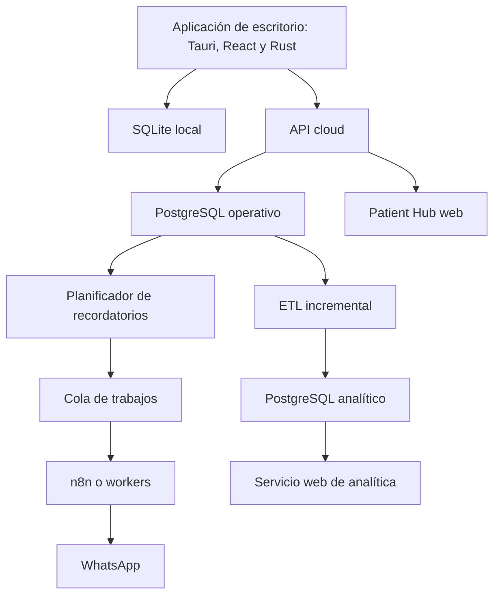
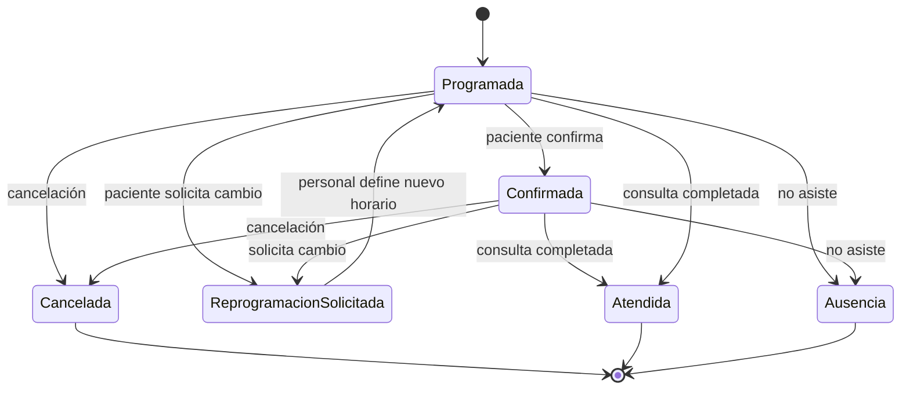
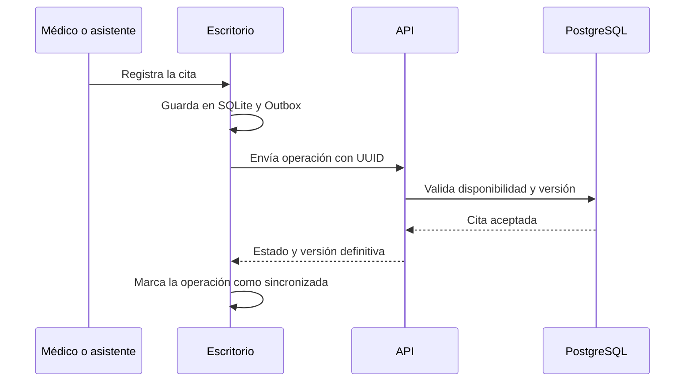
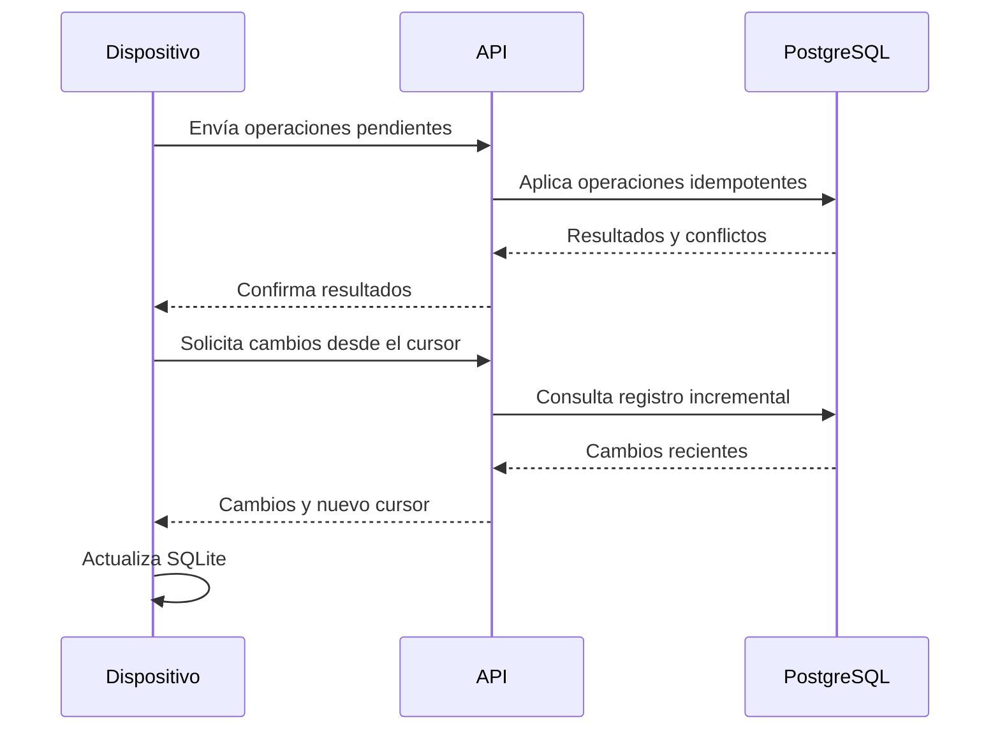
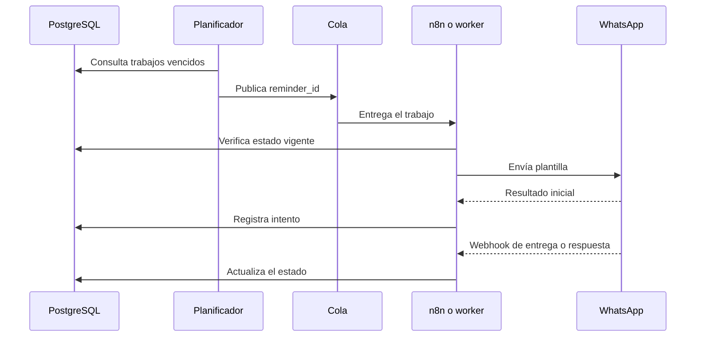

# Documento de Arquitectura Técnica de Nightingale

**Versión:** 0.1  
**Fecha:** 19/10/2026  
**Estado:** Borrador técnico inicial  
**Documento relacionado:** Especificación de Requisitos de Software de Nightingale, versión 0.3

## 1. Propósito del documento

Este documento describe la arquitectura técnica propuesta para Nightingale. Su finalidad es convertir las decisiones funcionales del producto en una estructura técnica comprensible antes de comenzar la implementación.

El documento define:

- Los componentes principales del sistema.
- Las responsabilidades de cada componente.
- El funcionamiento con y sin conexión.
- La sincronización entre SQLite y PostgreSQL.
- El comportamiento ante varios dispositivos concurrentes.
- Los flujos de citas, recordatorios y Patient Hub.
- La separación entre datos operativos y analíticos.
- Los criterios iniciales de seguridad, despliegue y recuperación.
- Las decisiones que todavía permanecen abiertas.

No pretende detallar cada clase, tabla, endpoint o tarea de programación. Es una guía para mantener una arquitectura coherente durante el desarrollo.

## 2. Resumen del producto

Nightingale será una aplicación de escritorio dirigida inicialmente a médicos y especialistas independientes. Permitirá administrar pacientes, citas, disponibilidad, recordatorios, confirmaciones, cancelaciones, reprogramaciones, ausencias y listas de espera.

El personal utilizará una aplicación de escritorio. Los pacientes no instalarán Nightingale ni accederán al panel administrativo: utilizarán un Patient Hub web para gestionar citas ya registradas.

El producto deberá continuar funcionando durante interrupciones eléctricas o de conectividad, siempre que el equipo disponga de energía. Cada instalación conservará una base de datos SQLite local y sincronizará sus cambios con PostgreSQL cuando tenga conexión.

## 3. Alcance técnico inicial

### 3.1 Incluido

- Aplicación de escritorio multiplataforma basada en Tauri.
- Interfaz construida con React, TypeScript y TailwindCSS.
- Núcleo local desarrollado en Rust.
- Persistencia local en SQLite.
- API de sincronización y servicios en la nube.
- PostgreSQL como fuente central de verdad.
- Varios dispositivos concurrentes por cuenta profesional.
- Patient Hub web para citas existentes.
- Recordatorios mediante WhatsApp.
- Procesamiento de trabajos en segundo plano.
- Uso de n8n para orquestación de comunicaciones e integraciones.
- Cola de ejecuciones o mensajes para recordatorios.
- ETL hacia una base PostgreSQL analítica.
- Servicio web de analítica.
- Auditoría básica, copias de seguridad y observabilidad.

### 3.2 Fuera del alcance inicial

- Gestión de clínicas completas, redes hospitalarias o múltiples departamentos.
- Historia clínica electrónica.
- Diagnósticos, recomendaciones o decisiones clínicas.
- Creación de citas nuevas por parte del paciente.
- Pagos, seguros y autorizaciones.
- Check-In y gestión de filas presenciales.
- Integraciones con sistemas clínicos existentes.
- Inteligencia artificial en el flujo crítico de recordatorios.
- Predicción de ausencias.
- Gestión de récipes o prescripciones.

## 4. Principios de arquitectura

### 4.1 Operación local con respaldo central

La aplicación debe permitir consultar y modificar la agenda localmente cuando no exista conexión. PostgreSQL conservará el estado central y permitirá reconstruir una instalación nueva después de perder o reemplazar un dispositivo.

### 4.2 PostgreSQL es la fuente central de verdad

SQLite no se replicará directamente con PostgreSQL. Los dispositivos intercambiarán operaciones y cambios mediante una API controlada.

Cuando exista una diferencia entre dispositivos, el servidor determinará el estado definitivo utilizando versiones, restricciones y reglas de conflicto simples.

### 4.3 La operación local debe ser inmediata

La interfaz no esperará una respuesta de la nube para cada acción. Una operación se aplicará localmente y, cuando corresponda, quedará marcada como pendiente de sincronización.

### 4.4 La complejidad debe responder a una necesidad real

El volumen inicial será moderado. No se introducirán microservicios, replicación compleja, CRDT, event sourcing completo ni bloqueos distribuidos en la primera versión.

### 4.5 Los procesos externos no controlan el dominio

n8n, WhatsApp y futuros proveedores de inteligencia artificial podrán ejecutar integraciones, pero no serán la fuente de verdad de las citas.

### 4.6 Las funciones médicas y administrativas estarán separadas

Nightingale manejará información necesaria para organizar la atención, pero no almacenará historia clínica, diagnósticos ni resultados médicos en la primera versión.

## 5. Decisiones tecnológicas

| Área | Decisión | Estado |
|---|---|---|
| Aplicación de escritorio | Tauri | Confirmada |
| Núcleo de escritorio | Rust | Confirmada |
| Interfaz | React y TypeScript | Confirmada |
| Estilos | TailwindCSS | Confirmada |
| Base local | SQLite | Confirmada |
| Base operativa en la nube | PostgreSQL | Confirmada |
| Base analítica | PostgreSQL separado lógica o físicamente | Confirmada |
| Orquestación | n8n | Propuesta aceptada, límites por definir |
| Cola | Redis, Valkey, SQS u otra alternativa | Pendiente de proveedor y despliegue |
| Patient Hub | Aplicación web adaptable a teléfonos | Confirmada |
| Canal inicial | WhatsApp | Confirmada |
| Infraestructura cloud | AWS o DigitalOcean, entre otras posibles | Pendiente |
| IA administrada | AWS Bedrock o DigitalOcean Inference | Futura e indefinida |
| Backend cloud | Lenguaje y framework pendientes | Pendiente |
| Plataformas de la base de desarrollo | Windows, macOS y Linux | Confirmada por el usuario; matriz concreta aceptada en C01 |

## 6. Vista general de la arquitectura

La aplicación de escritorio será la interfaz principal del médico y su asistente. Los demás componentes funcionarán en la nube para permanecer disponibles aunque los dispositivos estén desconectados o apagados.

## 7. Componentes del sistema

### 7.1 Aplicación de escritorio

La aplicación de escritorio permitirá:

- Iniciar sesión y seleccionar la cuenta profesional.
- Consultar agenda, pacientes y estados de sincronización.
- Crear, confirmar, cancelar y reprogramar citas.
- Registrar asistencia y ausencias.
- Gestionar solicitudes de reprogramación.
- Administrar una lista de espera.
- Consultar indicadores básicos.
- Continuar trabajando durante interrupciones de Internet.

#### Responsabilidad de React

React se encargará de:

- Presentación de pantallas y componentes.
- Formularios y validación inmediata de campos.
- Estado visual de la interfaz.
- Navegación.
- Indicadores de conexión y sincronización.

React no deberá:

- Ejecutar SQL directamente.
- Contener credenciales cloud.
- Resolver conflictos de sincronización.
- Aplicar por sí solo reglas críticas de agenda.
- Acceder libremente al sistema operativo.

#### Responsabilidad del núcleo Rust

Rust se encargará de:

- Reglas locales del dominio.
- Validación de operaciones.
- Acceso a SQLite.
- Registro de operaciones en la bandeja de sincronización.
- Comunicación segura con la API.
- Gestión de sesiones y secretos locales.
- Migraciones de la base local.
- Detección de conectividad.
- Procesamiento de reintentos.

La interfaz se comunicará con Rust mediante comandos Tauri concretos. Se evitarán comandos genéricos que permitan ejecutar consultas arbitrarias o acceder a archivos sin restricciones.

### 7.2 SQLite local

Cada dispositivo tendrá una base SQLite independiente.

SQLite contendrá:

- Una copia de los datos necesarios para trabajar.
- Citas y pacientes disponibles para el usuario.
- Configuración local.
- Cambios pendientes de envío.
- Identificadores de operaciones ya procesadas.
- El punto hasta el que se recibieron cambios del servidor.

SQLite no se almacenará en una carpeta de red compartida. Cada dispositivo sincronizará mediante la API.

Se evaluará el modo WAL para permitir lecturas y escrituras concurrentes dentro de la aplicación. La estrategia de cifrado del archivo local deberá definirse antes de utilizar información real de pacientes.

### 7.3 API cloud

La API será el límite entre los dispositivos y los servicios en la nube.

Sus responsabilidades serán:

- Autenticar usuarios y dispositivos.
- Autorizar cada operación según la cuenta y la función del usuario.
- Recibir operaciones sincronizadas.
- Garantizar idempotencia.
- Validar versiones.
- Impedir reservas incompatibles.
- Registrar cambios y auditoría.
- Entregar actualizaciones incrementales a los dispositivos.
- Servir al Patient Hub.
- Exponer operaciones internas para recordatorios y analítica.

Los dispositivos no se conectarán directamente a PostgreSQL.

### 7.4 PostgreSQL operativo

PostgreSQL será la fuente central de verdad para:

- Cuentas profesionales.
- Usuarios y dispositivos.
- Pacientes.
- Servicios y horarios.
- Citas y su historial.
- Confirmaciones y solicitudes.
- Lista de espera.
- Recordatorios.
- Entregas de mensajes.
- Auditoría.
- Registro de cambios para sincronización.

Las operaciones que afecten la disponibilidad de horarios se ejecutarán dentro de transacciones.

### 7.5 Patient Hub

El Patient Hub será una aplicación web móvil, independiente de la aplicación de escritorio.

El paciente accederá mediante un enlace seguro asociado con una cita existente. No podrá navegar por la agenda completa ni crear citas nuevas.

Permitirá:

- Consultar fecha, hora, profesional, servicio y lugar.
- Confirmar asistencia.
- Cancelar la cita.
- Solicitar una reprogramación.
- Consultar el estado actual.
- Ver instrucciones administrativas permitidas.

Una solicitud de reprogramación no cambiará directamente la agenda. El médico o asistente deberá revisar y aprobar el nuevo horario.

### 7.6 Servicio de recordatorios

El servicio de recordatorios funcionará en la nube y no dependerá de que la aplicación de escritorio esté abierta.

Se dividirá conceptualmente en:

- **Planificador:** identifica recordatorios que deben programarse.
- **Registro persistente:** conserva cada trabajo y su estado.
- **Cola:** distribuye los trabajos pendientes.
- **Ejecutor:** prepara y envía la comunicación.
- **Webhook receptor:** registra entrega, respuesta o error.
- **Reintentos:** procesa fallos temporales sin duplicar mensajes.

### 7.7 n8n

n8n podrá utilizarse para:

- Orquestar el envío de recordatorios.
- Integrar webhooks del proveedor de WhatsApp.
- Ejecutar escalaciones administrativas.
- Transformar datos para servicios externos.
- Facilitar cambios en flujos de comunicación sin modificar el núcleo.

n8n no deberá:

- Ser la fuente de verdad de una cita.
- Asignar definitivamente un horario sin validación de la API.
- Modificar directamente tablas operativas.
- Almacenar reglas críticas que no existan también como reglas del dominio.
- Conservar credenciales dentro de flujos exportados sin protección.

Si se utiliza el modo de cola de n8n, Redis o Valkey podrá actuar como su broker de ejecuciones. En la primera versión no será obligatorio añadir una segunda cola empresarial si la carga y las necesidades de aislamiento no lo justifican.

### 7.8 Subsistema analítico

La analítica tendrá componentes separados del flujo transaccional:

- Registro de eventos operativos.
- Proceso ETL incremental.
- PostgreSQL analítico.
- Servicio web de consulta.
- Interfaz de indicadores.

El servicio analítico no será responsable de modificar citas. Su información podrá tener un pequeño retraso respecto al sistema operativo.

### 7.9 Servicio futuro de inteligencia artificial

La inteligencia artificial no formará parte del camino crítico inicial.

Los posibles proveedores considerados son:

- AWS Bedrock.
- DigitalOcean Inference.

Los posibles usos futuros incluyen interpretar respuestas abiertas de pacientes o asistir al personal con comunicaciones administrativas. El proveedor y el modelo se mantendrán abstraídos detrás de un servicio cloud propio.

La aplicación de escritorio no contendrá credenciales del proveedor de IA. Ningún modelo podrá confirmar, cancelar o reprogramar una cita sin pasar por las validaciones ordinarias de la API.

## 8. Modos de operación

| Modo | Escritorio | Patient Hub | Recordatorios | Sincronización |
|---|---|---|---|---|
| En línea | Funcionalidad completa | Disponible | Operativos | Inmediata o frecuente |
| Sin Internet en el consultorio | Funciones locales | Disponible desde otras conexiones | Operativos en la nube | Cambios pendientes |
| Cloud temporalmente no disponible | Funciones locales | Puede quedar temporalmente indisponible | Reintentos pendientes | Se reanuda al recuperar el servicio |
| Dispositivo apagado | No disponible en ese equipo | Disponible | Operativos | Se actualiza al encender |
| Dispositivo reemplazado | Requiere instalación y autenticación | Disponible | Operativos | Reconstrucción desde PostgreSQL |

Las funciones que requieren Internet, como WhatsApp o la consulta del estado más reciente de otros dispositivos, no podrán ejecutarse localmente durante una desconexión.

## 9. Modelo de sincronización

### 9.1 Enfoque

Nightingale utilizará una arquitectura **cloud-authoritative con clientes offline-capable**:

- PostgreSQL conserva el estado definitivo.
- SQLite mantiene una copia operativa por dispositivo.
- La API recibe operaciones, no archivos SQLite.
- Cada operación tiene un identificador único.
- Los dispositivos descargan cambios incrementales.
- Los conflictos se resuelven mediante reglas sencillas.

### 9.2 Tablas locales de control

#### `sync_outbox`

Contendrá las operaciones locales pendientes:

- Identificador de operación.
- Tipo de entidad.
- Identificador de entidad.
- Tipo de acción.
- Versión esperada.
- Cuerpo de la operación.
- Fecha de creación.
- Número de intentos.
- Estado.
- Último error.

#### `sync_inbox`

Permitirá recordar operaciones remotas ya aplicadas y evitar repeticiones.

#### `sync_cursor`

Guardará el punto hasta el que el dispositivo descargó cambios del servidor.

### 9.3 Escritura local transaccional

Cada acción local deberá actualizar la entidad y registrar la operación pendiente dentro de una misma transacción SQLite.

Si cualquiera de las dos escrituras falla, ninguna deberá considerarse completada.

### 9.4 Identificadores

Los dispositivos generarán UUID para pacientes, citas y operaciones. Esto permitirá trabajar sin conexión sin solicitar identificadores al servidor.

### 9.5 Idempotencia

La API conservará el identificador de cada operación procesada. Si un dispositivo reenvía la misma operación por un corte de red, el servidor devolverá el resultado anterior sin aplicarla nuevamente.

### 9.6 Versionado optimista

Las entidades sincronizables tendrán un número de versión.

Un dispositivo enviará:

- Identificador de la entidad.
- Versión sobre la que realizó el cambio.
- Operación solicitada.

El servidor aceptará el cambio únicamente si la versión coincide. Cuando lo acepte, incrementará la versión.

Si la versión no coincide, devolverá el estado actual para que el dispositivo lo muestre o solicite intervención.

### 9.7 Descarga incremental

El servidor conservará un registro ordenado de cambios sincronizables. El dispositivo solicitará los cambios posteriores a su cursor.

La respuesta incluirá:

- Cambios creados o modificados.
- Cancelaciones o eliminaciones lógicas.
- Nuevo cursor.

No será necesario descargar todas las tablas en cada conexión.

### 9.8 Eliminaciones

Las entidades sincronizadas no se eliminarán físicamente de inmediato. Se utilizarán cancelaciones, estados inactivos o marcas de eliminación para que todos los dispositivos puedan recibir el cambio.

### 9.9 Estado de sincronización visible

La interfaz distinguirá:

- `synced`: confirmado por la nube.
- `pending`: cambio local pendiente.
- `syncing`: operación en proceso.
- `conflict`: diferencia que requiere atención.
- `failed`: fallo persistente o no recuperable automáticamente.

La aplicación mostrará además:

- Estado de conexión.
- Momento de la última sincronización exitosa.
- Cantidad de cambios pendientes.
- Conflictos que requieren revisión.

## 10. Concurrencia en varios dispositivos

Nightingale permitirá que el médico y sus asistentes utilicen varios dispositivos sobre la misma cuenta profesional.

No se implementarán bloqueos distribuidos. La concurrencia se controlará mediante:

- Restricciones de PostgreSQL.
- Transacciones cortas.
- Identificadores únicos.
- Idempotencia.
- Versionado optimista.
- Recarga del estado actual cuando exista un conflicto.

### 10.1 Reglas iniciales de conflicto

| Situación | Resolución |
|---|---|
| Dos dispositivos reservan el mismo horario | Se conserva la primera reserva aceptada por PostgreSQL |
| Dos dispositivos modifican la misma cita | Se acepta el primer cambio válido; el segundo recibe la versión actual |
| El paciente cancela mientras un dispositivo está desconectado | La cancelación tiene prioridad |
| El paciente confirma y luego se reprograma | La confirmación anterior se invalida |
| El paciente solicita reprogramación | Se registra una solicitud; no se modifica la agenda automáticamente |
| Se reenvía una operación ya aceptada | Se devuelve el resultado anterior sin repetirla |
| Se modifica un dato no crítico desde dos dispositivos | Se conserva el último cambio aceptado, con auditoría |

### 10.2 Reservas sin conexión

Una cita creada sin conexión se mostrará localmente como provisional hasta que PostgreSQL la acepte.

Si el horario fue ocupado desde otro dispositivo, el servidor rechazará la reserva y la aplicación solicitará seleccionar otro horario.

Para reducir la complejidad, la primera versión debería utilizar bloques de horario definidos. La decisión sobre citas de duración fija o servicios que ocupen varios bloques permanece pendiente.

## 11. Estados de una cita

El estado de negocio de la cita será independiente del estado de sincronización.

Estados iniciales propuestos:

- `scheduled`: programada y pendiente de confirmación.
- `confirmed`: confirmada por el paciente o el personal.
- `reschedule_requested`: el paciente solicitó un cambio.
- `cancelled`: cancelada.
- `completed`: atendida.
- `no_show`: ausencia sin aviso.

Una reprogramación conservará historial y reiniciará la confirmación cuando cambien la fecha o la hora.

**Pendiente antes de implementar Citas:** definir todas las salidas de `reschedule_requested` y su relación con la solicitud separada de reprogramación. El diagrama no decide qué ocurre si se rechaza o retira la solicitud, ni cómo se conserva la confirmación previa. No añadir transiciones por deducción; resolverlas en el plan de esa ruta.

## 12. Flujos principales

### 12.1 Crear una cita con conexión

### 12.2 Crear una cita sin conexión

1. El usuario selecciona un horario disponible en la copia local.
2. Rust valida la operación localmente.
3. SQLite guarda la cita con estado de sincronización `pending`.
4. La misma transacción añade la operación a `sync_outbox`.
5. La interfaz identifica la cita como provisional.
6. Al recuperar la conexión, el dispositivo envía la operación.
7. PostgreSQL acepta o rechaza la reserva.
8. SQLite se actualiza con el resultado definitivo.

### 12.3 Recuperar la conexión

El envío y la descarga se realizarán en lotes pequeños. Un error en una operación no deberá impedir que se procesen otras operaciones independientes.

### 12.4 Confirmación desde el Patient Hub

1. El paciente abre un enlace asociado con su cita.
2. El Patient Hub valida el enlace con la API.
3. La API devuelve el estado actual de la cita.
4. El paciente confirma.
5. PostgreSQL actualiza la cita y registra auditoría.
6. El cambio queda disponible para los dispositivos en la siguiente sincronización.

Si la cita fue reprogramada, el enlace deberá mostrar la información más reciente o solicitar una nueva confirmación.

### 12.5 Cancelación desde el Patient Hub

1. El paciente solicita cancelar.
2. La API verifica que la cita sea cancelable.
3. PostgreSQL marca la cita como cancelada.
4. El horario se libera.
5. Se genera un evento para la lista de espera.
6. Los dispositivos reciben la cancelación.

La cancelación prevalecerá sobre modificaciones locales antiguas que aún no hayan sido sincronizadas.

### 12.6 Solicitud de reprogramación

1. El paciente solicita un cambio desde el Patient Hub.
2. PostgreSQL registra la solicitud sin modificar el horario.
3. El médico o asistente recibe una alerta.
4. El personal selecciona un nuevo horario.
5. La cita se reprograma y conserva el historial.
6. Se crea una nueva solicitud de confirmación.

### 12.7 Recordatorio

**Pendiente antes de implementar Recordatorios:** las flechas del ejecutor hacia PostgreSQL simplifican el flujo y no autorizan acceso directo desde n8n. El plan maestro §16.5 exige que n8n consulte y registre resultados mediante la API interna. La ruta de Recordatorios deberá ajustar este diagrama y separar los accesos del planificador, la API y el ejecutor antes de implementar sus adaptadores.

Antes de enviar, el ejecutor deberá confirmar que:

- La cita continúa activa.
- El horario no cambió.
- El recordatorio no fue enviado previamente.
- El paciente puede recibir comunicaciones.
- La plantilla corresponde al tipo de cita.

### 12.8 Lista de espera

1. Una cancelación libera un horario.
2. El sistema identifica entradas compatibles por servicio y disponibilidad.
3. Se selecciona la siguiente entrada según la regla configurada.
4. Se envía una oferta con tiempo limitado.
5. Si el paciente acepta, la API valida nuevamente el horario.
6. Si continúa disponible, se asigna.
7. Si no responde o rechaza, se ofrece a la siguiente persona.

La regla exacta de prioridad de la lista de espera permanece pendiente.

## 13. Modelo conceptual de datos

| Entidad | Finalidad |
|---|---|
| `practice` | Cuenta profesional del médico o especialista |
| `user` | Médico, asistente u operador autorizado |
| `device` | Instalación de escritorio autorizada |
| `patient` | Datos administrativos y de contacto del paciente |
| `service` | Tipo de consulta o servicio ofrecido |
| `schedule_rule` | Horario habitual de disponibilidad |
| `schedule_block` | Bloqueo, ausencia o excepción de agenda |
| `appointment` | Reserva actual |
| `appointment_history` | Cambios de estado, horario y responsable |
| `reschedule_request` | Solicitud del paciente pendiente de revisión |
| `waitlist_entry` | Interés de un paciente en un horario o servicio |
| `waitlist_offer` | Oferta de un horario liberado |
| `reminder_job` | Recordatorio programado y persistente |
| `message_delivery` | Intentos, entrega y respuesta de comunicaciones |
| `patient_access_token` | Acceso limitado al Patient Hub |
| `sync_operation` | Operación recibida desde un dispositivo |
| `change_log` | Cambios incrementales para sincronización |
| `audit_event` | Acción relevante para seguridad y trazabilidad |

Todas las entidades principales incluirán `practice_id` para aislar la información de cada cuenta profesional y permitir una futura evolución hacia clínicas sin rediseñar completamente el sistema.

## 14. Superficie inicial de la API

La API se organizará por capacidades, no por acceso genérico a tablas.

| Grupo | Operaciones principales |
|---|---|
| Autenticación | Iniciar sesión, renovar sesión, cerrar sesión y registrar dispositivo |
| Sincronización | Enviar operaciones, obtener resultados y descargar cambios desde un cursor |
| Pacientes | Crear, consultar y actualizar datos administrativos |
| Agenda | Consultar disponibilidad y bloqueos |
| Citas | Crear, confirmar, cancelar, reprogramar y registrar asistencia |
| Patient Hub | Validar acceso, consultar cita, confirmar, cancelar y solicitar cambio |
| Lista de espera | Registrar entrada, ofrecer horario y aceptar o rechazar oferta |
| Recordatorios | Programar, cancelar, consultar estado y registrar resultado |
| Analítica | Consultar indicadores autorizados |

La forma exacta de los endpoints, protocolo y contratos se definirá en la especificación de API.

## 15. Diseño de recordatorios y cola

### 15.1 Fuente de verdad

La tabla `reminder_job` será el registro persistente del trabajo. La cola transportará identificadores, no será el único lugar donde exista el recordatorio.

### 15.2 Estados propuestos

- `scheduled`
- `queued`
- `processing`
- `sent`
- `delivered`
- `responded`
- `cancelled`
- `retry_pending`
- `failed`

### 15.3 Idempotencia

Cada recordatorio tendrá una clave única derivada de:

- Cita.
- Tipo de recordatorio.
- Versión de la cita.
- Fecha programada.

Un reintento no deberá producir dos comunicaciones equivalentes.

### 15.4 Reintentos

Los errores temporales utilizarán espera incremental. Los errores permanentes, como un número inválido, pasarán a `failed` y generarán una alerta para el personal.

### 15.5 n8n y la cola

En la alternativa inicial más sencilla:

- n8n utiliza su modo de ejecución con cola.
- Redis o Valkey distribuye ejecuciones a workers.
- PostgreSQL conserva los trabajos de Nightingale y los estados de negocio.
- n8n actualiza Nightingale mediante una API interna autenticada.

Una cola separada como SQS o RabbitMQ podrá evaluarse cuando existan más consumidores, mayor carga o necesidades de aislamiento.

## 16. Analítica y ETL

### 16.1 Objetivo

La analítica permitirá medir:

- Citas creadas.
- Citas confirmadas.
- Cancelaciones.
- Reprogramaciones.
- Ausencias sin aviso.
- Horarios recuperados.
- Rendimiento de recordatorios.
- Tiempo de respuesta del paciente.
- Utilización de la agenda.

### 16.2 Flujo

### 16.3 Estrategia inicial

El ETL leerá eventos o cambios posteriores a un cursor. Transformará los datos en estructuras orientadas a indicadores y actualizará la base analítica.

La primera versión no requiere procesamiento en tiempo real. La frecuencia exacta, como cada pocos minutos, cada hora o diariamente, permanece pendiente.

### 16.4 Privacidad analítica

Los datos analíticos deberán utilizar identificadores seudonimizados cuando no sea necesario conocer la identidad del paciente. No se copiarán campos personales sin una finalidad concreta.

## 17. Seguridad y privacidad

### 17.1 Autenticación

- Cada usuario tendrá una identidad propia.
- No se compartirán credenciales entre médico y asistente.
- Los dispositivos se registrarán y podrán revocarse.
- Las sesiones cloud utilizarán tokens de duración limitada.
- El almacenamiento local de secretos utilizará mecanismos seguros del sistema operativo.

### 17.2 Autorización

Roles iniciales:

- Médico o especialista.
- Asistente administrativo.
- Operador técnico limitado, si resulta necesario.

Cada operación validará `practice_id`, usuario, rol y alcance.

### 17.3 Seguridad de Tauri

- Se concederán únicamente las capacidades necesarias.
- La WebView no tendrá acceso directo a secretos.
- Se aplicará una política de contenido restrictiva.
- No se cargará contenido remoto dentro de una ventana con permisos elevados.
- Los comandos Rust validarán todos los datos recibidos desde la interfaz.

### 17.4 Protección local

Antes de producción deberán definirse:

- Cifrado de SQLite.
- Custodia de la clave local.
- Bloqueo automático por inactividad.
- Copias de seguridad locales seguras.
- Borrado de información al revocar un dispositivo.
- Protección de archivos temporales y registros.

### 17.5 Protección en tránsito y en la nube

- Todo tráfico utilizará TLS.
- PostgreSQL no será accesible directamente desde Internet.
- Las credenciales se almacenarán en un gestor de secretos.
- Los servicios utilizarán permisos mínimos.
- Las copias de seguridad estarán cifradas.
- Se probará periódicamente la restauración.

### 17.6 Patient Hub

- Los enlaces serán aleatorios, limitados y revocables.
- El paciente solo verá la cita asociada.
- Las acciones sensibles podrán requerir una verificación adicional.
- Los enlaces antiguos no permitirán operar sobre una versión reemplazada de la cita.
- No se mostrarán diagnósticos ni información clínica.

### 17.7 Auditoría

Se registrarán como mínimo:

- Inicio y cierre de sesión.
- Registro y revocación de dispositivos.
- Creación, reprogramación y cancelación de citas.
- Cambios de estado.
- Acciones realizadas por el paciente.
- Acceso administrativo relevante.
- Conflictos de sincronización.
- Envíos y respuestas de recordatorios.

## 18. Despliegue

### 18.1 Escritorio

El proceso deberá contemplar:

- Instaladores firmados.
- Actualizaciones verificadas.
- Migraciones automáticas de SQLite.
- Posibilidad de revertir una actualización problemática.
- Canales separados para pruebas y producción.
- Compatibilidad definida por sistema operativo.

### 18.2 Cloud

Componentes mínimos:

- API.
- PostgreSQL operativo administrado o protegido.
- Servicio de sincronización.
- Patient Hub.
- Planificador de recordatorios.
- n8n y sus workers.
- Redis o Valkey si n8n opera en modo de cola.
- Receptor de webhooks.
- ETL.
- PostgreSQL analítico.
- Servicio web de analítica.
- Almacenamiento de copias de seguridad.
- Monitoreo y gestión de secretos.

### 18.3 Proveedores considerados

La infraestructura permanecerá independiente del proveedor en la medida razonable.

Opciones iniciales:

- **AWS:** servicios administrados para cómputo, PostgreSQL, colas, secretos y Bedrock.
- **DigitalOcean:** aplicaciones o máquinas administradas, PostgreSQL, Redis o Valkey e Inference.

La elección se realizará según costo total, región, latencia, capacidad operativa, copias de seguridad, seguridad y disponibilidad de soporte.

### 18.4 Entornos

Se mantendrán como mínimo:

- Desarrollo local.
- Pruebas o staging.
- Producción.

Producción utilizará datos y credenciales separados. Los flujos de n8n deberán versionarse y promoverse de forma controlada.

## 19. Observabilidad

### 19.1 Registros

Los servicios generarán registros estructurados con:

- Identificador de solicitud.
- Identificador de operación de sincronización.
- Servicio y versión.
- Resultado.
- Duración.
- Categoría del error.

No se escribirán datos personales innecesarios, tokens ni cuerpos completos de mensajes en registros generales.

### 19.2 Métricas

Métricas iniciales:

- Operaciones de sincronización exitosas y fallidas.
- Tiempo de sincronización.
- Cantidad de dispositivos con cambios pendientes.
- Conflictos por tipo.
- Trabajos de recordatorio pendientes.
- Reintentos y fallos definitivos.
- Entregas y respuestas de WhatsApp.
- Tiempo de respuesta de la API.
- Errores del Patient Hub.
- Estado del ETL.

### 19.3 Alertas

Se alertará cuando:

- Aumente la cola de recordatorios vencidos.
- Fallen repetidamente los webhooks.
- Un ETL deje de avanzar.
- PostgreSQL se acerque a límites de capacidad.
- Existan fallos reiterados de autenticación.
- Un proveedor externo permanezca indisponible.

## 20. Respuesta ante fallos

| Fallo | Comportamiento esperado |
|---|---|
| Interrupción de Internet | El escritorio continúa localmente y acumula cambios |
| Interrupción eléctrica | Los servicios cloud continúan; una laptop puede operar mientras tenga batería |
| API no disponible | Se conservan operaciones en Outbox y se reintentan |
| PostgreSQL temporalmente indisponible | La API rechaza o pausa escrituras; los clientes mantienen cambios pendientes |
| WhatsApp no disponible | Los recordatorios quedan pendientes y se reintentan |
| n8n o worker no disponible | Los trabajos permanecen registrados y vuelven a ejecutarse |
| Mensaje procesado dos veces | La clave idempotente evita el envío duplicado |
| Conflicto entre dispositivos | PostgreSQL conserva el primer cambio válido y devuelve el estado actual |
| Daño del dispositivo | Se reconstruyen los datos sincronizados desde PostgreSQL |
| Daño antes de sincronizar | Los cambios exclusivamente locales pueden perderse |
| Corrupción de SQLite | Se conserva el archivo para diagnóstico y se reconstruye desde la nube cuando sea posible |
| Fallo del ETL | No afecta la agenda; la analítica queda temporalmente desactualizada |

## 21. Copias de seguridad y recuperación

### 21.1 PostgreSQL operativo

Deberá contar con:

- Copias automáticas.
- Retención definida.
- Recuperación a un punto temporal cuando el proveedor lo permita.
- Pruebas periódicas de restauración.
- Procedimiento documentado de recuperación.

### 21.2 SQLite

La aplicación podrá generar copias coherentes mediante las herramientas de respaldo de SQLite. No se copiará el archivo abierto de forma arbitraria a carpetas sincronizadas.

La nube protege únicamente los cambios que ya fueron sincronizados. La interfaz advertirá cuando un dispositivo acumule cambios pendientes durante demasiado tiempo.

### 21.3 Objetivos pendientes

Deben definirse:

- RPO: cantidad máxima aceptable de datos que podrían perderse.
- RTO: tiempo máximo aceptable para recuperar el servicio.
- Retención de copias.
- Tiempo máximo permitido sin sincronización.

## 22. Rendimiento y capacidad

El sistema inicial no está diseñado para cientos de miles de consultas concurrentes. Se optimizará para médicos independientes y equipos pequeños.

Principios iniciales:

- Paginación en listados históricos.
- Índices sobre agenda, paciente, estado y fechas.
- Sincronización incremental.
- Lotes pequeños de operaciones.
- Transacciones breves.
- Procesamiento asíncrono de recordatorios y ETL.
- Separación de consultas analíticas.

Los objetivos numéricos de tiempo de respuesta y capacidad se definirán antes de las pruebas de aceptación.

## 23. Estrategia de evolución

### Etapa 1: núcleo local y sincronización

- Proyecto Tauri.
- React, TypeScript y TailwindCSS.
- Núcleo Rust.
- SQLite y migraciones.
- Pacientes, servicios, agenda y citas.
- Outbox, cursor e idempotencia.
- API y PostgreSQL operativo.
- Varios dispositivos concurrentes.

### Etapa 2: Patient Hub y recordatorios

- Enlaces seguros.
- Confirmación, cancelación y solicitud de reprogramación.
- Planificador de recordatorios.
- Cola y workers.
- WhatsApp.
- n8n.
- Webhooks y estados de entrega.

### Etapa 3: lista de espera y analítica

- Ofertas de horarios liberados.
- Eventos operativos.
- ETL incremental.
- PostgreSQL analítico.
- Servicio web de indicadores.

### Evolución posterior

- Seguimiento periódico de pacientes.
- Canales alternativos.
- Inteligencia artificial.
- Clínicas con varios especialistas.
- Múltiples sedes.
- Integraciones con sistemas externos.

## 24. Decisiones pendientes

| Decisión | Impacto |
|---|---|
| Versiones y arquitecturas de distribución | Las tres plataformas ya están confirmadas para desarrollo; falta definir el soporte de instaladores y producción |
| Duración fija o variable de las consultas | Modelo de disponibilidad y prevención de solapamientos |
| Lenguaje y framework del backend cloud | Reutilización de lógica, despliegue y capacidad del equipo |
| Proveedor cloud | Servicios administrados, costos, regiones y operación |
| Cola inicial | Integración con n8n, reintentos y despliegue |
| Cifrado de SQLite | Protección local y distribución de claves |
| Método de autenticación | Sesiones, recuperación de acceso y revocación |
| Duración y verificación de enlaces del Patient Hub | Seguridad y experiencia del paciente |
| Horarios exactos de recordatorios | Reglas del planificador |
| Límite de cancelación y reprogramación | Validaciones del Patient Hub |
| Prioridad de la lista de espera | Asignación de horarios liberados |
| Frecuencia del ETL | Actualidad y costo de la analítica |
| Proveedor oficial de WhatsApp | Plantillas, webhooks, costos y consentimiento |
| RPO y RTO | Copias de seguridad y recuperación |
| Política de retención | Privacidad, auditoría y costos |

## 25. Registro resumido de decisiones

| ID | Decisión |
|---|---|
| ADR-001 | Nightingale será una aplicación de escritorio basada en Tauri |
| ADR-002 | React, TypeScript y TailwindCSS construirán la interfaz |
| ADR-003 | Rust controlará la lógica local y el acceso a SQLite |
| ADR-004 | Cada dispositivo tendrá una base SQLite propia |
| ADR-005 | PostgreSQL será la fuente central de verdad |
| ADR-006 | La sincronización se realizará mediante API, no mediante replicación de archivos |
| ADR-007 | Se admitirán varios dispositivos concurrentes por cuenta profesional |
| ADR-008 | La concurrencia utilizará restricciones, idempotencia y versionado optimista |
| ADR-009 | Las citas creadas sin conexión serán provisionales hasta ser aceptadas por PostgreSQL |
| ADR-010 | El Patient Hub solo gestionará citas existentes |
| ADR-011 | Las solicitudes de reprogramación del paciente requerirán intervención del personal |
| ADR-012 | Los recordatorios se ejecutarán en la nube |
| ADR-013 | n8n podrá orquestar integraciones, pero no controlará el estado de las citas |
| ADR-014 | La analítica utilizará ETL y un PostgreSQL separado del flujo operativo |
| ADR-015 | La inteligencia artificial se mantiene fuera de la primera versión |
| ADR-016 | El segmento inicial serán médicos y especialistas independientes |

## 26. Criterios de aceptación de la arquitectura

La arquitectura se considerará adecuadamente implementada cuando:

- El escritorio pueda consultar y modificar datos locales sin conexión.
- Ninguna operación confirmada localmente desaparezca silenciosamente.
- Los cambios pendientes se reintenten después de recuperar la conexión.
- Reenviar una operación no produzca duplicados.
- PostgreSQL impida reservas incompatibles.
- Dos dispositivos puedan sincronizar cambios independientes.
- Los conflictos se identifiquen y se comuniquen al usuario.
- Un dispositivo nuevo pueda reconstruir su información desde la nube.
- Los recordatorios se ejecuten con el escritorio apagado.
- El Patient Hub no permita crear citas ni consultar datos ajenos.
- La caída del ETL no afecte la gestión de citas.
- Las acciones relevantes queden auditadas.
- Los datos clínicos permanezcan fuera del alcance inicial.

## 27. Conclusión

Nightingale utilizará una arquitectura local-first desde la experiencia del usuario y cloud-authoritative desde la consistencia de los datos. Esta combinación responde a las interrupciones eléctricas y de conectividad sin convertir cada dispositivo en una fuente de verdad independiente.

La aplicación de escritorio conservará capacidad operativa mediante SQLite, mientras PostgreSQL coordinará varios dispositivos, el Patient Hub y los servicios automáticos. La sincronización se mantendrá deliberadamente sencilla mediante Outbox, UUID, idempotencia, cursores y versionado optimista.

Los recordatorios, la analítica y futuras funciones de inteligencia artificial estarán desacoplados del núcleo de citas. De esta forma, una falla en una integración externa no impedirá que el médico continúe consultando y administrando su agenda.
